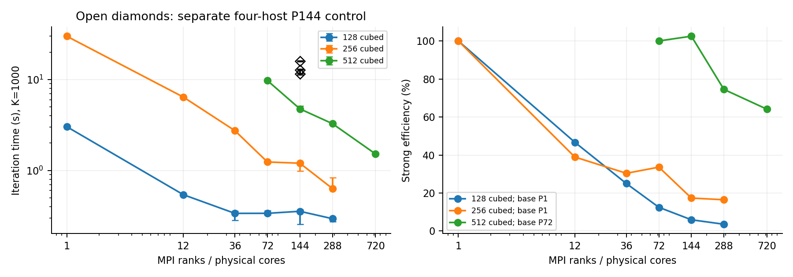
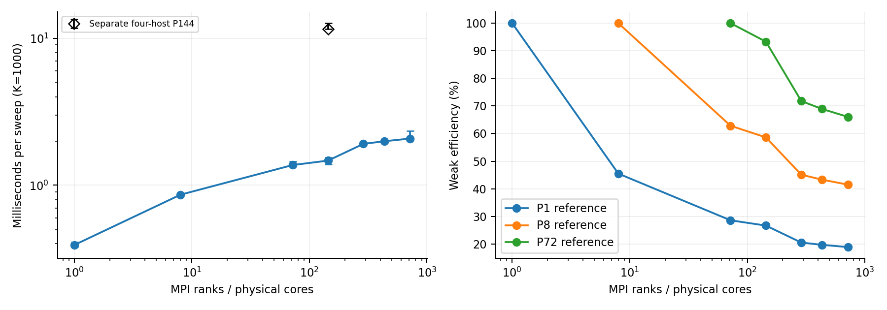
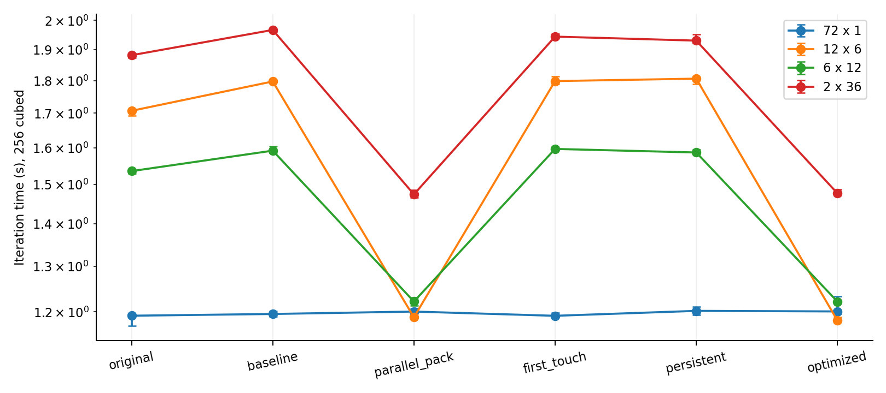

# B follow-up results — 12 November 2026

Only independently completed PBS jobs with exit zero enter the tables. Times are medians of all three formal samples (five for P1), after one warmup. Min/max bars are observed ranges, not confidence intervals. Slow samples are retained.

## Scheduler status (snapshot, not live)

Last collected: 2026-11-12T16:03:56.271157+08:00. This is a saved scheduler snapshot; uncompleted jobs may have progressed.

| experiment | job | state | exit_status |
|---|---|---|---|
| clean144 | 1536849.stdct-mgmt-02 | F | 0 |
| paired144 | 1536850.stdct-mgmt-02 | F | 0 |
| baseline | 1546654.stdct-mgmt-02 | F | 0 |
| optimize72 | 1546655.stdct-mgmt-02 | F | 0 |
| suspect_diag | 1536853.stdct-mgmt-02 | Q | None |
| link_suspect | 1546667.stdct-mgmt-02 | Q | None |
| link_reference | 1536855.stdct-mgmt-02 | F | 0 |
| twod | 1546883.stdct-mgmt-02 | F | 0 |

## Audited new measurements

| job | mode | case | P | T | median | minimum | maximum | max_deviation_pct |
|---|---|---|---|---|---|---|---|---|
| 1546655.stdct-mgmt-02 | optimize72 | parallel_pack_12x6 | 12 | 6 | 1.188800184 | 1.186284892 | 1.196125342 | 0.6161807592721669 |
| 1546655.stdct-mgmt-02 | optimize72 | baseline_72x1 | 72 | 1 | 1.195644083 | 1.190062889 | 1.2020901959999999 | 0.5391330991933563 |
| 1546655.stdct-mgmt-02 | optimize72 | original_6x12 | 6 | 12 | 1.535808966 | 1.5293013420000001 | 1.537122671 | 0.4237261367830758 |
| 1546655.stdct-mgmt-02 | optimize72 | baseline_2x36 | 2 | 36 | 1.96689247 | 1.959642318 | 1.970772424 | 0.3686094746196189 |
| 1546655.stdct-mgmt-02 | optimize72 | original_72x1 | 72 | 1 | 1.192018746 | 1.170902254 | 1.192689563 | 1.7714899258807426 |
| 1546655.stdct-mgmt-02 | optimize72 | baseline_12x6 | 12 | 6 | 1.797116925 | 1.795308681 | 1.803171832 | 0.3369233751999712 |
| 1546655.stdct-mgmt-02 | optimize72 | parallel_pack_2x36 | 2 | 36 | 1.4745058370000002 | 1.466709338 | 1.4855881119999998 | 0.7515924808102037 |
| 1546655.stdct-mgmt-02 | optimize72 | parallel_pack_72x1 | 72 | 1 | 1.200713497 | 1.197772059 | 1.207327974 | 0.55087887464631 |
| 1546655.stdct-mgmt-02 | optimize72 | persistent_2x36 | 2 | 36 | 1.930438851 | 1.922826929 | 1.95200225 | 1.117020567050342 |
| 1546655.stdct-mgmt-02 | optimize72 | optimized_72x1 | 72 | 1 | 1.200970499 | 1.195755635 | 1.2336112830000001 | 2.7178672604513343 |
| 1546655.stdct-mgmt-02 | optimize72 | persistent_72x1 | 72 | 1 | 1.202157424 | 1.194134875 | 1.211368759 | 0.7662336742346731 |
| 1546655.stdct-mgmt-02 | optimize72 | optimized_2x36 | 2 | 36 | 1.477255169 | 1.471749046 | 1.487518574 | 0.6947618268919431 |
| 1546655.stdct-mgmt-02 | optimize72 | first_touch_12x6 | 12 | 6 | 1.798264358 | 1.78892571 | 1.812853081 | 0.8112668715864135 |
| 1546655.stdct-mgmt-02 | optimize72 | first_touch_2x36 | 2 | 36 | 1.944035307 | 1.939141622 | 1.9542059 | 0.5231691504458791 |
| 1546655.stdct-mgmt-02 | optimize72 | first_touch_72x1 | 72 | 1 | 1.191822989 | 1.191486641 | 1.198462486 | 0.5570875089069061 |
| 1546655.stdct-mgmt-02 | optimize72 | persistent_12x6 | 12 | 6 | 1.805986187 | 1.789378294 | 1.809829138 | 0.9196024376901812 |
| 1546655.stdct-mgmt-02 | optimize72 | optimized_12x6 | 12 | 6 | 1.181961149 | 1.181351591 | 1.18954812 | 0.6418968175408324 |
| 1546655.stdct-mgmt-02 | optimize72 | persistent_6x12 | 6 | 12 | 1.5867945049999999 | 1.5821652099999999 | 1.594909183 | 0.5113880829830553 |
| 1546655.stdct-mgmt-02 | optimize72 | optimized_6x12 | 6 | 12 | 1.221885288 | 1.20383265 | 1.2245145100000001 | 1.477441309531502 |
| 1546655.stdct-mgmt-02 | optimize72 | first_touch_6x12 | 6 | 12 | 1.596715251 | 1.595487153 | 1.596727076 | 0.07691402704588235 |
| 1546655.stdct-mgmt-02 | optimize72 | baseline_6x12 | 6 | 12 | 1.591896685 | 1.585431227 | 1.604183686 | 0.7718466352607534 |
| 1546655.stdct-mgmt-02 | optimize72 | original_2x36 | 2 | 36 | 1.88164862 | 1.873832286 | 1.886640904 | 0.4153981735442125 |
| 1546655.stdct-mgmt-02 | optimize72 | original_12x6 | 12 | 6 | 1.706989876 | 1.691827296 | 1.712511906 | 0.8882642019840459 |
| 1546655.stdct-mgmt-02 | optimize72 | parallel_pack_6x12 | 6 | 12 | 1.222017403 | 1.213725669 | 1.230998844 | 0.7349683382536831 |
| 1536850.stdct-mgmt-02 | paired144 | pair_12x12 | 12 | 12 | 7.206986913 | 7.147927202 | 7.279309558 | 1.0035073724019572 |
| 1536850.stdct-mgmt-02 | paired144 | strong256 | 144 | 1 | 12.777951577 | 11.627928791 | 13.006588706 | 9.000055909352579 |
| 1536850.stdct-mgmt-02 | paired144 | strong128 | 144 | 1 | 11.603083963 | 11.27811402 | 12.731153515 | 9.722152796594408 |
| 1536850.stdct-mgmt-02 | paired144 | weak64 | 144 | 1 | 11.589038591 | 11.512316077 | 12.659222715 | 9.234451292888956 |
| 1536850.stdct-mgmt-02 | paired144 | pair_4x36 | 4 | 36 | 8.963796552 | 7.094253911 | 9.357585231 | 20.856593856794614 |
| 1536850.stdct-mgmt-02 | paired144 | strong512 | 144 | 1 | 16.022962163 | 15.702235574 | 16.208283166 | 2.001668516328503 |
| 1536850.stdct-mgmt-02 | paired144 | pair_24x6 | 24 | 6 | 6.418337659 | 6.357926692 | 6.43379765 | 0.9412245071788838 |
| 1546654.stdct-mgmt-02 | baseline | serial_256 | 1 | 1 | 32.203192816 | 32.193881334 | 32.322382609 | 0.37011793731454024 |
| 1546654.stdct-mgmt-02 | baseline | mpi_128 | 1 | 1 | 3.028341177 | 2.994950933 | 3.031047628 | 1.102591882763937 |
| 1546654.stdct-mgmt-02 | baseline | mpi_256 | 1 | 1 | 29.971071108 | 29.892586458 | 30.033972448 | 0.26186801838740115 |
| 1546654.stdct-mgmt-02 | baseline | serial_128 | 1 | 1 | 3.595405718 | 3.572281748 | 3.608961469 | 0.6431532854340283 |
| 1536849.stdct-mgmt-02 | clean144 | strong256 | 144 | 1 | 1.199994487 | 0.984019688 | 1.244006979 | 17.997982602398423 |
| 1536849.stdct-mgmt-02 | clean144 | strong128 | 144 | 1 | 0.354812486 | 0.25554742900000005 | 0.370043714 | 27.976765451258657 |
| 1536849.stdct-mgmt-02 | clean144 | weak64 | 144 | 1 | 1.4708567179999998 | 1.389114813 | 1.549147981 | 5.5574349288861065 |
| 1536849.stdct-mgmt-02 | clean144 | strong512 | 144 | 1 | 4.75848068 | 4.755006098 | 5.14623819 | 8.14876713968291 |
| 1546883.stdct-mgmt-02 | twod | twod512_p12 | 12 | 1 | 0.11331647300000003 | 0.112232003 | 0.116419097 | 2.738016740072702 |
| 1546883.stdct-mgmt-02 | twod | twod512_p1 | 1 | 1 | 1.123406092 | 1.119968836 | 1.226171796 | 9.147689756341482 |
| 1546883.stdct-mgmt-02 | twod | twod512_p72 | 72 | 1 | 0.03247924 | 0.032065514 | 0.034252651 | 5.460136998279519 |
| 1546883.stdct-mgmt-02 | twod | twod512_p36 | 36 | 1 | 0.044280888 | 0.043677733 | 0.045243633 | 2.174177265821764 |

## Optional 432/720-core results recovered from 8 November

| id | nodes | median | minimum | maximum |
|---|---|---|---|---|
| strong_512x512x512_p720_t1 | 10 | 1.521555195 | 1.4999461680000001 | 1.5655860019999999 |
| weak_640x576x512_p720_t1 | 10 | 2.077773583 | 2.069086781 | 2.339810424 |
| weak_576x512x384_p432_t1 | 6 | 1.991137045 | 1.944318718 | 2.002234596 |

## Interpretation and limits

- The nine-host P144 rerun is separate from the four-host hybrid control. Its host count/ranks per host changed; recovery cannot uniquely identify faulty hardware. No monotonicity acceptance filter is used.

- The main P144 pure-MPI series uses the predeclared nine-host cohort; open diamonds show the four-host paired control. The old and new four-host high-wait observations are retained separately. This is a comparison of declared layouts, not sample selection by speed. Hybrid gains always use their own four-host MPI denominator.

- New exclusive P1 samples replace the old shared-node P1 denominator only when the full five-repeat job is audited. The old weak-P1 (64 cubed) denominator is retained and labelled by the reference efficiencies E1/E8/E72.

- Cross-core scaling combines allocations and dates on the same CPU model; occupancy, NUMA placement, CPU frequency and node topology can differ. A serial controls use the actual same core as MPI P1.

- Optimization gains must use the matched experimental baseline. The original binary is an external reference because the experimental source changes the allocation representation. First touch is implemented but actual NUMA page placement is not independently measured.

- Axis communication/wait totals aggregate both neighbors. Rank/host/neighbor tables identify participants, not a uniquely faulty one-way link. Link RTTs are descriptive windows, not fitted network alpha/beta constants.

- Optional 2D and 3D problems have different work sizes and decompositions; compare trends rather than claiming a dimension-only runtime advantage.

## Report

[Six-page B completion supplement](../../../output/pdf/DSA5208_B_Completed_Experiments_20261112.pdf).

## Figures

## Measured conclusions

- Nine-host 256 cubed P144: 1.199994 s [0.984020, 1.244007], versus historical four-host 13.854904 s. This establishes a different observed operating regime, with host/layout/date confounding.

- Nine-host 128 cubed P144: 0.354812 s [0.255547, 0.370044], versus historical four-host 11.993227 s. This establishes a different observed operating regime, with host/layout/date confounding.

- Nine-host 512 cubed P144: 4.758481 s [4.755006, 5.146238], versus historical four-host 16.727098 s. This establishes a different observed operating regime, with host/layout/date confounding.

- Diagnostic 1536849.stdct-mgmt-02, slowest rank 112 (CN-142): largest axis wait is y, 0.199253 s; participants CN-140 / CN-142. Instrumented and formal runtimes are separate.

- Diagnostic 1536850.stdct-mgmt-02, slowest rank 43 (CN-041): largest axis wait is z, 6.701722 s; participants CN-041 / boundary. Instrumented and formal runtimes are separate.

- Diagnostic 1546655.stdct-mgmt-02, slowest rank 3 (CN-094): largest axis wait is y, 0.221198 s; participants CN-094 / boundary. Instrumented and formal runtimes are separate.

- Diagnostic 1546883.stdct-mgmt-02, slowest rank 50 (CN-068): largest axis wait is x, 0.010825 s; participants CN-068 / CN-068. Instrumented and formal runtimes are separate.

- Exclusive same-core 128 cubed: MPI P1 3.028341 s, A serial 3.595406 s; maximum median deviations 1.10% / 0.64%. All five formal samples are retained, whether or not the 5% target is met.

- Exclusive same-core 256 cubed: MPI P1 29.971071 s, A serial 32.203193 s; maximum median deviations 0.26% / 0.37%. All five formal samples are retained, whether or not the 5% target is met.

### All optimization outcomes

| layout | variant | median | baseline_over_variant |
|---|---|---|---|
| 12x6 | parallel_pack | 1.188800184 | 1.511706466054854 |
| 72x1 | baseline | 1.195644083 | 1.0 |
| 6x12 | original | 1.535808966 | 1.0365199840876564 |
| 2x36 | baseline | 1.96689247 | 1.0 |
| 72x1 | original | 1.192018746 | 1.0030413422709712 |
| 12x6 | baseline | 1.797116925 | 1.0 |
| 2x36 | parallel_pack | 1.4745058370000002 | 1.333933322367716 |
| 72x1 | parallel_pack | 1.200713497 | 0.9957779986544116 |
| 2x36 | persistent | 1.930438851 | 1.0188835916667944 |
| 72x1 | optimized | 1.200970499 | 0.9955649068778665 |
| 72x1 | persistent | 1.202157424 | 0.9945819566805753 |
| 2x36 | optimized | 1.477255169 | 1.3314507278600018 |
| 12x6 | first_touch | 1.798264358 | 0.9993619219583065 |
| 2x36 | first_touch | 1.944035307 | 1.0117575863554005 |
| 72x1 | first_touch | 1.191822989 | 1.0032060918737655 |
| 12x6 | persistent | 1.805986187 | 0.995088964653305 |
| 12x6 | optimized | 1.181961149 | 1.5204534654294295 |
| 6x12 | persistent | 1.5867945049999999 | 1.0032154005978235 |
| 6x12 | optimized | 1.221885288 | 1.3028200770021876 |
| 6x12 | first_touch | 1.596715251 | 0.9969822008044439 |
| 6x12 | baseline | 1.591896685 | 1.0 |
| 2x36 | original | 1.88164862 | 1.0453027462693858 |
| 12x6 | original | 1.706989876 | 1.0527988187084012 |
| 6x12 | parallel_pack | 1.222017403 | 1.302679226246666 |

Ratios above one mean faster than the matched experimental baseline. Ratios for the original binary are descriptive, not isolated optimization effects. The combined treatment includes extra synchronization; parallel packing or a persistent region is not assumed beneficial at every subdomain/thread count.

### Optional 2D 512 x 512, K=1000

| P | median | speedup | efficiency |
|---|---|---|---|
| 1 | 1.123406092 | 1.0 | 1.0 |
| 12 | 0.11331647300000003 | 9.91388155895039 | 0.8261567965791992 |
| 36 | 0.044280888 | 25.369999174361634 | 0.7047221992878232 |
| 72 | 0.03247924 | 34.5884353205309 | 0.48039493500737357 |
