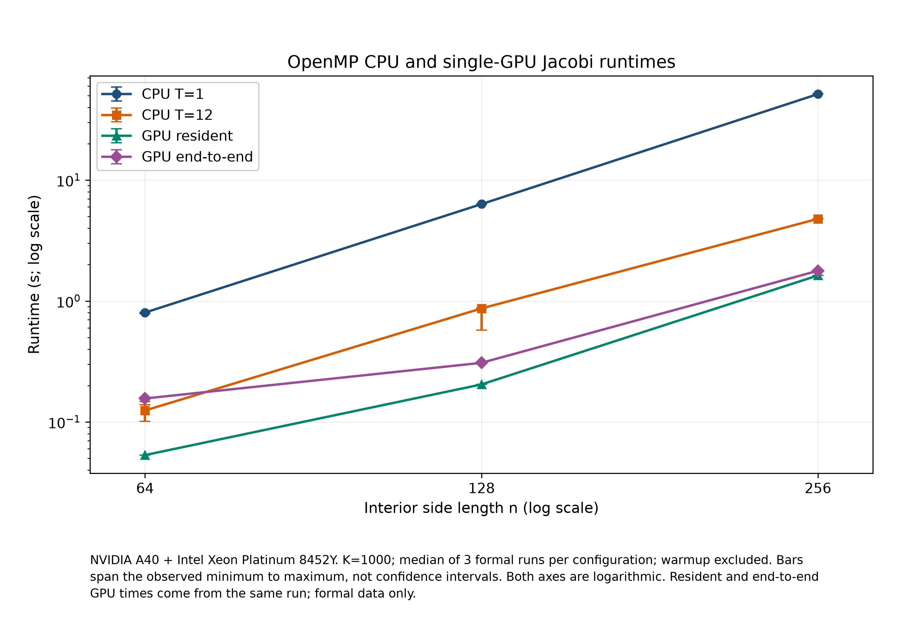
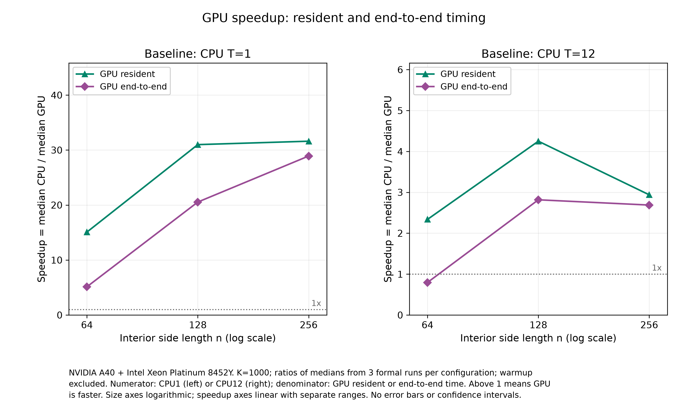

# C 模块中文成果说明：OpenMP CPU 与单 GPU Jacobi

更新：2026-11-06。本文件是供本人理解、核对和后续合稿使用的中文 README 稿；当前不撰写英文 C 章节，不补 contribution / AI usage，也不执行向 A 发送材料。

**当前结果：正式三规模实验已经完成。** 本文只使用同一正式批次的 64³ / 128³ / 256³ 数据，不混入早前 64³ pilot。正式图、统计 CSV 和验证摘要已生成，无需重跑实验或增加规模。

## 1. OpenMP CPU 与 GPU 实现

### 1.1 求解问题与计算工作量

在单位立方体上求解三维 Poisson 方程：

$$
-\Delta u=f,\qquad (x,y,z)\in(0,1)^3.
$$

使用制造解：

$$
u^*(x,y,z)=x+2y+3z+\sin(\pi x)\sin(2\pi y)\sin(3\pi z),
$$

$$
f(x,y,z)=14\pi^2\sin(\pi x)\sin(2\pi y)\sin(3\pi z).
$$

物理边界为 $u=x+2y+3z$，内部初值为零。$n$ 表示每个方向的内部点数，边界另计，$h=1/(n+1)$；使用 double 精度、七点有限差分和两个解缓冲区。等距网格的一轮 Jacobi 为：

$$
u_{i,j,k}^{(m+1)}=\frac{u_{i-1,j,k}^{(m)}+u_{i+1,j,k}^{(m)}+u_{i,j-1,k}^{(m)}+u_{i,j+1,k}^{(m)}+u_{i,j,k-1}^{(m)}+u_{i,j,k+1}^{(m)}+h^2f_{i,j,k}}{6}.
$$

正式性能实验统一执行 **K=1000 轮**，不提前停止，每次从相同初值重新开始。右端项在迭代前预计算。不同规模下固定 K 比较的是相同迭代次数的计算成本，不保证相同求解精度或普遍收敛。

二维小案例使用对应的五点离散、制造解 $x+2y+\sin(\pi x)\sin(2\pi y)$ 和右端项 $5\pi^2\sin(\pi x)\sin(2\pi y)$。非方形/非立方验证按各方向实际网格间距使用不同系数。

### 1.2 CPU 路径

CPU 使用一个持久 OpenMP 线程组，在 1000 轮外建立并行区域；内部更新采用 `collapse(3)` 与 `schedule(static)`。每一轮末的隐式屏障确保该轮更新完成后才进入下一轮。通过迭代奇偶选择只读旧缓冲和写入新缓冲，避免共享指针交换竞争；边界保持初始规定值。运行时记录实际线程数，若不符合请求则拒绝该样本。

### 1.3 GPU 路径与编译

实现分为 `jacobi_c_openmp.cpp` 的 C++ host/CPU、`jacobi_c_target.c` 的独立 C OpenMP target 区域，以及 `.h` 接口。NVHPC 三阶段构建为 C++ host 使用 `-mp=multicore`、C GPU 使用 `-mp=gpu`、最后链接；各阶段保留 GCC toolchain 选择修复。原完整 C++ GPU 路线曾出现前端崩溃，目前路线是已验证可用的 workaround，不把原崩溃归因于尚未独立证实的某个语法子句。

两个解数组和 RHS 在循环外一次映射到设备，1000 轮内重复使用。每轮一个同步 target 区域，通过 `teams` 与 `distribute parallel for collapse(3)` 分配内部点；未使用 `nowait`。迭代后只回传最终缓冲区，再在主机计算诊断量。第一轮 stencil 所在 target 区域内调用 `omp_is_initial_device()` 验证设备执行；GPU 请求还要求 `omp_get_num_devices()>0`，并设置 `OMP_TARGET_OFFLOAD=MANDATORY`。

GPU team/thread 的具体映射由编译器/运行时选择，当前未声称找到最优配置。最新版只使用 `bash build.sh nvidia` 构建，不能恢复旧的单文件 GPU 编译命令。

## 2. 实验设置与统计方法

| 项目 | 正式实验配置 |
|---|---|
| 平台 | Vanda，Intel Xeon Platinum 8452Y + NVIDIA A40 |
| 正式节点 | GN-A40-024 |
| GPU 显存 / 驱动 | 46068 MiB / 575.57.08 |
| 编译环境 | NVHPC 24.7，CUDA 12.3.0，GCC 13.2.0；主要优化 `-O2` |
| PBS 分配 | 36 CPU cores + 1 GPU；240 GB 为已确认资源配置记录 |
| CPU 对照 | T=1 和 Tc=12；实际线程数随运行验证 |
| CPU 绑定设置 | `OMP_PLACES=cores`、`OMP_PROC_BIND=close`，关闭动态线程数 |
| 内部网格 | 64³、128³、256³ |
| 精度 / 轮数 | double / K=1000，不提前停止 |
| 样本规则 | 每配置 1 次预热 + 3 次正式；每次单独启动进程并重置初值 |
| 总调用数 | 9 个配置 × 4 次 = 36；其中 27 次用于正式统计 |
| 运行顺序 | 各正式轮次轮换规模和 CPU1/CPU12/GPU 顺序 |

**分配 36 核与使用 CPU12 不矛盾。** PBS 为一块 A40 配套分配 36 个 CPU 核，而 CPU 多线程基准按照事先协议使用 $T_c=\min(12,\text{实际获配物理核数})=12$；因此图表使用 CPU12，不把 allocation 大小标成实际计算线程数。GPU 和 CPU 对照在同一正式 allocation 上依次执行。

所有时间点以三次正式样本的**中位数**表示，预热排除。runtime 图的误差棒覆盖该配置三次真实样本的最小值到最大值，不是置信区间。speedup 图使用中位数之比，不把不同程序的第 r 次调用当作配对统计样本，也不绘制未经定义的速度比误差棒。

| 时间指标 | 纳入的操作 |
|---|---|
| CPU 时间 | 主机数据准备后的 K 轮，含线程组建立、更新与轮间屏障 |
| GPU resident（驻留）时间 | 设备数据区已经建立后的 K 轮，含 target 启动与同步 |
| GPU end-to-end（端到端）时间 | 设备分配/映射、传入、K 轮、最终解回传及退出数据区 |

三类计时都不包含主机数学初始化、最终残差/误差计算和文件输出。这里的“端到端”特指 GPU 求解数据区的端到端，不是整个命令行程序的墙钟时间。resident 也不是用设备事件测出的纯 kernel 时间。

## 3. 正确性验证：用于报告的简表

验证按目的组织：离散参考解验证方程和边界；一步/两步独立公式验证方向系数与缓冲角色；全网格对比验证 CPU/GPU 一致性；target 内标志验证实际执行设备。无需把终端输出或完整日志放进报告。

| 验证内容 | 覆盖配置 | 实测结果 | 验收标准 |
|---|---|---:|---|
| 二维离散参考解 | 7×7，K=1000；CPU1/CPU12/GPU | 最大绝对误差 1.1945e−15 | ≤1e−9，通过 |
| 三维离散参考解 | 7×7×7，K=1000；CPU1/CPU12/GPU | 最大绝对误差 2.7247e−15 | ≤1e−9，通过 |
| 独立一步/两步公式 | 9×7 与 9×7×5；K=1/2；三种模式 | 最大差 6.6613e−16 | ≤1e−12，通过 |
| CPU1/GPU 最终全网格比较 | 六组小案例，包含物理边界 | 六组最大差均为 0 | ≤1e−9，通过 |
| 边界保持 | 全部 18 项小网格检查 | 最大边界误差 0 | ≤1e−12，通过 |
| 真正设备执行 | 6 项 GPU 验证及 12 次 GPU 性能调用 | `gpu_verified=true`，target 非主机 | 设备数≥1，MANDATORY 启用 |

总计 **18 项小网格检查全部通过**。一步/两步案例检查的是有限轮数的独立更新结果，不要求它们接近最终收敛解。`continuous_error_inf` 含空间离散误差，不能与离散参考误差或 CPU/GPU 实现差异混为一谈。

三个性能规模未导出全网格逐点比较；这些样本检查了实际设备、边界、有限值及相同规模跨模式的最终残差一致性。因此“小案例最大差 0”不能写成“所有大规模逐点完全一致”。

## 4. CPU 与 GPU 正式性能结果

### 4.1 时间中位数

| 内部网格 | CPU1（秒） | CPU12（秒） | GPU resident（秒） | GPU end-to-end（秒） |
|---|---:|---:|---:|---:|
| 64³ | 0.802221 | 0.124330 | 0.053188 | 0.156299 |
| 128³ | 6.330078 | 0.867985 | 0.204269 | 0.308162 |
| 256³ | 51.450687 | 4.783182 | 1.627774 | 1.779479 |



**图 1 图注：** Xeon Platinum 8452Y + 单 NVIDIA A40；K=1000；每配置三次正式运行的中位数，预热排除。横轴为内部边长 n 的对数，纵轴为秒数的对数；误差棒为真实 min/max，不是置信区间。GPU 两条时间来自同一次运行，仅使用当前正式批次。

### 4.2 加速比与 CPU 线程效率

GPU 速度比定义为：

$$
S_{b,g}=\frac{\operatorname{median}(T_{\mathrm{CPU},b})}{\operatorname{median}(T_{\mathrm{GPU},g})},
\quad b\in\{1,12\},\quad g\in\{\mathrm{resident},\mathrm{e2e}\}.
$$

大于 1 表示该 GPU 计时范围快于指定 CPU 基准。CPU 线程加速比为 $S_{\mathrm{CPU}}=T_1/T_{12}$，效率为 $E_{\mathrm{CPU}}=S_{\mathrm{CPU}}/12$。**不把 GPU CUDA 核数当作 CPU 线程数计算效率。**

| 规模 | CPU12 加速比 | CPU12 效率 | resident vs CPU1 | e2e vs CPU1 | resident vs CPU12 | e2e vs CPU12 |
|---|---:|---:|---:|---:|---:|---:|
| 64³ | 6.45× | 53.8% | 15.08× | 5.13× | 2.34× | 0.80× |
| 128³ | 7.29× | 60.8% | 30.99× | 20.54× | 4.25× | 2.82× |
| 256³ | 10.76× | 89.6% | 31.61× | 28.91× | 2.94× | 2.69× |



**图 2 图注：** 平台、K 和样本规则同图 1；速度比为三次正式运行的中位数之比。左图以 CPU1 时间为分子，右图以 CPU12 时间为分子，分母分别为 GPU resident 或 end-to-end 时间。横轴规模为对数；速度比纵轴为线性，左右图量程不同；虚线 1× 表示等耗时。图中不绘制误差棒，也不声称置信区间。

CPU12 的测量范围在 64³ 为 0.101018–0.139083 s，在 128³ 为 0.572921–0.870379 s，在 256³ 为 4.781407–4.805755 s。128³ 的 CPU12 波动相对明显；这些样本仍全部按原协议保留，不能为了更平滑的曲线重新挑样或删除快/慢样本。完整四类时间 min/max 见 `summary.csv`。

## 5. GPU resident 与端到端的差距

定义描述性差值 $\Delta=\operatorname{median}(T_{e2e})-\operatorname{median}(T_{resident})$，并用 $\Delta/\operatorname{median}(T_{e2e})$ 表示两种计时口径之间的相对差距。它是“中位数之差”，不等同于“逐次时间差的中位数”。

| 规模 | 两个中位数之差 Δ（秒） | Δ / e2e 中位数 |
|---|---:|---:|
| 64³ | 0.103111 | 66.0% |
| 128³ | 0.103893 | 33.7% |
| 256³ | 0.151705 | 8.5% |

两种计时的绝对差约为 0.103、0.104、0.152 秒，相对差距则由约 66.0% 降至 8.5%。这支持“规模增大后，设备数据区建立/结束等额外操作在总时间中的相对影响减小”的描述。它没有分别测出分配、初始化、主机设备传输和释放各自耗时，因此不能称为纯 PCIe 传输测量，也不能为单项成本分配百分比。

在 64³，resident 比 CPU12 快约 2.34×，但 e2e 速度比只有 0.80×，即 GPU e2e 约为 CPU12 时间的 1.26 倍。仅展示 resident 会掩盖这个差别。在 128³ 和 256³，e2e 相对 CPU12 分别快约 2.82× 和 2.69×，因此在这两个已测规模上，计入 GPU 数据区开销后仍有优势。离散测量只说明 64³ 尚无 e2e 优势、128³ 已出现优势，不能给出精确交叉规模。

## 6. 整体讨论与适用限制

### 6.1 GPU 收益如何随规模变化

相对 CPU1，resident 速度比约为 15.08× → 30.99× → 31.61×，e2e 约为 5.13× → 20.54× → 28.91×。但相对 CPU12，resident 为 **2.34× → 4.25× → 2.94×**，e2e 为 **0.80× → 2.82× → 2.69×**，均不能概括成“规模越大、GPU 相对多线程 CPU 的优势一定越大”。

实测上，128³→256³ 时 CPU12 中位数增长约 5.51 倍，而 GPU resident 增长约 7.97 倍，所以相对 CPU12 的 resident 速度比下降；GPU 绝对时间仍增长，并不意味着设备发生错误。CPU12 在三个规模上的加速比分别为 6.45×、7.29×、10.76×，CPU 基准自身的变化会影响 GPU 相对优势。

启动开销摊薄、设备利用率、缓存/内存行为以及 CPU 线程效率都可能影响趋势。但没有 profiler、带宽计数或独立分项测量，当前曲线不足以证实某一因素是唯一原因；128³ 的 CPU12 样本波动也是解释该点时必须保留的限制。

### 6.2 对整体项目讨论可用的要点

- 单节点 OpenMP CPU 和单 GPU 比较说明：相同 Jacobi stencil 的性能结论依赖规模、CPU 基准和计时范围，不能把“GPU 更快”写成无条件结论。
- 在 GPU 循环外保留设备映射，避免每轮主机设备数据往返，是本实现的关键设计；但 1000 次同步 target 启动和轮间依赖仍存在，resident 不等于无启动开销。
- CPU 的本地线程并行与 GPU 的设备执行，是节点内部加速的两种路径；MPI 及混合并行还要考虑分区、halo 和跨节点通信。本模块没有测试这些组合，不能把本次速度比外推为分布式 GPU 或 MPI+GPU 的结果。
- 和 B 的结果合稿时，需要先核对问题定义、K、节点/CPU 型号、编译器和计时边界；不同节点或不同工作量的数字不能直接拼成同一加速曲线。

### 6.3 明确限制

1. 仅测试一个正式 A40 / Xeon 节点和该软件栈，不宣称对所有 GPU、所有 CPU 或不同驱动普遍成立。早期 pilot 在不同节点/驱动，未混入图表。
2. 每配置只有三次正式样本，min/max 不是噪声分布估计或置信区间。未做统计显著性检验。
3. 只有 CPU1/CPU12 对照，没有完整线程数扫描，不能称为最优线程配置或完整 strong-scaling 研究。
4. 固定 K=1000 后的相对残差约为 0.0047745、0.00626234、0.00666474；不能宣称三个规模已达到统一收敛阈值。收敛性与精度研究应使用相应停止准则另行解释。
5. 未直接测量单独 kernel、PCIe 带宽或各项设备初始化开销；不进行未经测量的因果归因。
6. 不增加 512³、多 GPU、MPI、weak scaling 或更多线程数；现有正式矩阵足以支撑本模块约定的实验范围，无需为使曲线更漂亮而重新采样。

## 7. 文件和复现入口

| 文件 | 用途 |
|---|---|
| [runtime.png](../deliverables/formal_20261106/analysis/runtime.png) / [runtime.pdf](../deliverables/formal_20261106/analysis/runtime.pdf) | 正式耗时图，PNG 300 dpi；PDF 矢量版便于合稿 |
| [speedup.png](../deliverables/formal_20261106/analysis/speedup.png) / [speedup.pdf](../deliverables/formal_20261106/analysis/speedup.pdf) | 两种 CPU 基准下的 GPU 速度比 |
| [summary.csv](../deliverables/formal_20261106/analysis/summary.csv) | 12 组时间统计：中位数、min/max、样本数 |
| [speedups.csv](../deliverables/formal_20261106/analysis/speedups.csv) | CPU 加速比/效率与四种 GPU 速度比 |
| [validation_summary.csv](../deliverables/formal_20261106/analysis/validation_summary.csv) | 按目的压缩的验证表，不是终端转录 |
| [figure_captions.md](../deliverables/formal_20261106/analysis/figure_captions.md) | 图注与统计口径 |
| [plot_metadata.json](../deliverables/formal_20261106/analysis/plot_metadata.json) | 图表数据哈希、分析脚本哈希、坐标轴与环境记录 |
| [根 README](../README.md) | 当前工作目录与构建入口 |

在 Mac 的 `03_C` 目录复现图表：

```bash
cd /Users/zhu/Desktop/5208_project3/03_C
c_data='deliverables/formal_20261106'
.venv/bin/python analyze_c.py "$c_data"
```

换机器时先创建本地虚拟环境并安装本次锁定的绘图依赖：

```bash
python3 -m venv .venv
.venv/bin/python -m pip install -r requirements-plots.txt
```

仓库中用于绘图的数值输入位于 `deliverables/formal_20261106/`；environment.json 仅保留绘图必需的平台字段和实验配置，不包含账号变量或原始调度环境。绘图只读取已有实验数据，不重新运行求解器，不访问 Vanda。原始日志、stdout/stderr、网格和完整作业目录保留为内部证据；未来课程提交按约定只选源码、README、必要脚本、图及数值 CSV，不把终端记录塞进最终报告。

当前交付边界：先审阅本中文稿；英文 `final_C_openmp.md` 暂不撰写，contribution / AI usage 与向 A 发送材料不在本次执行范围。
