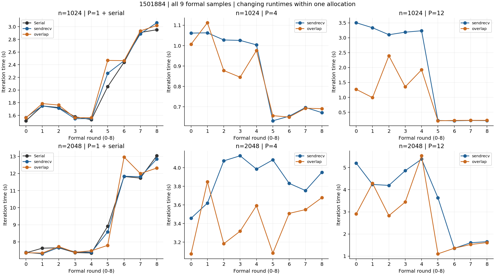
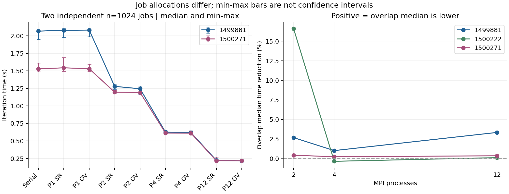
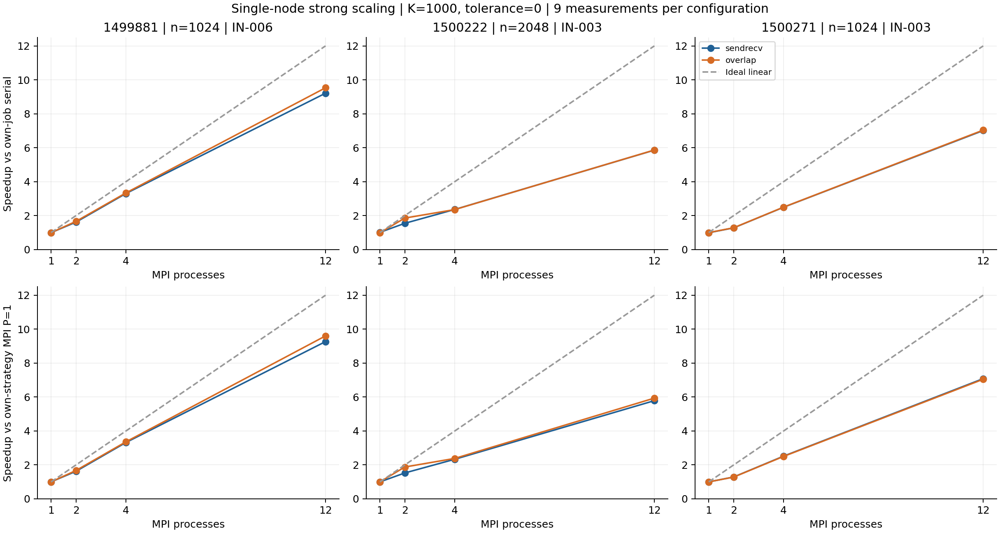

# A/B阶段结果梳理与报告材料

## 最新最终结论：三项补充均完成，实验2未证明大幅重叠收益

1502229等待位置诊断已完整审计。下表均为本次诊断程序全五轮正式样本，不与正式强扩展的九轮样本或旧串行基准混算。正的降低表示overlap更快。

| n / P | SR中位秒 | IM中位秒 | OV中位秒 | OV相对IM耗时降低 | OV同轮更快 |
|---|---:|---:|---:|---:|---:|
| 2048 / 2 | 4.434342 | 4.399289 | 4.406850 | -0.17% | 2/5 |
| 2048 / 12 | 1.285498 | 1.263220 | 1.250628 | +1.00% | 4/5 |
| 1024 / 12 | 0.221087 | 0.219135 | 0.216518 | +1.19% | 4/5 |

2048/P2中立即等待与overlap接近，overlap中位耗时反而高0.17%、仅2/5轮更快。两个P12组合中位耗时约低1%，均4/5轮更快，属于小样本单分配中的小幅等待/计算调度观测，未建立统计显著性或底层通信重叠证明。历史2048/P2的14–17%大差异仍不能归因为提前计算内部行；诊断程序/分配不同，不能用本次诊断去否定旧生产原件或确定旧现象根因。

本次SR/IM比较同时涉及接口、更新顺序/划分及可能代码生成差异，不称为纯API成本。所有54次性能、45次正确性、673条绑定与222文件原始包均核对通过；保留2048/P2/SR的5.331092秒较慢记录。35次完整网格、10次全局参考分别统计。审计中仅CV跨Python末位舍入作严格容差修复，原始数据未改。

实验1的时间变化、实验3的非对称正确性及全部历史数据继续保留。至此本轮实验1、3、2完成，内部计时未开展，不再新增实验。最终以[统一证据入口](../evidence/ab_final_2026-10-28/README.md)、[实验2分析](../evidence/vanda_1502229_mpi_wait/analysis_reviewed.md)和[更新后的英文报告草稿](AB_STAGE_REPORT_DRAFT_2026-10-28.md)为准。报告仍需人工确认成员信息、贡献与理解，未发送。

当前共7份完整原件归档；正式扩展与独立诊断分开。以下既有统计数值和解释过程作为历史记录保留；其中“实验2待提交/暂缓”均为早于本次完成的状态。

## 实验2准备状态更新：限定追加一次诊断，原审计结果不变

用户明确表示仍有时间并要求重新判断后，继续准备原定实验2：仅2048/P2、2048/P12、1024/P12三组合，三方案各1预热+5正式（54次性能），先完成45次正确性门槛。已完成本地工具准备，尚未执行新Vanda作业或产生新诊断结论。

理由是2048/P2已有重复方向，而P12大幅变化需要限制解释。立即等待/overlap对照更接近等待位置调度收益；sendrecv/立即等待还含计算顺序与划分差异，不称为纯API成本。方案紧邻轮换，减少时间间隔但不宣称排除环境变化。仅总迭代计时，不做插桩、节点原因专项或扩展矩阵复测。完成这一项即回到报告，无论结果是否稳定都保留样本。

[实验2设计、提交与验收说明](VANDA_MPI_WAIT_DIAGNOSTIC.md)。下方1501884及历史四作业的数值、归档与已确认解释不变；“实验2暂缓/停止追加”的文字记录的是此次重新判断前的状态。

## 当前结论：2026-10-28，已纳入1501884

实验1（同分配双规模）与实验3（非对称正确性）已完整审计、归档；实验2和内部阶段计时暂缓。本轮未发现实质数值错误，先进入阶段报告整理，不因性能不稳定继续无限追加实验。

当前材料：[新作业经复核中文分析](../evidence/vanda_1501884_ab_supplement/analysis_reviewed.md)、[四作业五数据集汇总](../evidence/ab_summary_2026-10-28/README.md)、[英文阶段报告草稿](AB_STAGE_REPORT_DRAFT_2026-10-28.md)。草稿尚未发送，真实成员信息、实际贡献和个人代码理解仍待人工确认。

### 新证据及修订后的表述

非对称u=x+2y+xy的31次完整网格验证全部通过，最大逐点差异8.88e-16；n=7正容差的7个实现配置均330轮停止，解析误差约1.25e-11、残差约2.52e-10。这增强坐标/边界/halo/行分区与全局停止正确性证据，不等于1024/2048大网格逐点证明。

1501884在IN-005同一次PBS分配中交错1024/2048，性能源码和两个性能程序与历史三轮完全一致；CPU列表固定，780条执行前绑定检查通过。然而本轮随轮次出现明显变化：1024/P12/sendrecv前五轮约3.10–3.50秒，后四轮约0.213–0.224秒；串行和MPI P=1后期反而变慢。因此只能说控制了版本与分配/映射，不能说同次分配已消除环境/时间因素。

原“随P增加中位耗时持续降低”的描述仅适用于10月27日三轮，不能推广到当前全部数据。本轮1024两策略P12均比P4慢，sendrecv的P12中位耗时还高于本次串行。完整保留不利结果，未按快慢删样本、删除整次作业或选择后半段替换统计。

### 所有作业并列，基准不混用

| 作业 / 节点 | n | 串行中位秒 | P12中位秒 SR / OV | 相对本次串行 SR / OV |
|---|---:|---:|---:|---:|
| 1499881 / IN-006 | 1024 | 2.066070 | 0.224262 / 0.216749 | 9.213 / 9.532 |
| 1500271 / IN-003 | 1024 | 1.527579 | 0.217869 / 0.217064 | 7.011 / 7.037 |
| 1500222 / IN-003 | 2048 | 6.842698 | 1.168184 / 1.166647 | 5.858 / 5.865 |
| 1501884 / IN-005 | 1024 | 1.749200 | 3.101710 / 0.991551 | 0.564 / 1.764 |
| 1501884 / IN-005 | 2048 | 7.650589 | 4.192806 / 2.828012 | 1.825 / 2.705 |

SR/OV分别为sendrecv/overlap。各数值均为本作业、本规模的全部九次正式样本中位数。新数据同策略MPI P=1加速比和效率、min/max及CV见完整CSV；不合并跨作业样本。

本轮2048/P2 overlap中位耗时低14.01%、7/9轮更快，历史2048为16.61%、9/9，方向再次出现但一致性/幅度有差异；1024/P2本轮overlap中位耗时反而高1.45%。P12中位数之比差异虽较大（1024为68.03%、2048为32.55%），但伴随显著时间变化；同轮降低的中位数为22.79%/4.85%，两个统计口径不同，不能当作底层通信重叠比例。

### 验收、数量与证据边界

1501884：PBS F/退出0，walltime24分34秒；一次原结构化验证92次（88数值+4拒绝）、180次性能（18预热+162正式）、31次非对称逐点验证；17份运行源码与上传包一致，180条实际顺序和780条绑定、工作量/指标及全部统计重核通过。每规模内部九个位置平衡，九轮未覆盖全部十八个跨规模位置。

四个MPI性能作业合计五个规模数据集、45配置、450次含预热性能执行（405正式）及1950条绑定；四套原结构化验证352数值+16拒绝，另31次非对称验证；独立全网格执行合计203次。这些是套件执行数，不是203个独立数学问题。原套件之前verify_small另有串行前检，不纳入上述结构化计数；1501884另6次前检仅3次保留了数值日志，明确不冒充逐次文件审计。

所有性能规模仍K=1000/tol=0、不宣称收敛。缓存/带宽/NUMA、共享负载、频率/调度或通信进度的具体原因均未确定；未证明有效底层通信重叠，未验证多节点PBS集成；libpbs.so.0警告保留。原B作业1498804完整包仍未取得。

新原始包646个文件逐成员SHA-256核验通过；新包SHA-256为ddda26f6f5822c5b29d7143549935a0544fc9dc3ac257bbb704d109f03f5f78b。[六份归档清单](../evidence/ab_summary_2026-10-28/raw_archives_manifest.json)同时保留之前五份原件。

## 以下为此前汇总与准备记录

以下原文保留历史数值和当时状态；涉及当前实验完成情况和扩展性概括时，以上述10月28日最新结论为准。

## 2026-10-28 补充准备状态（尚无新集群结果）

用户已明确授权一次有限补充轮，优先同次PBS分配内1024/2048双规模对照，其次非对称边界独立正确性；立即等待诊断按预算决定。本文件既有三轮数值及解释边界不变，下文10月27日“正常追加计划结束”是历史状态。新增代码、本地检查及提交/下载说明见[Vanda补充实验](VANDA_AB_SUPPLEMENT.md)。7次真实本地非对称串行全网格检查通过；MPI检查及新性能结果待PBS运行，合成工具数据不加入本汇总。

更新：2026-10-27。目标：准备2026-10-29阶段报告。当前约定的A串行基准/正确性、B纯MPI三轮复测全部完成并核验；无需为完成本轮汇总再追加实验。本文是阶段材料，不代表课程最终MPI+其他并行模型的整体交付已完成。

## 1. 已解决的问题

原串行约比MPI单进程慢两倍，旧的“相对串行加速比”混合了实现差异与多进程并行收益。
1499802在同CPU、相同flags下确认差距仍存在，g++换成mpicxx编译同一串行源码不能消除差距。
1499842中，原串行3.496400秒、每轮局部归约3.469020秒、按行局部归约1.723135秒、MPI单进程1.746897秒。受控候选修改与Linux机器码共同支持：该环境中原串行最大更新量归约的每点栈访问是主要差距来源；按行候选在热点使用寄存器累积。不能写成向量化收益，也不泛化至所有平台。

后续明确以jacobi_serial_row_update.cpp为串行基准。三轮复测中MPI P=1均接近各自串行，约两倍单进程优势不再出现。原jacobi.cpp、jacobi_mpi.cpp及历史数值保留；没有用新串行时间重算旧1498804加速比。
诊断证据：[1499802](../evidence/vanda_1499802_single_rank/analysis.md)、[1499842](../evidence/vanda_1499842_local_reduction/analysis.md)。

## 2. 实验设计与完成情况

算法为单位正方形上的二维Jacobi五点模板，double精度，固定边界u=x+y，内部初值0；n为每边内部点数，总网格为(n+2)×(n+2)。采用old/new双缓冲，按轮交换。
MPI使用一维按行分区，前n%P个rank多一行，每个rank只存本地行及上下halo；支持非整除分区，P>n明确拒绝。
sendrecv先完成两次MPI_Sendrecv再更新本地网格；overlap发起Irecv/Isend，先计算不依赖halo的内部行，Waitall后更新首末行，并处理只有一行/两行的情况。非阻塞调用只构成尝试重叠的实现方式。
正容差模式逐轮Allreduce全局最大更新量决定统一停止；固定轮数模式仅最后一轮归约更新量。计时包含迭代内通信及必要归约/同步，报告最慢rank；不含初始化、最终指标计算、网格收集、输出、编译及排队。

三轮均为Vanda单节点12 CPU/4GB，Xeon Gold 6438N，GCC 12.2.0/OpenMPI 4.1.5，-std=c++17 -O2 -Wall -Wextra -Wpedantic，不启用OpenMP。
各9配置：串行与MPI P=1/2/4/12两种通信方案；各预热1次、正式9次，交错旋转使每配置覆盖9个顺序位置。每rank执行前固定到不同已分配CPU，串行与rank0使用同一CPU。正式统计排除预热，全部样本保留。

| 作业 | n | 节点 | walltime | 本次串行中位秒数 | 验证 / 性能执行 | 结论 |
|---|---:|---|---|---:|---|---|
| 1499881.stdct-mgmt-02 | 1024 | IN-006 | 00:05:49 | 2.066070 | 92 / 90 | 完整审计通过 |
| 1500222.stdct-mgmt-02 | 2048 | IN-003 | 00:10:11 | 6.842698 | 92 / 90 | 完整审计通过 |
| 1500271.stdct-mgmt-02 | 1024 | IN-003 | 00:05:23 | 1.527579 | 92 / 90 | 本轮完整审计通过 |

三轮11份源码逐文件一致；哈希清单、原始stdout/stderr、汇总、PBS最终状态、CPU mask、执行前绑定及交错顺序均有审计证据。不同作业CPU列表不同；即使节点名相同，也不是同一CPU分配或同一运行环境的受控规模对比。

## 3. 正确性证据及其边界

| 检查层次 | 每轮证据 | 三轮合计 | 能支持的结论 |
|---|---|---:|---|
| 数值验证套件 | 88次；n=1/2/4/7/8/12/16/31/32，含不整除分区与小行数 | 264次 | 所覆盖案例的串行/MPI、两通信方案满足验收 |
| 完整小网格独立参考 | 上述88次中的43次，n≤8，逐点差阈值1e-12 | 129次 | 所覆盖小网格与独立Python参考一致 |
| 正容差收敛 | 上述88次中的27次，tol=1e-12 | 81次 | 所覆盖小规模的状态、更新量、误差和残差通过 |
| 预期非法输入 | 4次，P>n、负容差、NaN、非法exchange | 12次 | 明确拒绝，非零退出且stdout为空 |
| 大规模性能结果检查 | 含预热90次，核对n/K/tol/status/threads/nodes与全局指标 | 270次 | 工作量一致且全局指标匹配本次串行 |
| 执行前CPU绑定 | 390条原始stderr记录，与汇总及mask相符 | 1170条 | exec前rank到CPU映射符合设计 |

表中子集不能再与88次相加；三轮反复使用同一套件，不是264个独立数学问题。阈值来自归档team_contract_v0.1.json：边界误差≤1e-14，小网格逐点差≤1e-12，小规模收敛真误差≤1e-8、残差≤1e-7；MPI与同案例串行指标比较采用rtol=1e-10、atol=1e-12。进程数为1/2/4/12，跳过P>n的数值配置；单行/双行/非整除路径均有对应小案例。

性能运行固定1000轮、tolerance=0。1024的全局指标为max_update≈0.000707706、max_error≈1.859066、residual_inf≈2972.876638；2048分别约0.000713934、1.924827、11984.433500；边界误差均0。两轮1024这些指标完全相同。较大的误差/残差与固定工作量设计并不矛盾，不能将这些运行写成收敛解或达到指定精度的求解耗时。
大网格没有输出完整网格，匹配四个全局标量不能替代1024/2048逐点验证。边界u=x+y有对称性；未新增非对称案例，不声称覆盖任意边界或所有实现错误。绑定为exec前快照，没有连续采样。

## 4. 两次1024独立作业：哪些稳定、哪些不同

下表变化率=(1500271/1499881−1)×100%；负值表示第二次更快。绝对时间并排比较用于描述差异，不把任一作业的时间当作另一作业的基准。

| 配置 | 通信 | 1499881中位秒数 | 1500271中位秒数 | 变化率 |
|---|---|---:|---:|---:|
| 串行 | none | 2.066070 | 1.527579 | -26.06% |
| MPI P=1 | sendrecv | 2.078345 | 1.543310 | -25.74% |
| MPI P=1 | overlap | 2.081533 | 1.529819 | -26.51% |
| MPI P=2 | sendrecv | 1.278700 | 1.196519 | -6.43% |
| MPI P=2 | overlap | 1.244289 | 1.191220 | -4.26% |
| MPI P=4 | sendrecv | 0.625749 | 0.612902 | -2.05% |
| MPI P=4 | overlap | 0.619289 | 0.611397 | -1.27% |
| MPI P=12 | sendrecv | 0.224262 | 0.217869 | -2.85% |
| MPI P=12 | overlap | 0.216749 | 0.217064 | +0.15% |

稳定的观察：全局数值指标一致，MPI P=1接近各自串行；P=1→2→4→12的中位耗时依次降低；P=2/sendrecv在两轮的样本CV分别约1.62%/1.50%，没有复现旧作业的大幅两档变化。P=4/12的中位耗时在这两次作业中相近，尤其P=12/overlap约0.217秒。
存在差异：本次串行耗时低约26.06%，两种MPI P=1也低约26%；P=12/sendrecv只低2.85%、overlap高0.15%。因此尽管12进程耗时接近，相对串行加速比变为7.011/7.037，低于首轮9.213/9.532。基准变化对加速比的算术影响可以确认，其系统原因尚未确定。
首轮P=2/4/12的overlap中位耗时低2.69%/1.03%/3.35%，本次缩至0.44%/0.25%/0.37%，同轮胜出从8/7/6次变为4/5/4次。不能将首轮优势概括为稳定、普遍或显著。
本次P=12/sendrecv的r0约0.270921秒，其余八条约0.211205–0.231269秒，CV为8.24%；这条通过工作量、数值及绑定检查，保留。整体不能笼统称作所有配置都稳定。

## 5. 强扩展结果与基准定义

相对本作业串行：S_serial(P)=median(T_serial)/median(T_MPI(P))；效率E_serial=S_serial/P。
相对同策略MPI单进程：S_MPI(P)=median(T_MPI(1,该策略))/median(T_MPI(P,该策略))；效率E_MPI=S_MPI/P。
均为中位数之比，不是逐轮比值的中位数；各作业、各规模单独计算，不合并不同作业样本。

表中SR/OV分别为sendrecv/overlap；MPI效率可由最后一列除以P得到，精确数值见CSV。

| 作业 | n | P | 相对本次串行加速比：SR / OV | 串行基准效率：SR / OV | 同策略MPI P=1加速比：SR / OV |
|---|---:|---:|---:|---:|---:|
| 1499881 | 1024 | 2 | 1.616 / 1.660 | 80.8% / 83.0% | 1.625 / 1.673 |
| 1499881 | 1024 | 4 | 3.302 / 3.336 | 82.5% / 83.4% | 3.321 / 3.361 |
| 1499881 | 1024 | 12 | 9.213 / 9.532 | 76.8% / 79.4% | 9.267 / 9.603 |
| 1500271 | 1024 | 2 | 1.277 / 1.282 | 63.8% / 64.1% | 1.290 / 1.284 |
| 1500271 | 1024 | 4 | 2.492 / 2.499 | 62.3% / 62.5% | 2.518 / 2.502 |
| 1500271 | 1024 | 12 | 7.011 / 7.037 | 58.4% / 58.6% | 7.084 / 7.048 |
| 1500222 | 2048 | 2 | 1.546 / 1.854 | 77.3% / 92.7% | 1.528 / 1.877 |
| 1500222 | 2048 | 4 | 2.362 / 2.354 | 59.1% / 58.9% | 2.334 / 2.383 |
| 1500222 | 2048 | 12 | 5.858 / 5.865 | 48.8% / 48.9% | 5.787 / 5.937 |

三轮所测配置均呈现单节点强扩展，但未达到理想线性。两次1024在12进程的串行基准效率范围为58.4%–79.4%；2048约48.8%–48.9%。这些是有限作业的观测范围，不是置信区间或未来性能保证。2048只有一次作业。
2048的效率低于两轮1024，并不自动说明实现出错或网格越大扩展越差；规模、CPU映射、节点或运行时条件没有全部控制。1500222与1500271同在IN-003也仍有CPU列表和运行时差异，不能据此确定规模的独立因果影响。

## 6. 通信比较

耗时降低=(sendrecv中位数−overlap中位数)/sendrecv中位数。正数表示overlap更快；同轮计数仅为同一交错轮中的先后运行，不能视为同时实验或独立显著性检验。

| 作业 | n | P | overlap中位耗时降低 | 同轮更快次数 |
|---|---:|---:|---:|---:|
| 1499881 | 1024 | 2 | +2.69% | 8/9 |
| 1499881 | 1024 | 4 | +1.03% | 7/9 |
| 1499881 | 1024 | 12 | +3.35% | 6/9 |
| 1500271 | 1024 | 2 | +0.44% | 4/9 |
| 1500271 | 1024 | 4 | +0.25% | 5/9 |
| 1500271 | 1024 | 12 | +0.37% | 4/9 |
| 1500222 | 2048 | 2 | +16.61% | 9/9 |
| 1500222 | 2048 | 4 | -0.33% | 4/9 |
| 1500222 | 2048 | 12 | +0.13% | 5/9 |

2048在P=2观察到16.61%的中位耗时降低且9轮均更快，可以如实报告为该次分配内的结果；P=4方向反转但幅度仅0.33%，P=12相差0.13%。不能据此声称overlap对各规模和进程数都更好，也不能仅凭耗时证明MPI通信进度与内部计算实现了有效重叠。
2048/P=4/overlap的2.049554秒低耗时记录已核对并保留；没有将该点删除来改善结论。所有CV、min/max、逐次样本见summary.json及逐作业审计；min/max不是置信区间。

## 7. 可以直接写入阶段报告的结论

1. 已实现并验证一维按行分区纯MPI Jacobi，包含sendrecv与尝试重叠的非阻塞方案、非整除分区和全局停止/指标处理。
2. 已完成串行基准差异诊断；按行归约版本使三轮复测中的MPI P=1与匹配串行接近，减少旧基准实现差异对并行加速比的混入。
3. 单节点固定工作量1024、2048均观察到强扩展；12进程相对本作业串行在1024两轮分别为9.213/9.532与7.011/7.037倍，2048为5.858/5.865倍。报告保留所有作业，而不是只选最好的一轮。
4. 正确性由独立小网格参考、收敛及边界/残差检查和跨实现比较支持；性能网格另检查工作量及全局指标，明确其没有大网格逐点对照。
5. 通信策略收益依赖本次配置与分配；两次1024没有稳定复现相同优势幅度，2048的P=2优势不能推广至所有配置。

## 8. 尚未验证的解释及限制

| 说法 | 证据状态 / 推荐写法 |
|---|---|
| 串行提速来自向量化 | 不支持；受控机器码证据指向最大更新量的栈访问/寄存器累积 |
| 交错运行或绑定已根治旧波动 | 不支持因果判断；仅能说新1024作业内P=2大幅两档波动未复现 |
| 2048效率下降来自缓存、带宽、NUMA或系统负载 | 都是未证实的可能解释，未采集足够硬件计数器、频率、负载及通信分解数据 |
| 已证明有效通信重叠 | 未证明；非阻塞API及单次提速不足以证明 |
| 同型号CPU或同节点即可受控比较规模 | 不充分；CPU映射及运行时状态不同，独立作业数量有限 |
| 已完成大网格逐点正确性验证 | 未完成；只有小网格逐点参考与大网格全局指标一致性 |
| libpbs.so.0警告不影响所有环境 | 仅三轮单节点执行完成；警告保留，不确认多节点TM/PBS集成 |
| 已完整审计原B的1498804原始包 | 未取得完整包；已有精选证据和历史核对不等同于完整原件审计 |

## 9. 必要剩余事项与停止追加实验的边界

- 将本材料整理为简短英文阶段报告，核对算法、计时范围、双基准定义、正确性层次、所有三轮结果与局限；10月29日发送与否由用户决定。
- 补齐真实成员姓名/学号、实际分工、个人代码理解和人工复核记录。B/C原有接口确认不得由AI代填。
- 如能取得旧1498804完整包，再补交接归档核验；它不阻塞三轮新结果的阶段汇总，也不要求重新提交实验。
- 课程最终要求涉及MPI加另一并行模型，C的OpenMP/混合后续需单独衔接；当前只汇总A/B。多节点、弱扩展、二维分区、非对称增强案例、性能原因专项定位继续暂缓。
- 本次未发现使三轮新结果失效的实质问题，正常追加实验计划已结束。无需为解释所有运行时差异再不断增加作业。

## 10. 可复核材料

- [1499881分析](../evidence/vanda_1499881_mpi_recheck/analysis.md)、[1500222分析](../evidence/vanda_1500222_mpi_recheck/analysis.md)、[1500271分析](../evidence/vanda_1500271_mpi_recheck/analysis.md)。
- [完整精确性能表](../evidence/ab_summary_2026-10-27/performance_comparison.csv)、[通信比较表](../evidence/ab_summary_2026-10-27/communication_comparison.csv)、[统计及全部正式样本](../evidence/ab_summary_2026-10-27/summary.json)。
- [原始归档清单及SHA-256](../evidence/ab_summary_2026-10-27/raw_archives_manifest.json)。五轮完整原始包在本地results/raw_archives/；390文件的新包逐成员内容已核验。精选目录不能代替完整包。
- 图表中的误差线只表示min/max。汇总重建脚本为evidence/ab_summary_2026-10-27/reproduce_summary.py，从仓库根目录读取原始结果；输出目录须不存在，避免覆盖现有分析。该脚本不运行MPI或新增实验。

AI使用：用户本人完成集群登录、上传、qsub及下载；Codex读取现有文件，补充1500271审计、归档及跨作业统计，生成图表并目视检查，更新中文材料。未提交/推送Git，未发送邮件。个人理解、组员确认及最终报告审阅待用户与组员完成。
