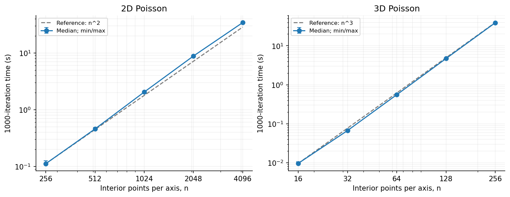
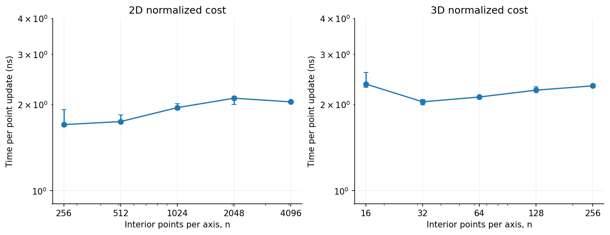

# A: serial runtime scaling

## Serial runtime scaling — 5 November 2026

We vary the interior side length n while fixing K=1000 Jacobi iterations.
All ten configurations ran in one Vanda allocation on CN-161 (Intel Xeon
Platinum 8452Y), using GCC 12.2.0, C++17 and -O2. PBS allocated two CPU slots;
the parent process was pinned to CPU 65 within its allowed set {65,67}, and
all serial child processes inherited that affinity. The code uses no OpenMP
or MPI. Each invocation initializes its arrays afresh. One complete warmup
round was followed by three measured rounds with rotating configuration order.
Only iteration time is reported: initialization, source generation, final
residual/error evaluation and file output are excluded.

The 2D study solves −Δu=f on (0,1)² with
u*=x+2y+sin(πx)sin(2πy), f=5π²sin(πx)sin(2πy),
Dirichlet boundary u=x+2y and zero interior initial values. This nonzero-source
problem is implemented in a_scaling_20261104/jacobi_a_scaling.cpp, an independent
extension of the numerical solver. The 3D study uses the manufactured problem
defined above. Source and boundary values are evaluated from global grid
coordinates before iteration; no random inputs or external datasets are used.

For dimension D, each update reads 2D neighbors and the precomputed source,
writes the other solution buffer, and the buffers are exchanged after the
whole grid has been updated. With N=n^D interior unknowns, one iteration costs
Θ(N), fixed-K work is Θ(KN), and storage is Θ(N). The five-/seven-point
operators are applied without constructing sparse matrices; their nonzero
counts are approximately 5N/7N and increase with n. Thus at fixed K we expect
T proportional to n² in 2D and n³ in 3D, or approximately linear growth with N.

```text
Generate the source and initialize both solution buffers and fixed boundaries
For k = 1,...,K:
    For every interior grid point:
        Write the Jacobi update using only values in the old buffer
    Exchange the old and new buffers
Evaluate the final residual and errors outside the iteration timer
```

Two compute-node checks at n=7 and K=1000 gave maximum errors against the
exact discrete solutions of 1.11e−15 (2D) and 2.78e−15 (3D); both boundary
errors were zero. This validates the discrete update separately from spatial
discretization error. The analytical discrete solution uses the same sine
eigenvalue construction as in the 3D validation, omitting the z term and
using source amplitude 5π² in 2D. All 40 performance invocations completed
1000 iterations, with zero boundary error. The downloaded source and runner
hashes match the local versions. Thirty formal samples were used in the
following table; all ten warmup samples were excluded.

| Problem | n | Median seconds | Min–max seconds | ns per point update | Local exponent q |
|---|---:|---:|---:|---:|---:|
| 2D | 256 | 0.111561 | 0.111217–0.125922 | 1.702 | — |
| 2D | 512 | 0.457194 | 0.455617–0.482564 | 1.744 | 2.035 |
| 2D | 1024 | 2.045982 | 2.009691–2.110084 | 1.951 | 2.162 |
| 2D | 2048 | 8.828188 | 8.395645–8.906398 | 2.105 | 2.109 |
| 2D | 4096 | 34.295781 | 34.228360–34.384209 | 2.044 | 1.958 |
| 3D | 16 | 0.009661 | 0.009408–0.010599 | 2.359 | — |
| 3D | 32 | 0.067011 | 0.065273–0.068193 | 2.045 | 2.794 |
| 3D | 64 | 0.557119 | 0.548134–0.557227 | 2.125 | 3.056 |
| 3D | 128 | 4.709857 | 4.695788–4.829070 | 2.246 | 3.080 |
| 3D | 256 | 39.009305 | 38.969158–39.195725 | 2.325 | 3.050 |

Here q=log(T₂/T₁)/log(n₂/n₁) uses adjacent grid medians, and the normalized
cost is T/(KN). Error bars below show the observed min/max of three samples,
not confidence intervals. Reference curves are anchored at each smallest grid.



Across the full ranges, endpoint growth exponents are 2.066 for 2D and 2.995
for 3D, close to the expected values 2 and 3. These are empirical finite-range
exponents, not proofs of asymptotic complexity. In 2D, doubling n increases
the median time by about 3.89–4.48 times; in 3D the factors are about 6.94–8.45.
For the larger 3D grids n=32–256, each doubling gives approximately eightfold
growth, consistent with the increase in point-update count.



Normalized median costs lie between 1.70 and 2.10 ns per update in 2D, and
2.05–2.36 ns in 3D. Thus most of the runtime increase is explained by problem
size. The slightly increasing cost over the larger 3D grids and the 2D
variation are compatible with changes in memory-system behavior, but this
experiment does not isolate cache or bandwidth effects. The 2D n=256 formal
range spans 13.2% of its median, illustrating why the sample range is retained;
three repetitions do not establish a precise distribution of runtime noise.

The 4096² and 256³ cases have the same number of interior points, 16777216,
and medians of 34.296 and 39.009 seconds respectively. The 3D kernel is about
1.14 times slower here; it uses more neighbors and directional contributions.
This observation compares these two stencil implementations on this platform,
rather than implying that all equal-size 3D computations are intrinsically
slower by that factor.

The job completed with PBS exit status 0 and walltime 6 min 23 s. Summed
iteration timings for all 40 performance invocations were 360.443 seconds;
job walltime additionally includes compilation, initialization and diagnostics.
The largest 2D and 3D formal residual ratios after 1000 iterations were
approximately 0.00502 and 0.00666. These scaling measurements describe fixed
work; convergence behavior is covered by the separate numerical study above.

This completes A's serial problem-size scaling evidence. B's MPI and C's GPU
analyses use their own matched baselines; these times should only enter a
cross-implementation speedup if platform, problem and timing scope match.

Reproduction: run a_scaling_20261104/analyze_a_scaling.py on the downloaded
batch, with --output evidence/vanda_1522376_a_scaling. See the
[batch overview](../evidence/vanda_1522376_a_scaling/README.md),
[verification summary](../evidence/vanda_1522376_a_scaling/verification.json)
and [numerical summary](../a_scaling_20261104/Vanda_1522376.stdct-mgmt-02/data/summary.csv).
Internal logs are retained locally and excluded from the final course submission.

AI usage for this addition: ChatGPT/Codex assisted with the 2D extension,
run/PBS and analysis scripts, numerical checks and report drafting. The user
uploaded the inputs, submitted the Vanda job and downloaded the results.
