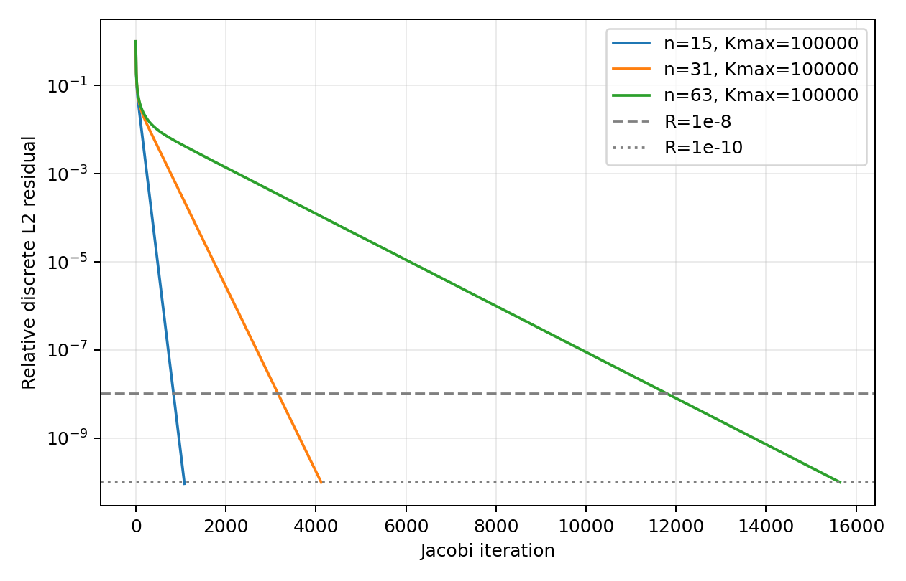
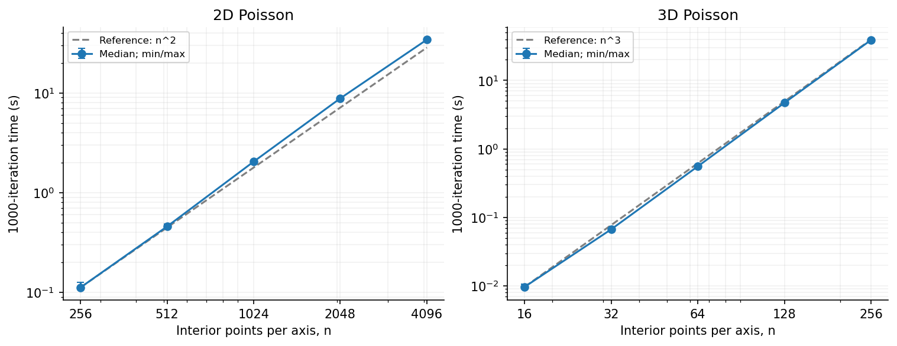
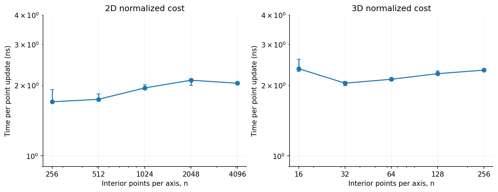

# A: Poisson problems, serial scaling and numerical behavior

Updated 5 November 2026. The algorithm and numerical study are supplemented
by the completed 2D/3D fixed-work serial scaling experiment. A's experimental
sections are ready for integration with the MPI and OpenMP/GPU sections.

## Problem and discretization

We solve −Δu=f on Ω=(0,1)³ with Dirichlet boundary u=x+2y+3z and zero initial
interior values. The manufactured solution and source are

\[
u^*=x+2y+3z+\sin(\pi x)\sin(2\pi y)\sin(3\pi z),\quad
f=14\pi^2\sin(\pi x)\sin(2\pi y)\sin(3\pi z).
\]

The directional frequencies and coefficients differ. Each direction contains
n_d interior points with h_d=1/(n_d+1); boundary points are additional.
Using double precision, a seven-point central difference and a_d=1/h_d² gives

\[
u^{k+1}_{i,j,l}=
\frac{a_x(u^k_{i-1,j,l}+u^k_{i+1,j,l})+
a_y(u^k_{i,j-1,l}+u^k_{i,j+1,l})+
a_z(u^k_{i,j,l-1}+u^k_{i,j,l+1})+f_{i,j,l}}
{2(a_x+a_y+a_z)}.
\]

Two arrays ensure that every update reads the previous iteration.
Both arrays retain the physical boundary. The source is computed before
iteration. The independent serial entry point is jacobi_numerics.cpp.

## Fixed work and convergence

Fixed-work mode performs exactly K iterations (K=1000 for the planned study),
with initial and final residuals outside timing and no per-iteration update
maximum reduction. Solve mode evaluates the true interior residual r(k)=f−Ah u(k)
every 10 iterations and at the iteration limit. Its convergence measure is
Rk=‖r(k)‖₂/‖r(0)‖₂. An initially zero residual yields immediate convergence.

The main criterion is Rk≤1e−8. A's accuracy study continues to 1e−10, recording
the first sampled iteration reaching 1e−8 as well. The limit is 100000
iterations; reaching it without meeting the criterion is reported explicitly.
Solve timing includes iteration-time residual checks and in-memory history
updates. Initialization, final error evaluation and file output are excluded.

The completed grid study uses n=15,31,63. We calculate the interior L∞ error against
the continuous manufactured solution and the observed order log₂(Eh/Eh/2).
These grid spacings halve exactly. Convergence and accuracy reuse the same
runs. Old 2D Laplace cases n=1024/2048 use K=1000 and report R1000.
Their single-run times describe numerical diagnostics, rather than statistical
performance comparisons.

## Local basic-check evidence

Windows, GCC 12.2.0, C++17, -O2, 1 November 2026:

| Case | Observation |
|---|---|
| 3D n=7, K=1000 | R1000=4.393e−16; boundary error=0 |
| Fixed-work solution vs exact discrete solution | Maximum absolute error=2.776e−15 |
| n=7, solve to 1e−10, checks every 10 | Converged at iteration 280; R=7.140e−11 |
| First sampled R≤1e−8 in that solve | Iteration 220 |
| n=7, solve with iteration limit 1 | Correct iteration-limit status; R≈0.6231 |

For the manufactured problem the exact discrete solution is available directly:

\[
\lambda_h=\sum_{d=x,y,z}4h_d^{-2}\sin^2(m_d\pi h_d/2),\quad
(m_x,m_y,m_z)=(1,2,3),\qquad
u_h^*=x+2y+3z+\frac{14\pi^2}{\lambda_h}\prod_d\sin(m_d\pi x_d).
\]

This follows from the sine eigenvalues of the difference operator and its
annihilation of the linear term. The n=7 continuous error is about 0.09445;
this is distinct from error against the discrete solution.

Records: results/final_202611/A_numerics/local_20261101_r2/.
The first runner attempt incorrectly applied the fixed-1000-iteration
grid-error threshold to an early-stopped solve. It now checks the residual
criterion for solve mode. Both attempt directories remain; the solver
required no change.

## Historical serial baseline gap

The controlled Vanda diagnosis used the 2D Laplace problem, n=1024, K=1000,
the same CPU/compiler settings, and eight measured samples per implementation.

| Implementation | Median seconds |
|---|---:|
| Original serial | 3.496400 |
| Iteration-local update maximum | 3.469020 |
| Row-local update maximum | 1.723135 |
| Single-rank MPI sendrecv | 1.746897 |

The row-local variant accumulates each row maximum in a register and combines
row maxima afterwards. The original and iteration-local variants access the
maximum-update value on the stack in the point loop. Controlled source changes,
machine code and timings support code generation for this reduction as the
main source of the approximately twofold difference in this environment.
None of the four update loops was automatically vectorized. Changing g++
to the mpicxx compiler driver alone did not remove the gap.

The mathematical updates and numerical rules were unchanged. The corrected
row-local baseline is close to MPI P1, so the former single-rank advantage
should not be interpreted as multi-process speedup. Historical measurements
retain their original baselines. New scaling uses matching baselines within
each experiment.

Sources:
[row-reduction diagnosis](../evidence/vanda_1499842_local_reduction/analysis.md),
[compiler-driver diagnosis](../evidence/vanda_1499802_single_rank/analysis.md),
[A/B summary](AB_RESULTS_SUMMARY.md).

## Vanda numerical results — 3 November 2026

The five planned cases completed on Vanda CN-161 using GCC 12.2.0 and -O2.
PBS allocated two CPU slots; the serial program itself used one computational
thread. Total job walltime was 34 seconds, with an exit status of zero.
The sum of the five timed iteration/solve intervals was 23.453 seconds.
The one-hour walltime request was a maximum allowance, not a duration estimate.
The difference includes job setup, module loading, compilation, initialization,
final diagnostics and output; these phases were not individually timed.

### Three-dimensional convergence and accuracy

| Interior grid | First checked R≤1e−8 | Iterations to R≤1e−10 | Final relative residual | Continuous L∞ error | Observed order | Solve seconds |
|---|---:|---:|---:|---:|---:|---:|
| 15³ | 840 | 1080 | 9.2665e−11 | 0.0227631872 | — | 0.016261 |
| 31³ | 3170 | 4120 | 9.8634e−11 | 0.00563935389 | 2.0131 | 0.409443 |
| 63³ | 11820 | 15640 | 9.9977e−11 | 0.00140667331 | 2.0032 | 11.157644 |

Halving the grid spacing reduced the continuous error by factors of 4.0365
and 4.0090, consistent with second-order spatial accuracy. All physical
boundary errors were zero. The errors against the exact discrete solution
were 4.87e−9, 1.43e−8 and 4.03e−8, respectively, much smaller than the
continuous discretization errors reported above.

The largest case contained 63³=250047 interior points. It stopped at the
prescribed residual target after 15640 iterations, performing about 3.91
billion point updates. These are optimized compiled stencil loops with
precomputed source values and no per-iteration file output. Each configuration
was solved once, with the same run providing convergence and accuracy results.



### Has Jacobi converged after 1000 iterations?

| Problem | Interior size | R1000 | Meets R≤1e−8? |
|---|---:|---:|---|
| New 3D Poisson | 15³ | 4.3752e−10 | Yes |
| New 3D Poisson | 31³ | 3.4236e−4 | No |
| New 3D Poisson | 63³ | 4.6994e−3 | No |
| Historical 2D Laplace | 1024² | 5.0143e−3 | No |
| Historical 2D Laplace | 2048² | 5.0177e−3 | No |

The 3D values are taken from the k=1000 samples of the same convergence
histories. The two old 2D cases performed exactly 1000 iterations, taking
1.926010 and 9.943647 seconds. Their final continuous L∞ errors were
1.859066 and 1.924827. Thus the previous large-grid 1000-iteration experiments
measure fixed work rather than a converged solution. A universal fixed
iteration count does not give a universal residual accuracy across grid sizes.

These are single-run numerical-study times, not repeated-sample scaling
benchmarks. B's MPI and C's CPU/GPU measurements retain their own matched
baselines and timing scopes.

Evidence:
[batch overview](../evidence/vanda_1512708_a_numerics/README.md),
[raw summary](../evidence/vanda_1512708_a_numerics/data/summary.csv),
[precision table](../evidence/vanda_1512708_a_numerics/data/precision.csv),
[run log](../evidence/vanda_1512708_a_numerics/run.log).
The downloaded source and runner hashes match the local files.

AI usage: ChatGPT/Codex assisted with serial implementation, local basic checks,
run/analysis scripts and drafting this section. Members remain responsible
for understanding and reporting their assigned work.

## Serial runtime scaling — 5 November 2026

We vary the interior side length n while fixing K=1000 Jacobi iterations.
All ten configurations ran in one Vanda allocation on CN-161 (Intel Xeon
Platinum 8452Y), using GCC 12.2.0, C++17 and -O2. PBS allocated two CPU slots;
the parent process was pinned to CPU 65 within its allowed set {65,67}, and
all serial child processes inherited that affinity. The code uses no OpenMP
or MPI. Each invocation initializes its arrays afresh. One complete warmup
round was followed by three measured rounds with rotating configuration order.
Only iteration time is reported: initialization, source generation, final
residual/error evaluation and file output are excluded.

The 2D study solves −Δu=f on (0,1)² with
u*=x+2y+sin(πx)sin(2πy), f=5π²sin(πx)sin(2πy),
Dirichlet boundary u=x+2y and zero interior initial values. This nonzero-source
problem is implemented in a_scaling_20261104/jacobi_a_scaling.cpp, an independent
extension of the numerical solver. The 3D study uses the manufactured problem
defined above. Source and boundary values are evaluated from global grid
coordinates before iteration; no random inputs or external datasets are used.

For dimension D, each update reads 2D neighbors and the precomputed source,
writes the other solution buffer, and the buffers are exchanged after the
whole grid has been updated. With N=n^D interior unknowns, one iteration costs
Θ(N), fixed-K work is Θ(KN), and storage is Θ(N). The five-/seven-point
operators are applied without constructing sparse matrices; their nonzero
counts are approximately 5N/7N and increase with n. Thus at fixed K we expect
T proportional to n² in 2D and n³ in 3D, or approximately linear growth with N.

```text
Generate the source and initialize both solution buffers and fixed boundaries
For k = 1,...,K:
    For every interior grid point:
        Write the Jacobi update using only values in the old buffer
    Exchange the old and new buffers
Evaluate the final residual and errors outside the iteration timer
```

Two compute-node checks at n=7 and K=1000 gave maximum errors against the
exact discrete solutions of 1.11e−15 (2D) and 2.78e−15 (3D); both boundary
errors were zero. This validates the discrete update separately from spatial
discretization error. The analytical discrete solution uses the same sine
eigenvalue construction as in the 3D validation, omitting the z term and
using source amplitude 5π² in 2D. All 40 performance invocations completed
1000 iterations, with zero boundary error. The downloaded source and runner
hashes match the local versions. Thirty formal samples were used in the
following table; all ten warmup samples were excluded.

| Problem | n | Median seconds | Min–max seconds | ns per point update | Local exponent q |
|---|---:|---:|---:|---:|---:|
| 2D | 256 | 0.111561 | 0.111217–0.125922 | 1.702 | — |
| 2D | 512 | 0.457194 | 0.455617–0.482564 | 1.744 | 2.035 |
| 2D | 1024 | 2.045982 | 2.009691–2.110084 | 1.951 | 2.162 |
| 2D | 2048 | 8.828188 | 8.395645–8.906398 | 2.105 | 2.109 |
| 2D | 4096 | 34.295781 | 34.228360–34.384209 | 2.044 | 1.958 |
| 3D | 16 | 0.009661 | 0.009408–0.010599 | 2.359 | — |
| 3D | 32 | 0.067011 | 0.065273–0.068193 | 2.045 | 2.794 |
| 3D | 64 | 0.557119 | 0.548134–0.557227 | 2.125 | 3.056 |
| 3D | 128 | 4.709857 | 4.695788–4.829070 | 2.246 | 3.080 |
| 3D | 256 | 39.009305 | 38.969158–39.195725 | 2.325 | 3.050 |

Here q=log(T₂/T₁)/log(n₂/n₁) uses adjacent grid medians, and the normalized
cost is T/(KN). Error bars below show the observed min/max of three samples,
not confidence intervals. Reference curves are anchored at each smallest grid.



Across the full ranges, endpoint growth exponents are 2.066 for 2D and 2.995
for 3D, close to the expected values 2 and 3. These are empirical finite-range
exponents, not proofs of asymptotic complexity. In 2D, doubling n increases
the median time by about 3.89–4.48 times; in 3D the factors are about 6.94–8.45.
For the larger 3D grids n=32–256, each doubling gives approximately eightfold
growth, consistent with the increase in point-update count.



Normalized median costs lie between 1.70 and 2.10 ns per update in 2D, and
2.05–2.36 ns in 3D. Thus most of the runtime increase is explained by problem
size. The slightly increasing cost over the larger 3D grids and the 2D
variation are compatible with changes in memory-system behavior, but this
experiment does not isolate cache or bandwidth effects. The 2D n=256 formal
range spans 13.2% of its median, illustrating why the sample range is retained;
three repetitions do not establish a precise distribution of runtime noise.

The 4096² and 256³ cases have the same number of interior points, 16777216,
and medians of 34.296 and 39.009 seconds respectively. The 3D kernel is about
1.14 times slower here; it uses more neighbors and directional contributions.
This observation compares these two stencil implementations on this platform,
rather than implying that all equal-size 3D computations are intrinsically
slower by that factor.

The job completed with PBS exit status 0 and walltime 6 min 23 s. Summed
iteration timings for all 40 performance invocations were 360.443 seconds;
job walltime additionally includes compilation, initialization and diagnostics.
The largest 2D and 3D formal residual ratios after 1000 iterations were
approximately 0.00502 and 0.00666. These scaling measurements describe fixed
work; convergence behavior is covered by the separate numerical study above.

This completes A's serial problem-size scaling evidence. B's MPI and C's GPU
analyses use their own matched baselines; these times should only enter a
cross-implementation speedup if platform, problem and timing scope match.

Reproduction: run a_scaling_20261104/analyze_a_scaling.py on the downloaded
batch, with --output evidence/vanda_1522376_a_scaling. See the
[batch overview](../evidence/vanda_1522376_a_scaling/README.md),
[verification summary](../evidence/vanda_1522376_a_scaling/verification.json)
and [numerical summary](../a_scaling_20261104/Vanda_1522376.stdct-mgmt-02/data/summary.csv).
Internal logs are retained locally and excluded from the final course submission.

AI usage for this addition: ChatGPT/Codex assisted with the 2D extension,
run/PBS and analysis scripts, numerical checks and report drafting. The user
uploaded the inputs, submitted the Vanda job and downloaded the results.
