# Jacobi Poisson solvers: serial scaling, MPI and OpenMP CPU/GPU

DSA5208 Project 3 | Review edition | 7 November 2026

Author identification and personal contribution declarations are intentionally omitted at the user’s request. They must be completed by the members before course submission.

## Jacobi Poisson solvers

DSA5208 Project 3 | English review edition | 7 November 2026

Author identification and personal contribution declarations are intentionally omitted at the user’s request. This edition is prepared for technical review and integration; members must supply their own identification and declarations before course submission.

### Abstract

We implement matrix-free Jacobi iteration for manufactured two- and three-dimensional Poisson problems. A fixed-work study separates runtime scaling from a residual-based convergence and grid-accuracy study. Distributed execution uses Cartesian domain decomposition and blocking face exchange; MPI+OpenMP shares each rank’s local update over its assigned cores. A separate OpenMP target implementation runs on a genuine NVIDIA A40 and retains data on the device between sweeps.

Serial growth is close to the expected quadratic/cubic dependence on side length. The MPI study reaches 288 physical cores and includes strong and weak scaling, matched-core hybrid layouts and rank-level communication/wait diagnostics. A pronounced 144-core slowdown is retained and reviewed rather than removed. GPU results distinguish resident execution from the device data-region end-to-end interval, exposing the significance of overhead at small grids.

Every performance configuration uses one warmup and three retained samples, except additional warmups required on a supplementary allocation. Medians and observed minimum/maximum ranges are reported. We qualify differences in node placement and system conditions and avoid treating fixed 1000-sweep work as universal convergence.

For 256³, the standardized 288-core point gives speedup 72.01 and efficiency 25.00% against MPI P1. Separately, in C's matched allocation, GPU data-region end-to-end execution is 2.69 times faster than CPU12 at 256³.

### Notation and scope

| Symbol | Meaning |
| --- | --- |
| D, n, N | Dimension, interior side length and total interior unknowns; N=n^D for a cube |
| P, T, C | MPI ranks, OpenMP threads per rank and total physical CPU cores C=P×T |
| K, h_d | Jacobi sweep count and directional grid spacing 1/(n_d+1) |
| R_k | L2 residual norm relative to the initial residual norm |

The report covers the algorithm, validation, serial complexity, MPI scaling, MPI+OpenMP and real GPU execution, followed by the design limitations and reproduction procedure. Optional high-core points are excluded until they actually finish and pass checks.

## 1. Problem, discretization and algorithm

On the unit square/cube, solve -Δu=f with fixed Dirichlet boundaries and zero initial interior values. Inputs are deterministic manufactured solutions; no external or real dataset is used. Boundary points are additional to the stated interior dimensions.

| Problem | Exact continuous solution u* | Right-hand side f |
| --- | --- | --- |
| 2D | x+2y+sin(πx)sin(2πy) | 5π² sin(πx)sin(2πy) |
| 3D | x+2y+3z+sin(πx)sin(2πy)sin(3πz) | 14π² sin(πx)sin(2πy)sin(3πz) |

The boundary equals the corresponding linear term. Five-point (2D) and seven-point (3D) central differences use each direction’s actual spacing; the same formula supports rectangular grids.

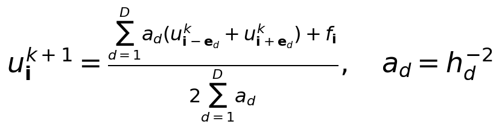

Here e_d is the unit grid direction. The right-hand side is precomputed. Two buffers ensure that every point reads only the previous sweep; both retain the physical boundary, and the read/write roles alternate after an entire update. The operator is applied without forming a sparse matrix.

### Work, storage and dependencies

A sweep costs Θ(N), K sweeps cost Θ(KN), and storage costs Θ(N). The main arrays occupy approximately 24∏(n_d+2) bytes in double precision, plus communication buffers and runtime overhead. Five/seven stencil neighbors give approximately 5N/7N operator nonzeros, but these are not explicitly stored. The problem size and operator size therefore grow together.

Within a sweep, point updates are independent when the old buffer is fixed. Across subdomains, adjacent old values are needed: the halo stores copies of neighboring ranks’ boundary faces. Physical boundaries are not communication targets, and a face stencil does not require diagonal corner exchange.

### Fixed work versus a converged solve

Performance runs do exactly K=1000 sweeps with no early stop or per-sweep residual reduction. Initial/final diagnostics are outside iteration timing. The numerical solve instead checks R_k=||f-A_hu^k||₂/||f-A_hu^0||₂ every ten sweeps and at the limit. Its main threshold is 1e-8; the accuracy study continues to 1e-10, with a 100000-sweep cap. An initially zero residual is already converged. Solve time includes its periodic checks; fixed-work iteration time does not.

## 2. Experimental design and validation

| Study | Platform / software | Measurement |
| --- | --- | --- |
| A serial/numerics | Vanda CN-161, Xeon Platinum 8452Y; GCC 12.2.0, C++17, -O2 | One pinned computational thread; 2D/3D serial scaling |
| B MPI/hybrid | Vanda Xeon Platinum 8452Y, 2×36 cores, SMT off; GCC 12.2.0, Open MPI 4.1.5, -O2 | P up to 288; actual hosts/core masks retained internally |
| C CPU/GPU | Vanda GN-A40-024; same CPU model + NVIDIA A40 (46068 MiB); NVHPC 24.7 / CUDA 12.3 / GCC 13.2 | CPU1/CPU12 and one actual GPU within a matched allocation |

Each performance configuration has one warmup and three measured fresh-start runs; order rotates between rounds. All valid samples are retained. A median and min/max range describe these observations, not a confidence interval. MPI reports the maximum rank duration after a barrier at the start. Iteration timing includes halo packing/exchange, local updates and required thread synchronization, but excludes initialization, final checks, collection and file output.

The primary MPI scaling cohort matches CPU model/topology and the approximately 512-GB host-memory family. The 72-core single-node hybrid cohort is reported separately with its own paired baseline. Node counts and shared-node load still vary, so only the documented observed scaling is claimed.

### Independent reference and transient checks

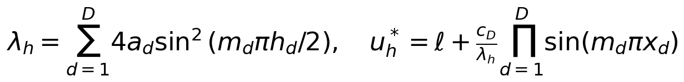

The linear term ℓ is annihilated by the stencil; m=(1,2) or (1,2,3), and c_D is 5π² or 14π². The exact discrete solution separates implementation error from continuous discretization error. Independent one/two-step formulas test directions, source coefficients and buffer parity before convergence can hide a defect.

| Purpose | Representative evidence | Result |
| --- | --- | --- |
| A mathematics | 2D 7×7 / 3D 7³ checks; 3D 15/31/63 grid study | Discrete error ≤2.78e-15 in small fixed-work checks; near order 2 |
| B halo / partition / threads | 7³ P1/P8, uneven 9×7×5 P8/T2, 2D P2/T2, thin domains and one-step oracle | All passed; maximum oracle error 7.55e-15 locally / 7.11e-15 on Vanda |
| B real multi-node | Corrected P8 verification on two physical hosts | Program-reported node count explicitly checked |
| C CPU / GPU / device | 18 small cases, six full-grid CPU/GPU pairs, actual target-device check | Maximum pairwise difference 0; boundary error 0; all GPU calls verified |

Large performance cases use finite diagnostics, boundary checks and cross-layout residual consistency; they are not all exported for pointwise comparison. C’s supplied status and numerical data pass re-audit, but an independent final PBS historical Exit_status is unavailable; it is not inferred from a run log.

## 3. Serial problem-size scaling

A fixes K=1000 on one pinned CPU, using five 2D sizes 256-4096 and five 3D sizes 16-256. Each configuration has three formal samples, with warmups excluded. Initialization, source generation and final residual/error calculations are outside timing.

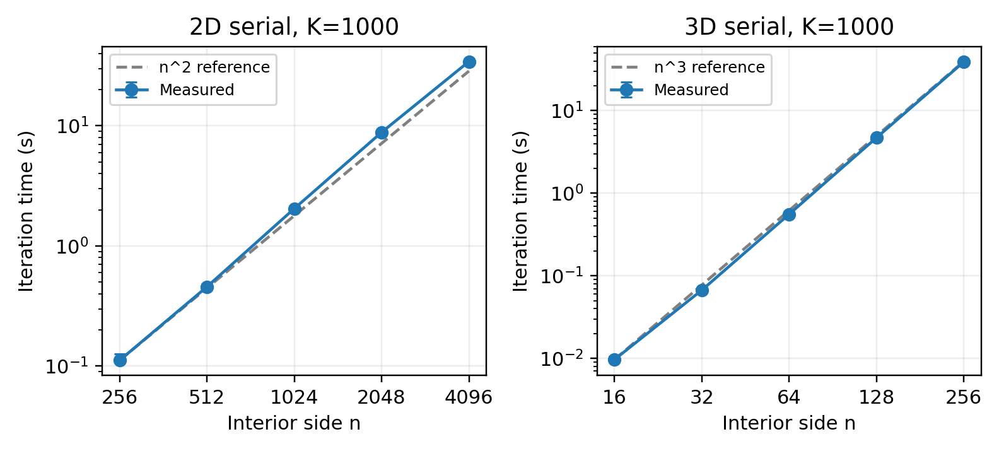

Figure 1. Serial iteration time versus interior side length. Both axes are logarithmic. Points are three-sample medians and bars show actual min/max. Reference slopes are 2 and 3, anchored at the smallest grid.

| D | n | Median [min, max] s | ns / point update |
| --- | --- | --- | --- |
| 2 | 256 | 0.111561 [0.111217, 0.125922] | 1.702 |
| 2 | 512 | 0.457194 [0.455617, 0.482564] | 1.744 |
| 2 | 1024 | 2.045982 [2.009691, 2.110084] | 1.951 |
| 2 | 2048 | 8.828188 [8.395645, 8.906398] | 2.105 |
| 2 | 4096 | 34.295781 [34.228360, 34.384209] | 2.044 |
| 3 | 16 | 0.009661 [0.009408, 0.010599] | 2.359 |
| 3 | 32 | 0.067011 [0.065273, 0.068193] | 2.045 |
| 3 | 64 | 0.557119 [0.548134, 0.557227] | 2.125 |
| 3 | 128 | 4.709857 [4.695788, 4.829070] | 2.246 |
| 3 | 256 | 39.009305 [38.969158, 39.195725] | 2.325 |

Endpoint exponents are 2.066 in 2D and 2.995 in 3D, close to Θ(n²) and Θ(n³) at fixed K. Larger 3D doublings cost approximately eight times as much. Normalized costs range about 1.70-2.10 ns (2D) and 2.05-2.36 ns (3D), so most growth follows point-update count. The remaining variation is compatible with memory-system effects, which were not isolated by counters or a bandwidth experiment.

## 4. Convergence, accuracy and baseline choice

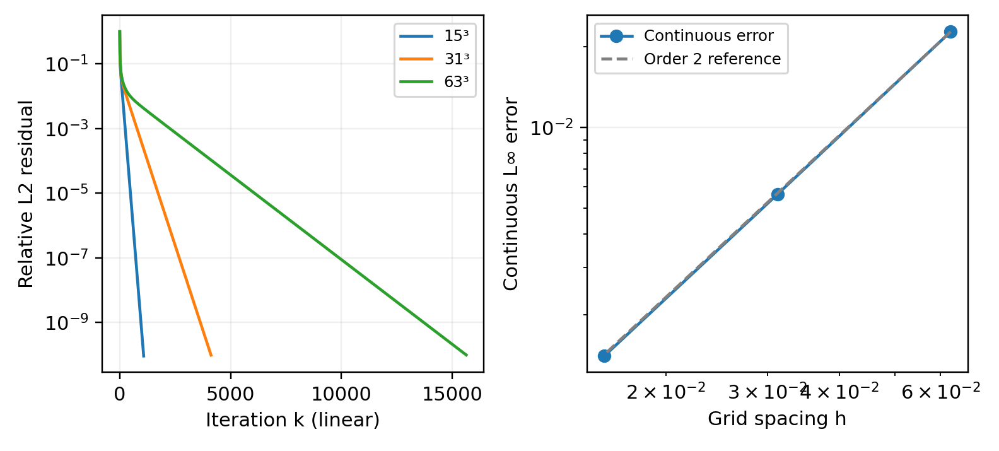

Figure 2. True relative residual histories (linear iteration axis, logarithmic residual axis) and continuous-solution error versus h (logarithmic axes). Each accuracy configuration was solved once to R≤1e-10; these are not repeated performance samples.

| Grid | First checked R≤1e-8 | Sweeps to R≤1e-10 | Continuous L∞ error | Order |
| --- | --- | --- | --- | --- |
| 15³ | 840 | 1080 | 0.0227631872 | - |
| 31³ | 3170 | 4120 | 0.00563935389 | 2.0131 |
| 63³ | 11820 | 15640 | 0.00140667331 | 2.0032 |

Halving h reduces continuous error by factors 4.0365 and 4.0090, consistent with second-order spatial accuracy. Errors against the exact discrete solution are much smaller (4.87e-9, 1.43e-8 and 4.03e-8). All physical boundary errors are zero.

At sweep 1000, R is about 4.38e-10, 3.42e-4 and 4.70e-3 on 15³/31³/63³. Only the first satisfies 1e-8. Historical 1024²/2048² Laplace cases similarly have R≈0.005 after 1000 sweeps. A fixed sweep count is a workload definition, not a universal accuracy target.

### Avoid an inappropriate serial baseline

A historical 2D controlled study found median 3.4964 s for the original serial loop, 1.7231 s for a row-local update-maximum reduction and 1.7469 s for MPI P1. Source, assembly and controlled timing support reduction-related code generation as the main explanation in that setting, rather than multi-process speedup at one rank. Current MPI speedups use their own MPI P1 baseline; C’s CPU/GPU ratios use C’s own matched CPU baselines. Separate numerical studies and compiler stacks are not pooled.

## 5. MPI partitioning and strong-scaling time

Nonperiodic Cartesian block decomposition supports quotient/remainder ownership in each axis and nondivisible global meshes. Ranks initialize from global coordinates and retain only their local interior plus a one-cell halo. Each axis uses two blocking MPI_Sendrecv calls over explicitly packed faces. Final residual evaluation refreshes the halo after the timed sweep loop.

Pure MPI is compiled without OpenMP. Rank counts are 1/12/36/72/144/288 for 128³ and 256³, and 72/144/288 for 512³. Allocation and process-grid details accompany the numeric input; no CPU oversubscription is enabled. Supplementary measurements record actual OS affinity masks before entering the solver, outside timing.

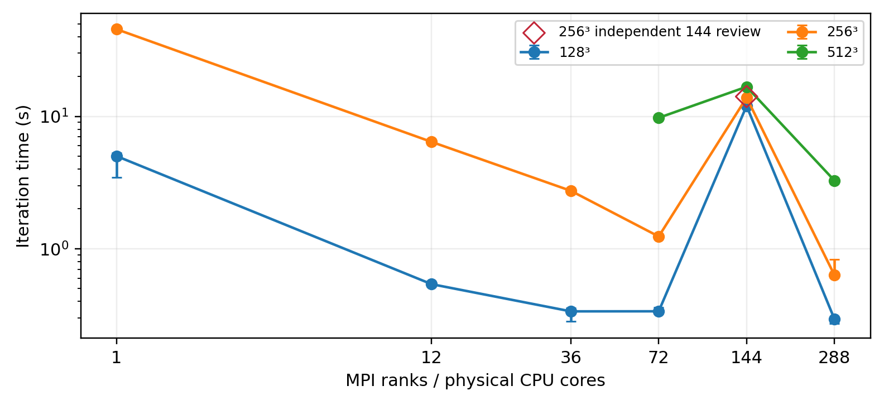

Figure 3. Strong-scaling iteration time, K=1000. All successful original 144-core samples remain in the main curve; an independently measured review point, when available, is shown separately. Error bars are min/max of three samples.

| Grid | P | Nodes | Median [min, max] s |
| --- | --- | --- | --- |
| 128³ | 1 | 1 | 5.010988 [3.475797, 5.284572] |
| 128³ | 72 | 3 | 0.337059 [0.323515, 0.360066] |
| 128³ | 144 | 4 | 11.993227 [11.878013, 14.063329] |
| 128³ | 288 | 9 | 0.294310 [0.272605, 0.294635] |
| 256³ | 1 | 1 | 45.525023 [43.850254, 46.184745] |
| 256³ | 72 | 3 | 1.238393 [1.197306, 1.246759] |
| 256³ | 144 | 4 | 13.854904 [12.601303, 14.110585] |
| 256³ | 288 | 9 | 0.632244 [0.625122, 0.829822] |
| 512³ | 72 | 3 | 9.755425 [9.514348, 9.936389] |
| 512³ | 144 | 4 | 16.727098 [16.041335, 17.107095] |
| 512³ | 288 | 9 | 3.273120 [3.271394, 3.274035] |

## 6. Strong-scaling speedup and efficiency

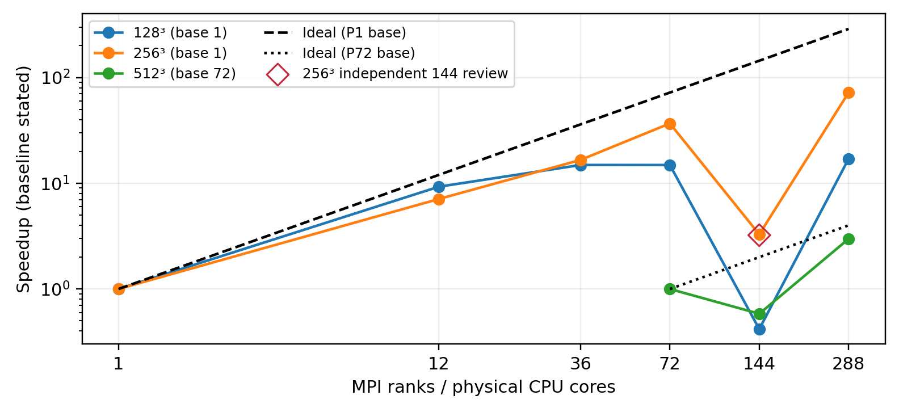

Figure 4. Speedup S=T1/TP for 128³/256³. The 512³ series instead uses S72=T72/TP, with a separate ideal reference. CPU-core axes and speedup are logarithmic.

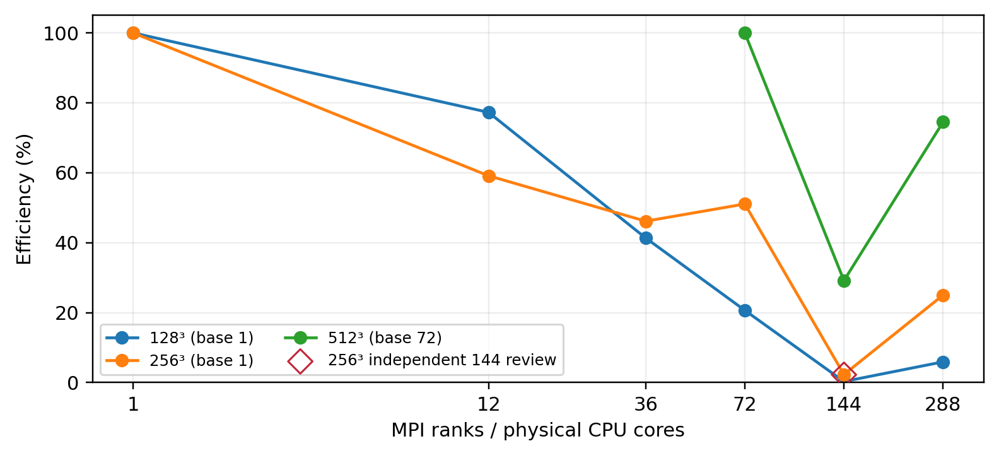

Figure 5. Efficiency E=S/P; for 512³ use E72=S72/(P/72). The core axis is logarithmic and efficiency is a linear percentage. These two baseline definitions are explicitly distinguished.

At 288 cores, 256³ has speedup 72.005 and efficiency 25.00%; 128³ has speedup 17.026 and efficiency 5.91%. Smaller local domains expose communication and synchronization overhead sooner. The curves do not establish a universal best rank count across system states.

## 7. Weak scaling and fixed local work

Weak scaling fixes each rank’s interior at 64³ points. Process grids at P=1/8/72/144/288 are 1×1×1, 2×2×2, 6×4×3, 6×6×4 and 8×6×6. The global grid changes with P; the physical domain remains the unit cube, so mesh spacing and the discrete equation change. The controlled quantity is point-update work per rank, not precision or a fixed convergence problem.

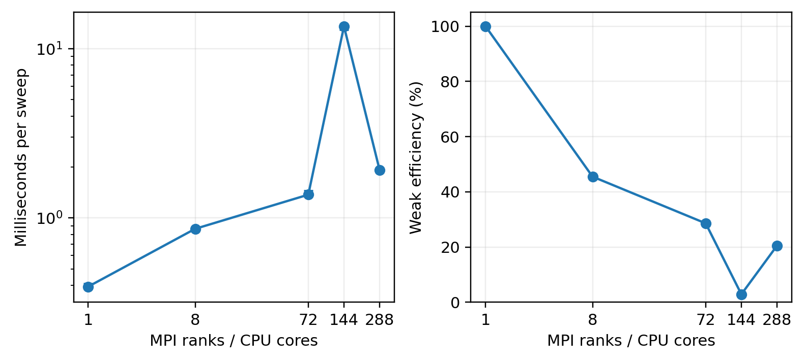

Figure 6. Weak time per sweep and efficiency Ew=Tweak,1/Tweak,P, without an additional division by P. Time and core axes are logarithmic; efficiency is linear in percent. Bars show observed min/max.

| P | Global interior grid | Nodes | ms / sweep | Ew |
| --- | --- | --- | --- | --- |
| 1 | 64×64×64 | 1 | 0.392329 | 100.00% |
| 8 | 128×128×128 | 1 | 0.862284 | 45.50% |
| 72 | 384×256×192 | 3 | 1.372183 | 28.59% |
| 144 | 384×384×256 | 4 | 13.575610 | 2.89% |
| 288 | 512×384×384 | 9 | 1.911628 | 20.52% |

Fixed local point count does not give constant runtime. Neighbor counts, cross-node traffic, contention, cache sharing and scheduling can change. The 144-core slowdown occurs in both strong and weak results and is retained; more cores do not by themselves explain the nonmonotonic observation.

### Sampling scope

Independent review measurements are kept separate from the main three-sample series. A resource/startup failure produces no accepted time; earlier successful samples are retained, and only missing samples may be supplemented with matching workload/hardware and clear provenance. A later startup failure does not justify deleting a valid slow observation.

## 8. Communication model and rank diagnostics

For an interior 3D local domain lx×ly×lz with six neighbors, outgoing face data per sweep are Vsend=8(2lylz+2lxlz+2lxly) bytes. Subtract absent physical-neighbor faces. This counts sent bytes once; receives have equal volume. A qualitative model is Titer≈γlxlylz+αm+βVsend+Tpack+Tsync, where m is outgoing message count. Parameters are explanatory, not fitted network microbenchmarks.

Under strong scaling, local volume falls approximately as N/P while near-cubic face area falls as (N/P)^(2/3); relative communication exposure grows. Weak scaling keeps face dimensions approximately fixed, but node/neighbor structure and contention still change.

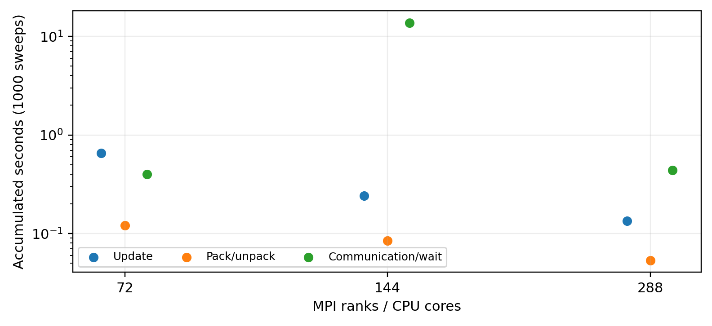

Figure 7. One separate K=1000 diagnostic per point. Major phases all come from the rank with maximum total duration. The y-axis is logarithmic. Communication includes waiting and is not pure transmission time.

| P | Total s | Update s | Pack s | Comm/wait s | Wait share |
| --- | --- | --- | --- | --- | --- |
| 72 | 1.172958 | 0.651368 | 0.120575 | 0.399991 | 34.10% |
| 144 | 14.042913 | 0.240497 | 0.084609 | 13.716785 | 97.68% |
| 288 | 0.628623 | 0.134376 | 0.053438 | 0.439661 | 69.94% |

Do not add independent phase maxima from different ranks. Rank-total ranges and residual uninstrumented time remain in the CSV. No per-sweep diagnostic barrier is added; timer overhead exists. The large 144-core communication/wait interval locates the observed loss in waiting rather than a correspondingly larger local update phase, but it does not identify a unique network or scheduling cause.

A separate 144-core allocation with a partially different host set gives 256³ median 14.113334 s, range [13.825400, 14.342317] s. This review is not pooled with the original series or substituted for it. Matching rank count does not isolate node placement or system load.

## 9. MPI+OpenMP at equal total cores

The hybrid executable checks MPI_THREAD_FUNNELED and calls MPI only on the initializing thread. Static OpenMP work sharing updates the local subdomain. A thread region is entered each sweep, so team entry and synchronization are timed. Reducing ranks also changes subdomains, messages and memory sharing.

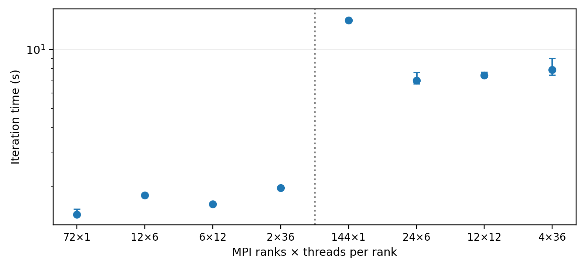

Figure 8. Matched 256³, K=1000 layouts at 72 and 144 total cores. Compare within the allocation groups, separated by the vertical line. References are paired pure-MPI controls, not unrelated scaling points.

| Total C | P×T | Nodes | Median [min, max] s | MPI / hybrid gain |
| --- | --- | --- | --- | --- |
| 72 | 72×1 | 1 | 1.441737 [1.437858, 1.544236] | 1.000 |
| 72 | 12×6 | 1 | 1.812523 [1.804147, 1.853521] | 0.795 |
| 72 | 6×12 | 1 | 1.628238 [1.614789, 1.628980] | 0.885 |
| 72 | 2×36 | 1 | 1.973561 [1.972097, 2.014452] | 0.731 |
| 144 | 144×1 | 4 | 14.113334 [13.825400, 14.342317] | 1.000 |
| 144 | 24×6 | 4 | 6.957972 [6.698904, 7.652053] | 2.028 |
| 144 | 12×12 | 4 | 7.393277 [7.245681, 7.698748] | 1.909 |
| 144 | 4×36 | 4 | 7.874100 [7.437435, 9.007569] | 1.792 |

Gain G=Tpaired MPI(C)/Thybrid(P,T), with C=P×T; no extra P/T factor is used. Pure-MPI controls have gain one. The eight paired configurations contribute 24 formal samples. Together with 20 scaling configurations, the report uses 84 formal samples; diagnostics are separate.

At 72 cores on one host, all mixed layouts are slower. In the explicitly controlled four-host 144-core review allocation, gains are about 1.79-2.03 and all hybrid timing ranges lie below the paired MPI range. This contrast is specific to the tested allocations, not a universal hybrid advantage.

The earlier 144-core hybrid observations remain in the legacy cohort. The review explicitly propagates OpenMP settings to remote ranks and records OS affinity masks, while placement and system state also change. Differences between cohorts cannot be assigned to affinity alone. Whole-allocation PE=36 cases are verified by actual mask sizes and nonoverlap.

## 10. OpenMP target design and timing scopes

The CPU backend creates a persistent OpenMP parallel region around all sweeps, using static collapse(3) and a sweep barrier. Iteration parity selects old/new buffers. C’s CPU region design differs from B’s per-sweep thread-region entry, so cross-implementation time ratios are not silently used as speedups.

The GPU backend maps both solution buffers and the right-hand side once and retains them through K synchronous target regions. A teams/distribute/parallel-for stencil covers interior points. No nowait is used; completion precedes the next sweep. Only the final solution is copied back, after which diagnostics are computed on the host.

| GPU safeguard / build | Evidence and meaning |
| --- | --- |
| Actual device | omp_get_num_devices()>0 and omp_is_initial_device() false inside the first stencil target; all GPU samples gpu_verified=true |
| No host fallback | OMP_TARGET_OFFLOAD=MANDATORY in the runner |
| NVHPC workaround | Separate C++ host (-mp=multicore) and C target (-mp=gpu), followed by GPU-enabled link; GCC toolchain selection retained |
| Mapping scope | Arrays resident for all 1000 sweeps; no claim of an optimal teams/thread configuration |

### Three different intervals

| Metric | Includes | Excludes |
| --- | --- | --- |
| CPU iteration | K sweeps, thread entry and sweep synchronization | Host initialization, final checks, output |
| GPU resident | K target launches and completion after data is resident | Data-region setup/transfer; final host checks |
| GPU end-to-end | Device data allocation/mapping, transfer, K sweeps, final copyback and exit | Host mathematical initialization and final diagnostics / output |

GPU end-to-end means the solver device-data-region interval, not complete command walltime. Resident is not a pure device-event kernel-only measurement. Both GPU intervals come from one invocation; differences include several operations and cannot isolate PCIe transfer time.

## 11. CPU/GPU runtime results

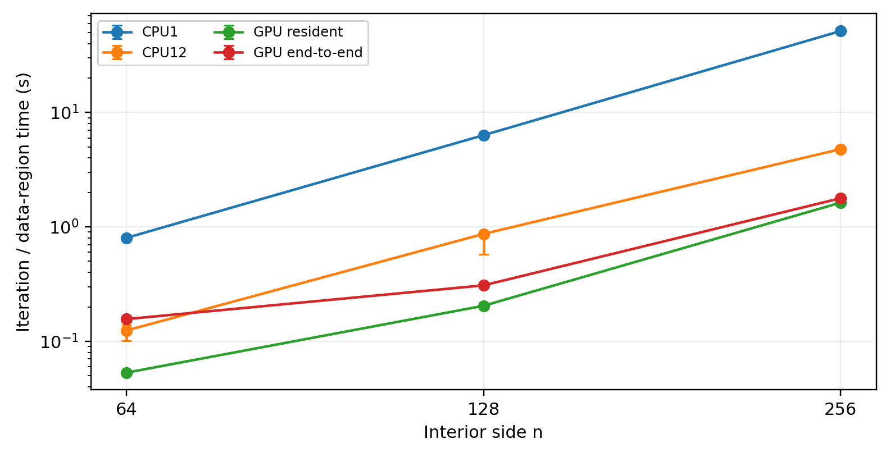

Figure 9. Vanda A40 and its matched CPU baselines, K=1000. Medians of three formal runs; bars are actual min/max, warmups excluded. Both axes are logarithmic. CPU1/CPU12 and GPU run within the same allocation.

| Grid | CPU1 s | CPU12 s | Resident s | End-to-end s |
| --- | --- | --- | --- | --- |
| 64³ | 0.802221 | 0.124330 | 0.053188 | 0.156299 |
| 128³ | 6.330078 | 0.867985 | 0.204269 | 0.308162 |
| 256³ | 51.450687 | 4.783182 | 1.627774 | 1.779479 |

CPU12 speedups at 64³/128³/256³ are 6.452/7.293/10.757, with efficiencies 53.77%/60.77%/89.64%. This compares only one and twelve threads; it does not establish a full CPU thread-scaling curve or an optimum thread count.

CPU12 at 128³ ranges from 0.572921 to 0.870379 s; all samples remain. The large-grid residuals after 1000 sweeps are approximately 0.0047745, 0.00626234 and 0.00666474, so the timings do not represent equal converged accuracy. Small-grid full-array identity is not extrapolated to every large performance grid.

## 12. GPU speedup and overhead interpretation

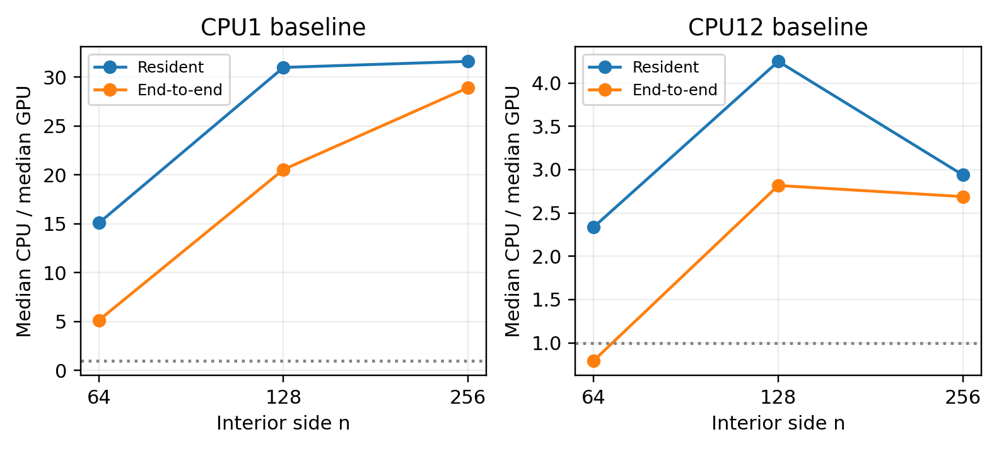

Figure 10. Ratios of medians, with CPU1 (left) or CPU12 (right) as numerator. Above one means GPU is faster. Size axes are logarithmic; speedup axes are linear with separate scales. No paired confidence interval is implied.

| Grid | CPU1 / resident | CPU1 / E2E | CPU12 / resident | CPU12 / E2E |
| --- | --- | --- | --- | --- |
| 64³ | 15.083 | 5.133 | 2.338 | 0.795 |
| 128³ | 30.989 | 20.541 | 4.249 | 2.817 |
| 256³ | 31.608 | 28.913 | 2.938 | 2.688 |

The table labels name the GPU scope and CPU baseline; entries are CPU-time/GPU-time, not the inverse. At 64³, resident GPU is faster than CPU12 but end-to-end GPU is slower (0.795×). At 128³ and 256³, end-to-end speedups against CPU12 are 2.817× and 2.688×. The exact crossover size was not measured.

Resident speedup against CPU12 is not monotonic: 2.338×, 4.249×, 2.938×. The difference of end-to-end and resident medians is about 0.1031, 0.1039 and 0.1517 s, approximately 66.0%, 33.7% and 8.5% of the end-to-end medians. Relative data-region overhead falls with size, but that difference aggregates allocation, mapping, transfers and release. GPU efficiency is not defined by treating an accelerator as a CPU core count.

## 13. Overall design discussion and limitations

MPI expresses distributed ownership and halo dependencies, OpenMP shares a rank’s CPU work, and target offload explicitly maps arrays to a different device memory space. They address different costs: inter-rank face messages, thread synchronization and shared-memory locality, and host/device movement plus kernel launch. Keeping device data resident removes repeated transfers without removing synchronization or launch overhead.

Strong scaling reduces work per rank until communication/wait and synchronization become relatively expensive. Weak scaling holds local updates fixed but cannot hold network state, neighbor structure and memory contention fixed. The measured 144-core waiting anomaly is reported with an independent review and rank-phase evidence rather than assigned a speculative root cause. A synthetic MMS problem supports correctness and complexity claims; it does not support conclusions about a real dataset.

A hybrid layout changes rank count and thread count together. Equal-total-core comparisons use paired pure-MPI baselines in the same allocation. A benefit or loss therefore cannot be attributed solely to OpenMP without further profiling. CPU/GPU comparisons similarly stay within C’s allocation and compiler stack; a B CPU time is not divided by a C GPU time and presented as a controlled speedup.

### Boundaries of the evidence

| Limitation | Consequence |
| --- | --- |
| Three formal samples | Min/max show observed variability, not confidence bounds or guaranteed ordering |
| Shared cluster and node transitions | Some differences can reflect scheduling, fabric/topology or shared memory-system conditions |
| Memory family / hybrid cohort | The primary scaling cohort and paired hybrid cohorts are labelled separately; unlike machines are not silently pooled |
| Instrumented phase samples | One run per point, timers add cost; blocking wait is not pure network transfer |
| Fixed K | Residual accuracy differs with grid size; numerical-study convergence is separate |
| C scheduler provenance | Supplied samples/device/validation/status checked; independent final PBS Exit_status not available |
| Optional high-core queue | 432/720-core points are omitted until successful execution; >=256-core evidence uses actual 288-core runs |

## 14. Reproduction and AI assistance

### Build and representative correctness checks

A numerical route: make numerics. Fixed-size scaling uses a_scaling_20261104/jacobi_a_scaling.cpp with GCC/C++17/-O2 and the supplied PBS/runner. B route: source b_mpi/runtime_modules.sh on a Vanda compute node and run make b-mpi; verify_b.py checks the representative cases. C CPU/GPU route: bash c_openmp/build.sh nvidia under the supplied NVHPC module configuration, then use run_c.py and make_job.py. Compilation and numerical work run on compute allocations, not login nodes.

The source package README gives exact representative arguments and plotting commands. The concise CSV inputs regenerate every report plot using closeout/plot_report.py. Raw command output, stderr, qstat, executables and full job archives are internal evidence and are excluded from the course source package. The original B cohort is retained internally; the matched-memory scaling cohort and the independent 144 review are explicitly selected rather than pooled.

### AI assistance

ChatGPT/Codex assisted with implementation, independent checks, experiment scripts, cluster execution after the user authenticated, numerical auditing, plotting and English drafting. Tool execution and generated output do not establish a member’s personal understanding or authorship. Human members remain responsible for reviewing the mathematics, code, findings and final course submission. Names, student IDs and personal contribution statements are intentionally not supplied in this review edition at the user’s request.

### Evidence and references

The mathematical derivations are given in Sections 1-2. Numerical inputs are the supplied A convergence/serial summaries, B per-run audited records and cohort summaries, and C’s formal samples/environment/validation summaries. The course project specification is transcribed in docs/PROJECT_REQUIREMENTS.md. The source package contains the actual implementations and reproduction scripts; no unavailable lecture slide or scheduler record is claimed to have been independently inspected.

Before course upload, members must add their identification and actual contribution/AI declarations, review their assigned code and explanations, and confirm the Canvas deadline. This work prepares the technical review PDF and a source/figure/CSV whitelist; it does not upload to Canvas or send messages on behalf of members.

