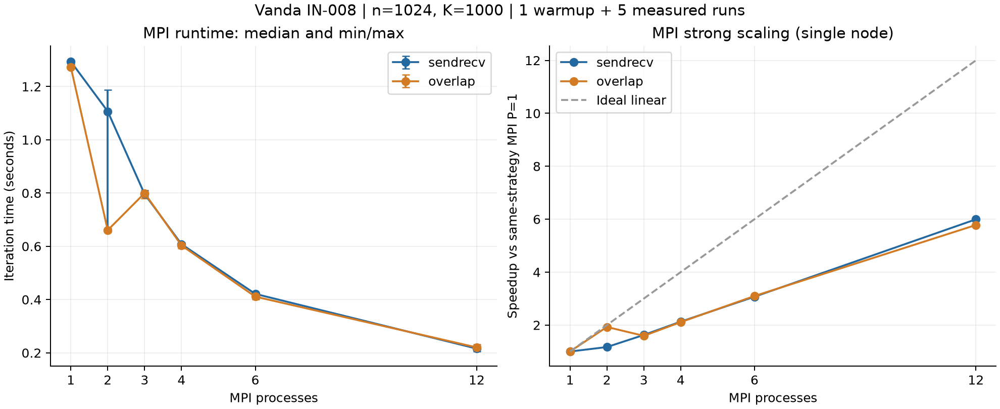
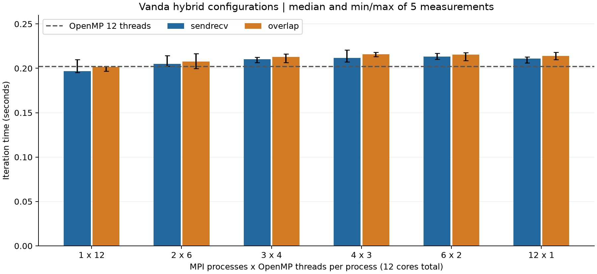

# 成员 B：Vanda 实验分析与交接

日期：2026-10-27。此文为 B 的实验材料与报告章节草稿，不是含组员姓名学号的最终提交 PDF。

## 完成与证据

Vanda 作业 `1498804.stdct-mgmt-02` 在 IN-008 节点执行，PBS 最终 `job_state=F`、`Exit_status=0`，日志 `RUN_STATUS=PASSED`、`JOB_EXIT_STATUS=0`。278 次验证执行通过；26 组性能配置各预热 1 次、测量 5 次，共 156 次性能执行。已逐项核对原始 JSON、重算中位数/min/max，并核对归档源码及 Linux 可执行文件 SHA-256。原始压缩包保留不改，审计记录为 `audit.json`。

资源为单节点 12 CPU、4GB、30 分钟上限，作业实际 walltime 6 分钟。模块为 GCC 12.2.0、Open MPI 4.1.5、Python 3.10.8，C++17、-O2、-Wall -Wextra -Wpedantic，OpenMP 构建另加 -fopenmp。当前记录未采集 lscpu，不能推断 CPU 型号、缓存容量或主频。

## 算法与设计

二维 Laplace 的 Jacobi 五点更新；单位正方形，double，边界/精确解 u=x+y，内部初值 0。MPI 按行分区，前 n%P 个进程多一行，每个进程保留本地行及两个 halo。P>n 明确拒绝。OpenMP 静态分配本地更新循环，以 max reduction 汇总局部更新量。主线程执行 MPI，混合版使用 MPI_THREAD_FUNNELED。

sendrecv 使用两次 MPI_Sendrecv；overlap 先发起非阻塞收发，更新不依赖 halo 的内部行，等待通信完成后更新首末行。old/new 双数组避免读取本轮新值。正容差模式每轮汇总全局最大更新量统一停止；固定轮数模式只在最后一轮归约该指标，两种通信策略口径相同。最终重新交换 halo 再计算残差，误差/残差/边界指标取全局最大值，小网格由 rank 0 收集完整网格输出。

## 正确性验证

验证包含手算 n=1/2、n=7 奇数网格的 1/2/31 轮、n=8 固定轮数、n=16/31/32 收敛、耗尽迭代上限、每进程一行/两行/三行及非法输入。不同可行进程数 1/2/3/4、混合版线程数 1/2、两种通信方式均与串行指标及独立 Python 小网格参考比较。n<=8 检查完整网格形状和最大绝对差<=1e-12；小规模收敛真误差<=1e-8、残差<=1e-7，边界误差<=1e-14。278 次执行包括预期非法输入失败；不是 278 个不同数学问题。

## 实验口径

本次性能问题固定为 n=1024、K=1000、tolerance=0，即 1024×1024 内部点、严格迭代 1000 轮，不宣称解已收敛。初始化和最终验证不计入迭代时间；MPI 计时包含 halo 通信、需要的归约与线程同步，取最慢 rank 耗时，排队/编译时间不计入。每组记录 5 次及 min/max，min/max 不是置信区间。

相对串行总加速比为 S_serial=T_serial/T_config，效率为 S_serial/(P×T)。该指标包含实现、编译效果与并行等全部差异。另计算相同通信策略的 MPI 强扩展 S_MPI(P)=T_MPI(1)/T_MPI(P)，效率 S_MPI(P)/P，以区分 MPI 版本自身的单进程差异。

## 全部运行数据

| 版本 | P×T | 通信 | 中位秒数 | min–max 秒数 | 相对串行加速比 | 相对串行效率 |
|---|---|---|---:|---:|---:|---:|
| serial | 1×1 | none | 2.653333 | 2.652524–2.906314 | 1.000 | 100.0% |
| mpi | 1×1 | sendrecv | 1.293866 | 1.283230–1.298246 | 2.051 | 205.1% |
| mpi | 1×1 | overlap | 1.273339 | 1.268828–1.282436 | 2.084 | 208.4% |
| mpi | 2×1 | sendrecv | 1.106782 | 0.664464–1.187305 | 2.397 | 119.9% |
| mpi | 2×1 | overlap | 0.660491 | 0.652982–0.667356 | 4.017 | 200.9% |
| mpi | 3×1 | sendrecv | 0.796026 | 0.788032–0.810191 | 3.333 | 111.1% |
| mpi | 3×1 | overlap | 0.799649 | 0.778821–0.806979 | 3.318 | 110.6% |
| mpi | 4×1 | sendrecv | 0.607945 | 0.603080–0.611122 | 4.364 | 109.1% |
| mpi | 4×1 | overlap | 0.603213 | 0.592417–0.613834 | 4.399 | 110.0% |
| mpi | 6×1 | sendrecv | 0.421349 | 0.405231–0.422843 | 6.297 | 105.0% |
| mpi | 6×1 | overlap | 0.411059 | 0.399658–0.418163 | 6.455 | 107.6% |
| mpi | 12×1 | sendrecv | 0.215857 | 0.204950–0.226783 | 12.292 | 102.4% |
| mpi | 12×1 | overlap | 0.220319 | 0.213532–0.232312 | 12.043 | 100.4% |
| openmp | 1×12 | none | 0.202181 | 0.197087–0.204198 | 13.124 | 109.4% |
| hybrid | 1×12 | sendrecv | 0.196799 | 0.195336–0.209764 | 13.482 | 112.4% |
| hybrid | 1×12 | overlap | 0.201575 | 0.196962–0.202143 | 13.163 | 109.7% |
| hybrid | 2×6 | sendrecv | 0.205024 | 0.202576–0.214398 | 12.942 | 107.8% |
| hybrid | 2×6 | overlap | 0.207793 | 0.199661–0.216483 | 12.769 | 106.4% |
| hybrid | 3×4 | sendrecv | 0.210324 | 0.206459–0.212469 | 12.615 | 105.1% |
| hybrid | 3×4 | overlap | 0.212965 | 0.206404–0.216193 | 12.459 | 103.8% |
| hybrid | 4×3 | sendrecv | 0.211763 | 0.207128–0.220789 | 12.530 | 104.4% |
| hybrid | 4×3 | overlap | 0.215857 | 0.213044–0.217973 | 12.292 | 102.4% |
| hybrid | 6×2 | sendrecv | 0.213256 | 0.210351–0.216851 | 12.442 | 103.7% |
| hybrid | 6×2 | overlap | 0.215444 | 0.208886–0.217586 | 12.316 | 102.6% |
| hybrid | 12×1 | sendrecv | 0.210878 | 0.206309–0.212733 | 12.582 | 104.9% |
| hybrid | 12×1 | overlap | 0.213816 | 0.209693–0.218225 | 12.409 | 103.4% |

## MPI 自身的强扩展

| 进程数 | 通信 | 相对同策略 MPI 单进程加速比 | 效率 |
|---:|---|---:|---:|
| 1 | sendrecv | 1.000 | 100.0% |
| 1 | overlap | 1.000 | 100.0% |
| 2 | sendrecv | 1.169 | 58.5% |
| 2 | overlap | 1.928 | 96.4% |
| 3 | sendrecv | 1.625 | 54.2% |
| 3 | overlap | 1.592 | 53.1% |
| 4 | sendrecv | 2.128 | 53.2% |
| 4 | overlap | 2.111 | 52.8% |
| 6 | sendrecv | 3.071 | 51.2% |
| 6 | overlap | 3.098 | 51.6% |
| 12 | sendrecv | 5.994 | 50.0% |
| 12 | overlap | 5.780 | 48.2% |

## 可以支持的结论

1. 串行中位数 2.653333 秒，MPI 单进程 sendrecv 为 1.293866 秒、overlap 为 1.273339 秒。一个 MPI 进程就有约 2 倍差异，不能归因为多个进程并行。两份实现虽求解同一问题且匹配数值，但当前记录不足以确定差异来自代码生成、绑定、缓存、频率还是系统负载。
2. MPI 从 1 到 12 进程，sendrecv 加速 5.994 倍、效率 49.95%；overlap 加速 5.780 倍、效率 48.16%。这是同一实现基准下的单节点强扩展结果。
3. 在本次固定 12 核配置中，hybrid 1×12 sendrecv 的观测中位数最低，为 0.196799 秒；与串行相比 13.482 倍。该配置只有一个 MPI 进程，不能用它证明跨进程或跨节点通信性能。2×6、4×3 等配置使用多个进程，但本次均未更快。
4. 相对串行效率超过 100% 是原始数值计算结果，应如实保留，不应截成 100%。由于单进程 MPI 基准已明显不同，不能将其直接解读为并行效率超过理想线性扩展，也不能认定缓存导致超线性加速。
5. overlap 没有普遍优于 sendrecv。MPI 2 进程这一组 sendrecv 的 5 次时间为 1.179913、1.187305、1.106782、0.668077、0.664464 秒，波动很大；overlap 的优势可能混合了运行环境/时间顺序影响，需要重测后才能解释。固定 12 核混合配置的 sendrecv 中位数均略低于 overlap，但不少范围重叠，不作显著性结论。

## 核心绑定与环境限制

MPI 命令使用 `--map-by slot:PE=T --bind-to core --report-bindings`，OpenMP 使用 OMP_NUM_THREADS=T、OMP_PLACES=cores、OMP_PROC_BIND=close。4×3 的 MPI 日志显示四个 rank 分别绑定到可见的 0–2、3–5、6–8、9–11 核，12×1 显示逐核分配。1×12 日志称 rank 未绑定或绑定到所有可用处理器：这不足以单独证明越界，也不能据此宣称线程级 affinity 已验证。原始记录没有逐线程掩码或完整 cpuset/topology，后续应补采。

MPI stderr 还提示 `libpbs.so.0` 找不到，PBS TM 的 plm/ras 组件被忽略。作业及数值检查确实通过，但当前日志不能证明调度器集成完整，也不能证明多节点启动可用。需在计算节点核对 PBS 库路径/站点 MPI 使用建议，避免仅隐藏警告。单节点成功不能替代多节点验收。

配置按固定顺序执行而非随机交错；只有一个问题规模、一个节点、一次 PBS 分配，未完成弱扩展、多节点扩展或独立重复作业。报告只应据此描述本次单节点结果。

## 交接与下一步

B 的 MPI/混合实现、数值验证、Vanda 首次成功作业、原始性能证据和设计说明已具备。A 可使用本材料完善验证与算法章节；C 可审阅线程管理、优化持久并行区域，并补充其他规模的实验。本人接口确认、代码理解和最终小组报告审阅不能由 AI 代替。

为了形成更可靠的性能结论，下一轮优先：采集 lscpu/cpuset/实际线程 affinity；核对 PBS 库警告；加上 hybrid 1×1 与 OpenMP 1 线程对照，分析单进程差异；交错/重复测试波动组；再增加 n=512/2048。多节点/弱扩展按时间和课程预期另行设计，不将当前结果写成已经完成。

## AI 使用说明

OpenAI Codex 协助编写 MPI/混合代码、验证和计时脚本、PBS 模板、操作教程及本分析；执行本机验证并审计下载的原始结果。用户本人完成 VPN、学校账号认证、现场环境查询、上传、提交 Vanda 作业和结果下载。AI 没有直接登录集群，也未代替成员本人确认或理解代码。归档源码与证据用于复核，最终报告应由成员检查并补充实际修改记录。

## 图表

