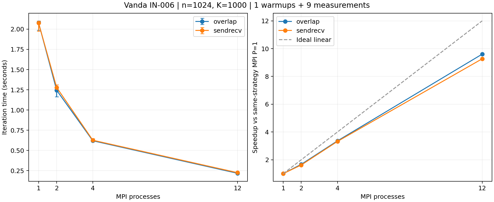

# A/B 集群实验核对

生成日期：2026-10-27（UTC）。此文件是当前作业的数据摘要，人工因果分析和阶段报告需另行审阅。

## 当前证据

集群：Vanda；作业：`1499881.stdct-mgmt-02`；记录主机：`IN-006`。
分配 CPU 数：12；并行输出记录的节点数：1。
完整原始目录的 PBS 完成状态、退出码、源码/程序哈希及逐次 JSON 已核对。
硬件型号、内存、walltime、模块与 flags 以原始 metadata.txt、qstat_full.txt 和构建日志为准，本摘要不推断未采集的信息。

## 正确性记录

共 92 次验证执行，其中 88 次含数值结果，4 次为预期非法输入拒绝测试；网格规模 n 包括 1, 2, 4, 7, 8, 12, 16, 31, 32。
验证器状态为 PASS，逐次数值 JSON 已与汇总核对。执行次数不等于不同数学问题数；本审计不代替验证器中的数值验收。

## 性能口径

n=1024，K=1000，tolerance=0；固定迭代工作量，不宣称收敛。
9 组配置，各预热 1 次、测量 9 次，共 90 次执行。
串行基准源码：`jacobi_serial_row_update.cpp`；运行顺序：`interleaved`。
显式CPU映射：`[25, 27, 29, 31, 33, 41, 43, 47, 51, 57, 59, 61]`；空列表表示未由本脚本记录显式映射，需查原始绑定日志。
计时为迭代阶段，MPI 含必要通信/同步并取最慢 rank；初始化、最终检查与输出不计入。
报告中位数和 min/max，min/max 不是置信区间。运行顺序和绑定方式应结合逐次命令审阅。

| 版本 | PxT | 通信 | 中位秒数 | min-max 秒数 | 相对串行加速比 | 相对串行效率 |
|---|---|---|---:|---:|---:|---:|
| serial | 1x1 | none | 2.066070 | 1.947887-2.081919 | 1.000 | 100.0% |
| mpi | 1x1 | sendrecv | 2.078345 | 1.975088-2.102839 | 0.994 | 99.4% |
| mpi | 1x1 | overlap | 2.081533 | 1.987628-2.096484 | 0.993 | 99.3% |
| mpi | 2x1 | sendrecv | 1.278700 | 1.237888-1.311958 | 1.616 | 80.8% |
| mpi | 2x1 | overlap | 1.244289 | 1.162906-1.282899 | 1.660 | 83.0% |
| mpi | 4x1 | sendrecv | 0.625749 | 0.614977-0.643781 | 3.302 | 82.5% |
| mpi | 4x1 | overlap | 0.619289 | 0.608202-0.631594 | 3.336 | 83.4% |
| mpi | 12x1 | sendrecv | 0.224262 | 0.218638-0.231805 | 9.213 | 76.8% |
| mpi | 12x1 | overlap | 0.216749 | 0.212211-0.233082 | 9.532 | 79.4% |

## 同策略 MPI 单进程基准

S(P)=T_MPI(1)/T_MPI(P)，E(P)=S(P)/P。缺少对应 P=1 时不推算此指标。

| 进程数 | 通信 | 相对 MPI P=1 加速比 | 效率 |
|---:|---|---:|---:|
| 1 | sendrecv | 1.000 | 100.0% |
| 1 | overlap | 1.000 | 100.0% |
| 2 | sendrecv | 1.625 | 81.3% |
| 2 | overlap | 1.673 | 83.6% |
| 4 | sendrecv | 3.321 | 83.0% |
| 4 | overlap | 3.361 | 84.0% |
| 12 | sendrecv | 9.267 | 77.2% |
| 12 | overlap | 9.603 | 80.0% |

## 本次观测

- MPI P=1 (sendrecv) 为 2.078345 秒，相对原串行为 0.994 倍；该差异不能归因于多进程并行。
- MPI P=1 (overlap) 为 2.081533 秒，相对原串行为 0.993 倍；该差异不能归因于多进程并行。
- overlap 在本次最大 P=12 时，相对同策略 MPI P=1 加速 9.603 倍，效率 80.0%。
- sendrecv 在本次最大 P=12 时，相对同策略 MPI P=1 加速 9.267 倍，效率 77.2%。
- 本次使用 12 核的已测配置中，观测中位数最低的是 mpi 12x1 overlap，为 0.216749 秒；此处不作统计显著性结论。
- 原串行中位数为 2.066070 秒。相对串行加速比包含实现和编译效果差异；不据此单独判断超线性扩展。

单个作业、单一规模不支持跨规模稳定性结论。非阻塞 API 的使用不证明通信已有效重叠；通信方案的优势与差异原因需结合重复实验分析。

## 环境警告

- libpbs.so.0 unavailable; MPI PBS TM components were ignored

完整原始目录须单独保留以供复核。当前摘要不自动确认线程 affinity、PBS 多节点集成、个人代码理解或组员接口确认。

AI 使用：Codex 协助编写核对工具和当前数据摘要；集群操作、源码修改、人工复核等实际贡献应在阶段报告中据实补充。

## 图表

