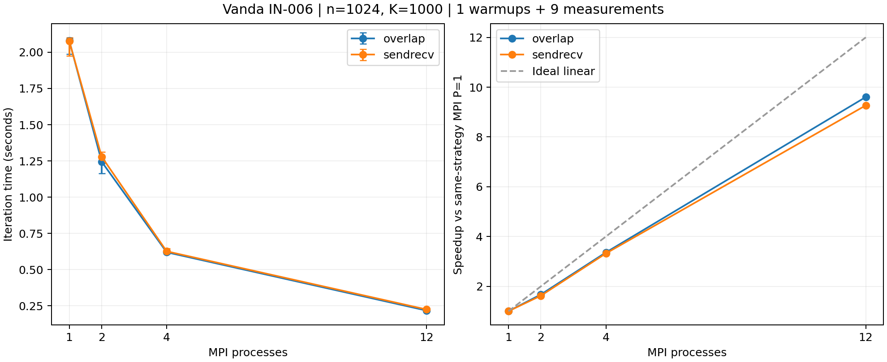

# MPI通信与强扩展复测：1499881

日期：2026-10-27。原始包由用户提交/下载，Codex复核。完整自动摘要见B_Vanda实验分析.md，统计见performance_audited.csv。

## 验收

- Vanda作业1499881.stdct-mgmt-02，IN-006，Intel Xeon Gold 6438N；单节点12CPU/4GB，PBS退出0、walltime5分49秒。
- 按行串行基准jacobi_serial_row_update.cpp；n=1024、固定K=1000、tol=0，不宣称收敛。
- 92次验证执行：88次数值执行、4次预期非法输入拒绝，全部重核通过。覆盖全网格、收敛、不整除分区及P=12等配置。
- 9配置，预热各1次、计时各9次，共90次；每个配置在九个顺序位置出现一次。
- 390条rank绑定记录与原始stderr逐项相符，使用CPU列表[25, 27, 29, 31, 33, 41, 43, 47, 51, 57, 59, 61]，每个rank固定不同CPU，serial与rank0使用同一CPU25。列表均位于本节点NUMA node1。
- 源码及Linux程序哈希、原始JSON、工作量/误差指标、分组统计与运行顺序通过复核。

## 新基准下的结果

串行中位数2.066070秒；MPI P=1的sendrecv/overlap分别2.078345、2.081533秒。旧的单进程约两倍优势在本次新基准下不再出现。

| P | 通信 | 中位秒数 | 相对本次串行加速比 | 效率 |
|---:|---|---:|---:|---:|
| 1 | sendrecv | 2.078345 | 0.994 | 99.4% |
| 1 | overlap | 2.081533 | 0.993 | 99.3% |
| 2 | sendrecv | 1.278700 | 1.616 | 80.8% |
| 2 | overlap | 1.244289 | 1.660 | 83.0% |
| 4 | sendrecv | 0.625749 | 3.302 | 82.5% |
| 4 | overlap | 0.619289 | 3.336 | 83.4% |
| 12 | sendrecv | 0.224262 | 9.213 | 76.8% |
| 12 | overlap | 0.216749 | 9.532 | 79.4% |

MPI自身的强扩展（各策略P=1作基准）：12进程sendrecv约9.267倍、overlap约9.603倍。精确数值见performance_audited.csv；与相对串行加速比的定义保持区分。

## 两进程波动与通信比较

本轮P=2/sendrecv的9次耗时约1.238-1.312秒，样本标准差/平均值约1.62%；未复现旧作业中约0.664-1.187秒的两档变化。
当前与旧作业的节点、绑定、运行顺序和串行基准不同，因此不能把变化单独归因于交错顺序。

P=2/overlap中位数比sendrecv低约2.69%，9个同轮比较中8次更快；P=4和12的中位耗时分别低约1.03%和3.35%。
这些是单次PBS分配内的观测；通信方案差异较小、min/max有重叠，不据此声称普遍优势、统计显著性或已证明通信完全重叠。仍需独立作业复测。

## 接下来

1. 同一脚本补n=2048，K=1000，取得该规模自己的串行与MPI P=1基准。若调度到不同节点，每个规模先各自计算加速比，不把原始秒数变化全部归因于规模。
2. 再独立重复n=1024作业，检查通信比较的跨作业稳定性。
3. 汇总当前诊断、正确性和扩展性图表，形成10月29日阶段报告；C部分另由组员推进。

## 原始证据与限制

完整下载目录：results/Vanda_mpi_recheck_1499881.stdct-mgmt-02。
完整原始压缩包：results/raw_archives/Vanda_mpi_recheck_1499881.stdct-mgmt-02.tar.gz。
SHA-256：`1f958a71a5ba40cfb734ff7274e8d08945bd4ea7a684d9a1eca6760b4fc6d8c6`。
精选目录保留原始汇总、日志、硬件/哈希、派生分析和图。程序及逐次输出在完整包中。
libpbs.so.0警告保留；当前证据仅单节点，不确认多节点PBS集成。所有加速比使用本作业基准，未把旧节点的耗时混入计算。

AI使用：Codex协助编写/调整工具、复核原始数值、绑定、统计和校验值并生成分析/图表；用户本人完成学校登录、上传、提交与下载。本地或模拟检查未计入集群实验次数。

