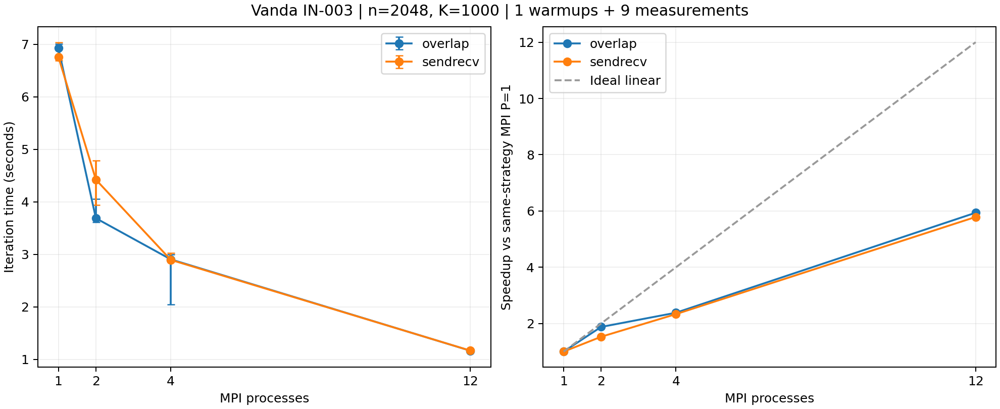

# A/B 集群实验核对

生成日期：2026-10-27（UTC）。此文件是当前作业的数据摘要，人工因果分析和阶段报告需另行审阅。

## 当前证据

集群：Vanda；作业：`1500222.stdct-mgmt-02`；记录主机：`IN-003`。
分配 CPU 数：12；并行输出记录的节点数：1。
完整原始目录的 PBS 完成状态、退出码、源码/程序哈希及逐次 JSON 已核对。
硬件型号、内存、walltime、模块与 flags 以原始 metadata.txt、qstat_full.txt 和构建日志为准，本摘要不推断未采集的信息。

## 正确性记录

共 92 次验证执行，其中 88 次含数值结果，4 次为预期非法输入拒绝测试；网格规模 n 包括 1, 2, 4, 7, 8, 12, 16, 31, 32。
验证器状态为 PASS，逐次数值 JSON 已与汇总核对。执行次数不等于不同数学问题数；本审计不代替验证器中的数值验收。

## 性能口径

n=2048，K=1000，tolerance=0；固定迭代工作量，不宣称收敛。
9 组配置，各预热 1 次、测量 9 次，共 90 次执行。
串行基准源码：`jacobi_serial_row_update.cpp`；运行顺序：`interleaved`。
显式CPU映射：`[11, 13, 15, 17, 19, 21, 47, 49, 51, 53, 57, 59]`；空列表表示未由本脚本记录显式映射，需查原始绑定日志。
计时为迭代阶段，MPI 含必要通信/同步并取最慢 rank；初始化、最终检查与输出不计入。
报告中位数和 min/max，min/max 不是置信区间。运行顺序和绑定方式应结合逐次命令审阅。

| 版本 | PxT | 通信 | 中位秒数 | min-max 秒数 | 相对串行加速比 | 相对串行效率 |
|---|---|---|---:|---:|---:|---:|
| serial | 1x1 | none | 6.842698 | 6.650737-7.000505 | 1.000 | 100.0% |
| mpi | 1x1 | sendrecv | 6.760168 | 6.690689-7.040612 | 1.012 | 101.2% |
| mpi | 1x1 | overlap | 6.926869 | 6.744805-7.006973 | 0.988 | 98.8% |
| mpi | 2x1 | sendrecv | 4.424784 | 3.945355-4.788347 | 1.546 | 77.3% |
| mpi | 2x1 | overlap | 3.689797 | 3.613914-4.059301 | 1.854 | 92.7% |
| mpi | 4x1 | sendrecv | 2.896657 | 2.866639-3.030053 | 2.362 | 59.1% |
| mpi | 4x1 | overlap | 2.906340 | 2.049554-2.994454 | 2.354 | 58.9% |
| mpi | 12x1 | sendrecv | 1.168184 | 1.149666-1.191881 | 5.858 | 48.8% |
| mpi | 12x1 | overlap | 1.166647 | 1.156630-1.187238 | 5.865 | 48.9% |

## 同策略 MPI 单进程基准

S(P)=T_MPI(1)/T_MPI(P)，E(P)=S(P)/P。缺少对应 P=1 时不推算此指标。

| 进程数 | 通信 | 相对 MPI P=1 加速比 | 效率 |
|---:|---|---:|---:|
| 1 | sendrecv | 1.000 | 100.0% |
| 1 | overlap | 1.000 | 100.0% |
| 2 | sendrecv | 1.528 | 76.4% |
| 2 | overlap | 1.877 | 93.9% |
| 4 | sendrecv | 2.334 | 58.3% |
| 4 | overlap | 2.383 | 59.6% |
| 12 | sendrecv | 5.787 | 48.2% |
| 12 | overlap | 5.937 | 49.5% |

## 本次观测

- MPI P=1 (sendrecv) 为 6.760168 秒，相对本次串行基准为 1.012 倍；该差异不能归因于多进程并行。
- MPI P=1 (overlap) 为 6.926869 秒，相对本次串行基准为 0.988 倍；该差异不能归因于多进程并行。
- overlap 在本次最大 P=12 时，相对同策略 MPI P=1 加速 5.937 倍，效率 49.5%。
- sendrecv 在本次最大 P=12 时，相对同策略 MPI P=1 加速 5.787 倍，效率 48.2%。
- 本次使用 12 核的已测配置中，观测中位数最低的是 mpi 12x1 overlap，为 1.166647 秒；此处不作统计显著性结论。
- 本次串行基准中位数为 6.842698 秒。相对串行加速比包含实现和编译效果差异；不据此单独判断超线性扩展。

单个作业、单一规模不支持跨规模稳定性结论。非阻塞 API 的使用不证明通信已有效重叠；通信方案的优势与差异原因需结合重复实验分析。

## 环境警告

- libpbs.so.0 unavailable; MPI PBS TM components were ignored

完整原始目录须单独保留以供复核。当前摘要不自动确认线程 affinity、PBS 多节点集成、个人代码理解或组员接口确认。

AI 使用：Codex 协助编写核对工具和当前数据摘要；集群操作、源码修改、人工复核等实际贡献应在阶段报告中据实补充。

## 图表

