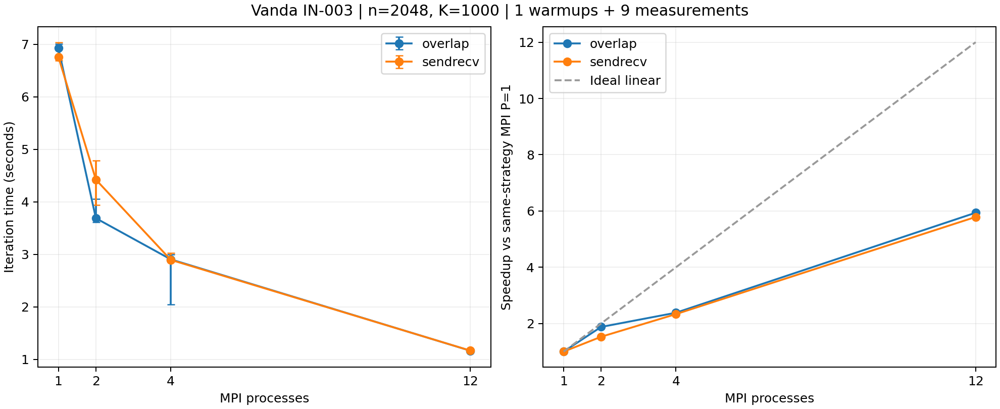

# MPI补充规模审计：1500222，n=2048

日期：2026-10-27。用户完成Vanda提交与下载，Codex核验原始记录并整理本分析。完整统计见performance_audited.csv，逐项验收见audit.json。

## 验收结果

- 作业1500222.stdct-mgmt-02，IN-003，Intel Xeon Gold 6438N；单节点12CPU/4GB，PBS状态F、退出0，实际walltime10分11秒。
- n=2048、固定K=1000、tolerance=0；不是收敛耗时测试。串行源码为jacobi_serial_row_update.cpp，MPI源码保持不变。
- 92次验证：88次数值执行（含独立小网格参考、收敛、迭代上限及非整除分区），4次预期非法输入拒绝；本地重核全部通过。正确性套件沿用既有小规模案例，不将其表述为92次2048全网格验证。
- 2048性能执行共90次：9配置，各1次预热、9次正式计时；所有执行的工作量、有限非负指标、边界误差及与本次串行的全局数值指标一致性均复核通过。大网格未输出全网格，不声称已逐点比对2048解。
- 390条rank绑定与原始stderr一致；CPU列表[11,13,15,17,19,21,47,49,51,53,57,59]符合继承mask，均在NUMA node1。rank r固定到列表第r个CPU，serial与rank0使用CPU11。
- 九轮正式测量中，每配置在九个顺序位置各出现一次。源码/程序哈希及原始JSON与统计一致。11份归档源码与1499881逐文件一致。

## 本次结果

按行串行中位数为6.842698秒；MPI单进程sendrecv/overlap为6.760168/6.926869秒，与串行接近，原有约两倍单进程优势不再出现。

| P | sendrecv中位秒数 | overlap中位秒数 | sendrecv加速比 | overlap加速比 | sendrecv效率 | overlap效率 |
|---:|---:|---:|---:|---:|---:|---:|
| 1 | 6.760168 | 6.926869 | 1.012 | 0.988 | 101.2% | 98.8% |
| 2 | 4.424784 | 3.689797 | 1.546 | 1.854 | 77.3% | 92.7% |
| 4 | 2.896657 | 2.906340 | 2.362 | 2.354 | 59.1% | 58.9% |
| 12 | 1.168184 | 1.166647 | 5.858 | 5.865 | 48.8% | 48.9% |

表中加速比和效率使用本作业的串行中位数，不混用其他节点或规模。P=1的约1%差异属于本次实现/计时差异，不能解释为多进程并行。
以各通信策略自己的MPI P=1为基准，P=12的强扩展加速比分别为5.787/5.937，效率48.2%/49.5%。

## 通信比较与波动

- P=2：overlap中位耗时比sendrecv低16.61%，九个同轮比较均更快；sendrecv范围3.945355-4.788347秒，样本CV约6.33%，overlap为3.613914-4.059301秒、CV约3.47%。这是本次2048单个作业的观测，不能代替1024的独立重复。
- P=4：overlap中位耗时高0.33%，九次中4次更快；其最后一次为2.049554秒，其余八次约2.842-2.994秒。该记录通过工作量、数值和绑定检查，保留于全部统计中，不因耗时低而删去，也不据此推断特定系统原因。
- P=12：两种中位耗时差仅0.13%，overlap九次中5次更快，各自CV约1.1%；本轮没有足够证据称overlap在12进程有稳定性能优势。
- 上一轮1024中，overlap在2/4/12进程中位数均略低；本轮4进程接近且方向反转、12进程接近。因此不作通信策略普遍优越、统计显著或有效通信重叠已证实的结论。

## 与1024的关系

1499881（n=1024）在IN-006，本轮在IN-003；二者lscpu型号相同，CPU映射和PBS分配不同。各作业均有自己的串行/MPI P=1基准。
相对串行的12进程加速比从1024首轮的9.213/9.532变为本次2048的5.858/5.865，说明当前数据并不支持“网格越大，效率必然更好”。
规模、节点分配及运行时环境一起变化，不能由两次作业单独确认带宽、缓存、系统干扰或通信中的哪一种因素导致差异；暂不把相关猜测写成已验证原因。

## 剩余计划

1. 最后补一次独立n=1024/K=1000作业，使用现有脚本和相同统计口径；无需上传新代码。
2. 合并两个规模和1024重复作业，整理10月29日阶段报告。若重复结果差异较大，如实报告范围和局限，不自动增加大批实验。
3. C部分、多节点、弱扩展与更复杂优化继续暂缓。

## 原始证据

完整目录：results/Vanda_mpi_recheck_1500222.stdct-mgmt-02。
完整压缩包：results/raw_archives/Vanda_mpi_recheck_1500222.stdct-mgmt-02.tar.gz。
SHA-256：`0dd1f898d49aa8e4f361e347653804c06c647841410f2458d8ed2f6c908f500a`。压缩包逐文件内容已与下载目录重新比对。
libpbs.so.0警告保留，本次仍为单节点证据。未运行新的OpenMP/混合实验。

AI使用：Codex协助核验数值、绑定、运行顺序、哈希和统计，生成分析与图表；用户本人完成学校登录、作业提交及下载。所有集群数值均来自保存的原始输出，本地复核不增加集群执行次数。

