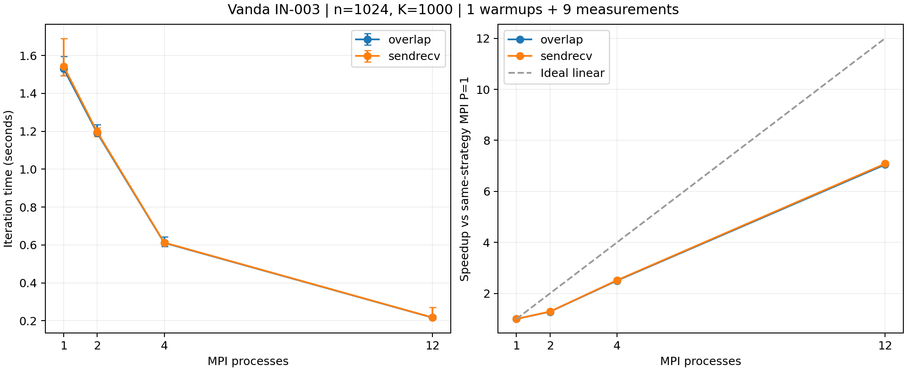

# A/B 集群实验核对

生成日期：2026-10-27（UTC）。此文件是当前作业的数据摘要，人工因果分析和阶段报告需另行审阅。

## 当前证据

集群：Vanda；作业：`1500271.stdct-mgmt-02`；记录主机：`IN-003`。
分配 CPU 数：12；并行输出记录的节点数：1。
完整原始目录的 PBS 完成状态、退出码、源码/程序哈希及逐次 JSON 已核对。
硬件型号、内存、walltime、模块与 flags 以原始 metadata.txt、qstat_full.txt 和构建日志为准，本摘要不推断未采集的信息。

## 正确性记录

共 92 次验证执行，其中 88 次含数值结果，4 次为预期非法输入拒绝测试；网格规模 n 包括 1, 2, 4, 7, 8, 12, 16, 31, 32。
验证器状态为 PASS，逐次数值 JSON 已与汇总核对。执行次数不等于不同数学问题数；本审计不代替验证器中的数值验收。

## 性能口径

n=1024，K=1000，tolerance=0；固定迭代工作量，不宣称收敛。
9 组配置，各预热 1 次、测量 9 次，共 90 次执行。
串行基准源码：`jacobi_serial_row_update.cpp`；运行顺序：`interleaved`。
显式CPU映射：`[15, 17, 19, 21, 47, 49, 51, 53, 57, 59, 61, 63]`；空列表表示未由本脚本记录显式映射，需查原始绑定日志。
计时为迭代阶段，MPI 含必要通信/同步并取最慢 rank；初始化、最终检查与输出不计入。
报告中位数和 min/max，min/max 不是置信区间。运行顺序和绑定方式应结合逐次命令审阅。

| 版本 | PxT | 通信 | 中位秒数 | min-max 秒数 | 相对串行加速比 | 相对串行效率 |
|---|---|---|---:|---:|---:|---:|
| serial | 1x1 | none | 1.527579 | 1.485619-1.611360 | 1.000 | 100.0% |
| mpi | 1x1 | sendrecv | 1.543310 | 1.493833-1.690599 | 0.990 | 99.0% |
| mpi | 1x1 | overlap | 1.529819 | 1.494616-1.595160 | 0.999 | 99.9% |
| mpi | 2x1 | sendrecv | 1.196519 | 1.172237-1.219694 | 1.277 | 63.8% |
| mpi | 2x1 | overlap | 1.191220 | 1.177272-1.235324 | 1.282 | 64.1% |
| mpi | 4x1 | sendrecv | 0.612902 | 0.604747-0.624158 | 2.492 | 62.3% |
| mpi | 4x1 | overlap | 0.611397 | 0.591608-0.643037 | 2.499 | 62.5% |
| mpi | 12x1 | sendrecv | 0.217869 | 0.211205-0.270921 | 7.011 | 58.4% |
| mpi | 12x1 | overlap | 0.217064 | 0.209885-0.227181 | 7.037 | 58.6% |

## 同策略 MPI 单进程基准

S(P)=T_MPI(1)/T_MPI(P)，E(P)=S(P)/P。缺少对应 P=1 时不推算此指标。

| 进程数 | 通信 | 相对 MPI P=1 加速比 | 效率 |
|---:|---|---:|---:|
| 1 | sendrecv | 1.000 | 100.0% |
| 1 | overlap | 1.000 | 100.0% |
| 2 | sendrecv | 1.290 | 64.5% |
| 2 | overlap | 1.284 | 64.2% |
| 4 | sendrecv | 2.518 | 63.0% |
| 4 | overlap | 2.502 | 62.6% |
| 12 | sendrecv | 7.084 | 59.0% |
| 12 | overlap | 7.048 | 58.7% |

## 本次观测

- MPI P=1 (sendrecv) 为 1.543310 秒，相对本次串行基准为 0.990 倍；该差异不能归因于多进程并行。
- MPI P=1 (overlap) 为 1.529819 秒，相对本次串行基准为 0.999 倍；该差异不能归因于多进程并行。
- overlap 在本次最大 P=12 时，相对同策略 MPI P=1 加速 7.048 倍，效率 58.7%。
- sendrecv 在本次最大 P=12 时，相对同策略 MPI P=1 加速 7.084 倍，效率 59.0%。
- 本次使用 12 核的已测配置中，观测中位数最低的是 mpi 12x1 overlap，为 0.217064 秒；此处不作统计显著性结论。
- 本次串行基准中位数为 1.527579 秒。相对串行加速比包含实现和编译效果差异；不据此单独判断超线性扩展。

单个作业、单一规模不支持跨规模稳定性结论。非阻塞 API 的使用不证明通信已有效重叠；通信方案的优势与差异原因需结合重复实验分析。

## 环境警告

- libpbs.so.0 unavailable; MPI PBS TM components were ignored

完整原始目录须单独保留以供复核。当前摘要不自动确认线程 affinity、PBS 多节点集成、个人代码理解或组员接口确认。

AI 使用：Codex 协助编写核对工具和当前数据摘要；集群操作、源码修改、人工复核等实际贡献应在阶段报告中据实补充。

## 图表

