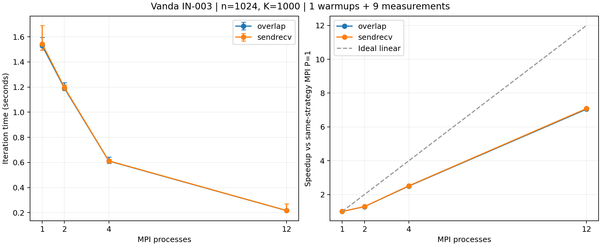

# MPI独立重复审计：1500271，n=1024

日期：2026-10-27。用户完成提交、运行及下载；Codex只读取已保存的结果，未新增集群执行。

## 验收结果

- 作业1500271.stdct-mgmt-02，IN-003，Intel Xeon Gold 6438N；单节点12 CPU、4GB，最终PBS状态F、退出码0，walltime为00:05:23，日志以RUN_STATUS=PASSED及JOB_EXIT_STATUS=0结束。
- 源码/程序SHA-256清单、summary中的哈希、逐次stdout JSON与summary一致。11份源码文件与1499881、1500222逐文件相同。未更换算法或MPI实现。
- validation共92次执行，88次数值结果、4次预期非法输入拒绝；案例×进程×通信方案的预期清单完整。43次输出完整小网格并与独立Python参考比对，27次属于正容差收敛验证。其余覆盖固定轮数和迭代上限；这些是执行次数而非独立数学问题数。
- 按合同阈值重新执行数值验收，并对MPI与本案例串行的max_update/max_error/residual_inf/boundary_error复核。拒绝测试对应进程数大于n、负容差、NaN容差及非法通信方式；均非零退出且stdout为空。
- benchmark共90次：9配置各1次预热、9次正式测量。全部n=1024、K=1000、tolerance=0、threads=1，状态fixed_iterations；有限非负全局指标与本次串行一致，边界误差0。该检查不等于1024大网格逐点验证，也不宣称1000轮已收敛。
- 390条执行前rank绑定记录与原始stderr一致；CPU列表为[15, 17, 19, 21, 47, 49, 51, 53, 57, 59, 61, 63]，符合继承mask且均在NUMA node1。rank r使用列表第r个CPU；serial与rank0均为CPU15。绑定证据是exec前快照，不是整个运行期的连续采样。
- 命令中的n/K/tol、进程数及绑定参数已核对。每个配置的9次正式测量在9个顺序位置各出现一次；预热从正式统计排除。
- 完整原始包390个文件，已解读压缩包成员并逐文件比较内容SHA-256；原始文件未修改。基础分析和补充审计均通过。

## 中位数与强扩展

串行基准：jacobi_serial_row_update.cpp；本次串行中位数1.527579秒，min/max为1.485619/1.611360秒，样本CV为2.35%。
计时仅为迭代阶段：MPI含halo交换及所需归约/同步，报告最慢rank；初始化、最终误差/残差计算、网格收集及JSON输出不计入。

| P | sendrecv秒 | overlap秒 | 相对本次串行加速比：SR / OV | 效率：SR / OV |
|---:|---:|---:|---:|---:|
| 1 | 1.543310 | 1.529819 | 0.990 / 0.999 | 99.0% / 99.9% |
| 2 | 1.196519 | 1.191220 | 1.277 / 1.282 | 63.8% / 64.1% |
| 4 | 0.612902 | 0.611397 | 2.492 / 2.499 | 62.3% / 62.5% |
| 12 | 0.217869 | 0.217064 | 7.011 / 7.037 | 58.4% / 58.6% |

MPI P=1与本次串行接近，旧的约两倍实现优势未再出现。各通信策略以自己的MPI P=1为基准时，P=12加速比分别为7.084/7.048，效率为59.0%/58.7%。

## 波动和通信比较

CV使用9次正式样本的样本标准差/平均值；min/max不是置信区间。正的耗时降低百分比表示overlap中位数更低。同轮比较是同一轮中的先后运行，不是同时配对执行。

| P | sendrecv min–max秒 | CV | overlap min–max秒 | CV | overlap中位耗时降低 | overlap同轮更快次数 |
|---:|---:|---:|---:|---:|---:|---:|
| 1 | 1.493833–1.690599 | 4.17% | 1.494616–1.595160 | 2.03% | 0.87% | 5/9 |
| 2 | 1.172237–1.219694 | 1.50% | 1.177272–1.235324 | 1.66% | 0.44% | 4/9 |
| 4 | 0.604747–0.624158 | 0.97% | 0.591608–0.643037 | 2.73% | 0.25% | 5/9 |
| 12 | 0.211205–0.270921 | 8.24% | 0.209885–0.227181 | 3.37% | 0.37% | 4/9 |

P=2/sendrecv的CV约1.50%，再次未出现旧作业的大幅两档波动。但节点、绑定、调度及基准与旧作业不同，不能确认旧波动的根因或声称已根治。
P=12/sendrecv的r0正式记录约0.270921秒，其余八条约0.211205–0.231269秒；该记录的工作量、全局指标及执行前绑定通过检查，完整保留，CV因而升至8.24%。没有证据将其归因为某种特定系统机制。
本次P=2/4/12的overlap中位耗时优势均不足0.5%，同轮更快仅4/5/4次；首轮较明显的小幅优势未稳定复现。当前不支持overlap普遍更好、统计显著或有效通信重叠已被证明。

## 跨作业解释与证据

相较1499881，本次串行中位耗时低26.06%；P=12/sendrecv仅低约2.85%，overlap高约0.15%。并行端耗时接近，而基准差异较大，因此相对串行加速比从9.213/9.532变为7.011/7.037。这个算术关系可以确认，导致基准变化的硬件或运行时原因尚未确认。
两作业均有自己的串行及MPI P=1基准，不混算、合并或挑选跨作业样本。完整比较见[汇总](../../docs/AB_RESULTS_SUMMARY.md)。

完整目录：results/Vanda_mpi_recheck_1500271.stdct-mgmt-02。
完整包：results/raw_archives/Vanda_mpi_recheck_1500271.stdct-mgmt-02.tar.gz。
SHA-256：`d207aea6e76f973acac73bf743d3ad62588dfbe0ef034bf554b04a0fa1c18014`。
基础统计见performance_audited.csv；补充验收见audit.json与supplemental_audit.py。后者从仓库根目录运行，输出归档必须不存在；已有归档时应先审阅脚本，勿覆盖原件。脚本仅复核保存的文件。
libpbs.so.0警告保留；本轮仅支持单节点结论，不确认多节点PBS集成。

AI使用：Codex编写补充审计及汇总工具，读取原始JSON、复核数值/顺序/绑定/哈希和统计，生成图表并目视检查。用户本人完成Vanda操作。未新增实验、提交/推送Git或发送邮件。

