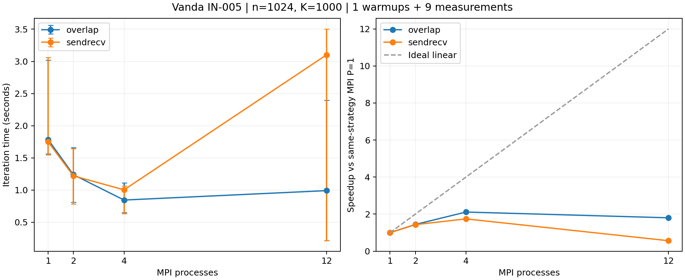
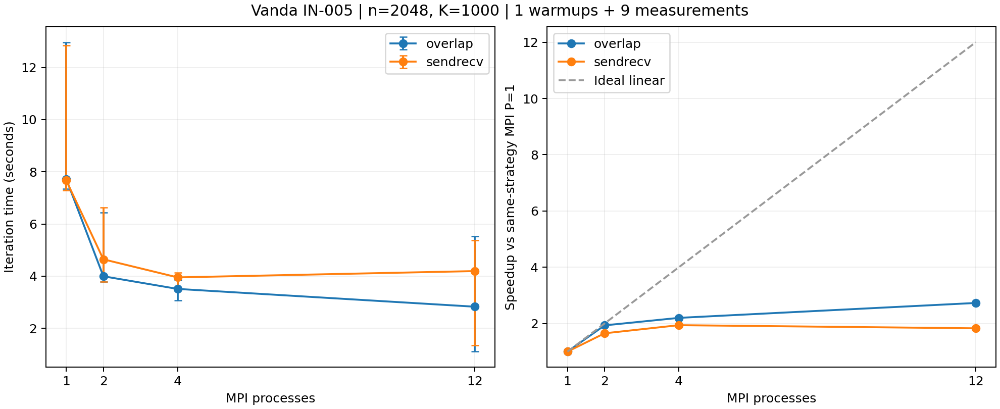

# 同次分配双规模与非对称验证复核

作业 1501884.stdct-mgmt-02，主机 IN-005。以下为当前原始数据派生结果，不预设改善方向。
源码、程序哈希、原始 JSON、工作量、780 条执行前绑定、完整执行顺序及统计重新核对。
原验证 92 次；非对称完整小网格验证 31 次；性能 180 次（18 预热、162 正式）。

| n | 模式 | P | 通信 | 中位秒 | min–max 秒 | 样本 CV | 相对本规模串行 |
|---:|---|---:|---|---:|---|---:|---:|
| 1024 | serial | 1 | none | 1.749200 | 1.514429–2.952787 | 28.22% | 1.000 |
| 1024 | mpi | 1 | sendrecv | 1.749099 | 1.547593–3.063077 | 28.67% | 1.000 |
| 1024 | mpi | 1 | overlap | 1.786112 | 1.561515–3.019444 | 28.25% | 0.979 |
| 1024 | mpi | 2 | sendrecv | 1.221238 | 0.786753–1.642238 | 30.00% | 1.432 |
| 1024 | mpi | 2 | overlap | 1.238940 | 0.810854–1.659521 | 29.59% | 1.412 |
| 1024 | mpi | 4 | sendrecv | 1.003814 | 0.631505–1.062946 | 22.75% | 1.743 |
| 1024 | mpi | 4 | overlap | 0.845220 | 0.649874–1.112420 | 20.56% | 2.070 |
| 1024 | mpi | 12 | sendrecv | 3.101710 | 0.213243–3.504229 | 84.17% | 0.564 |
| 1024 | mpi | 12 | overlap | 0.991551 | 0.214146–2.394721 | 83.78% | 1.764 |
| 2048 | serial | 1 | none | 7.650589 | 7.345913–13.040662 | 25.24% | 1.000 |
| 2048 | mpi | 1 | sendrecv | 7.667517 | 7.296916–12.851072 | 25.44% | 0.998 |
| 2048 | mpi | 1 | overlap | 7.721334 | 7.344094–12.966931 | 27.03% | 0.991 |
| 2048 | mpi | 2 | sendrecv | 4.643876 | 3.792208–6.637900 | 21.00% | 1.647 |
| 2048 | mpi | 2 | overlap | 3.993469 | 3.788555–6.430106 | 24.72% | 1.916 |
| 2048 | mpi | 4 | sendrecv | 3.951408 | 3.457291–4.128833 | 5.92% | 1.936 |
| 2048 | mpi | 4 | overlap | 3.509409 | 3.074776–3.850227 | 8.03% | 2.180 |
| 2048 | mpi | 12 | sendrecv | 4.192806 | 1.353720–5.377992 | 45.25% | 1.825 |
| 2048 | mpi | 12 | overlap | 2.828012 | 1.105263–5.529450 | 54.92% | 2.705 |

相对 MPI P=1 的加速比及效率另见 CSV，各规模、各策略各用本次基准。
min/max 不是置信区间，全部样本保留，未按性能好坏排除。

| n | P | overlap 中位耗时降低（正数更快） | 同轮更快次数 |
|---:|---:|---:|---:|
| 1024 | 1 | -2.12% | 2/9 |
| 1024 | 2 | -1.45% | 2/9 |
| 1024 | 4 | 15.80% | 6/9 |
| 1024 | 12 | 68.03% | 6/9 |
| 2048 | 1 | -0.70% | 4/9 |
| 2048 | 2 | 14.01% | 7/9 |
| 2048 | 4 | 11.19% | 8/9 |
| 2048 | 12 | 32.55% | 6/9 |

正式轮交替规模块，每规模的每配置覆盖内部九个位置；九轮不覆盖十八个跨规模位置。
同一次分配控制 CPU 列表、程序及 rank 映射，但不能排除共享节点干扰或时间变化。
这些大网格只核对全局指标，没有逐点验证，也不宣称 K=1000 收敛。
非对称验证采用 x=列坐标、y=行坐标及 u=x+2y+xy；小网格全点和全局指标均与独立 Python 参考比较。
小规模收敛阈值不推广到大网格。非阻塞 API 或总耗时差异均不足以证明底层有效通信重叠。
本作业与历史作业不能混算基准。系统根因仍需独立证据；不因当前数据再自动追加实验。

原始包：D:\桌面文件\NUS_sem1\DSA5208\Project3\github_ready\DSA5208_Project3\results\raw_archives\Vanda_ab_dual_1501884.stdct-mgmt-02.tar.gz；SHA-256：ddda26f6f5822c5b29d7143549935a0544fc9dc3ac257bbb704d109f03f5f78b；646 个文件逐成员核验。
环境警告：libpbs.so.0 warning retained。
AI 协助准备和审计；Vanda 登录、提交、下载及人工理解确认由用户完成。未发送邮件或提交 Git。

