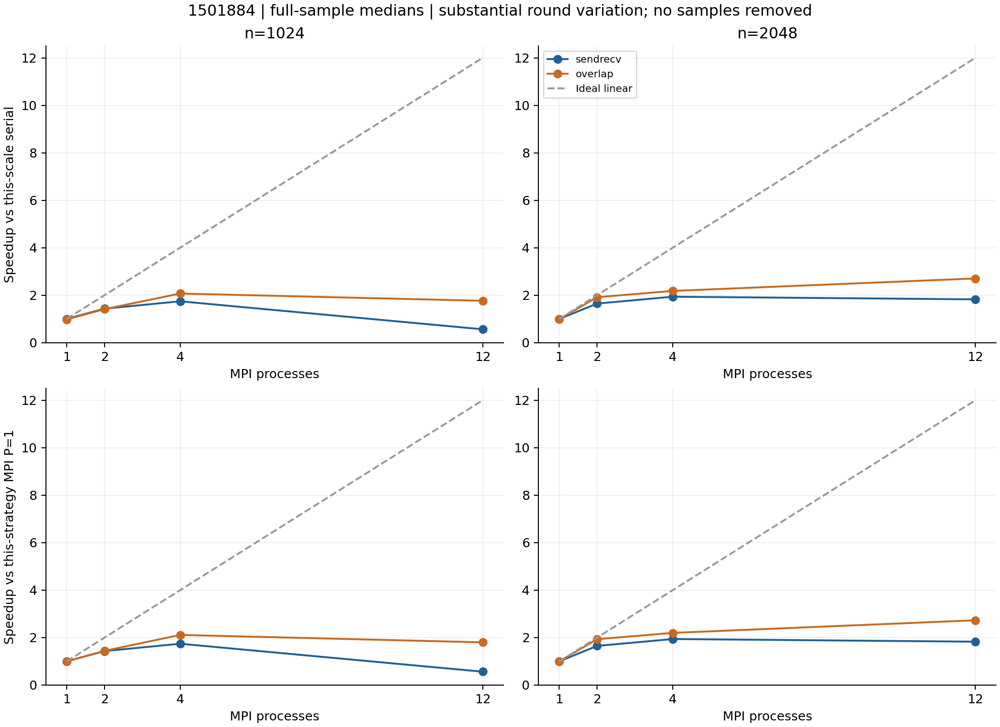
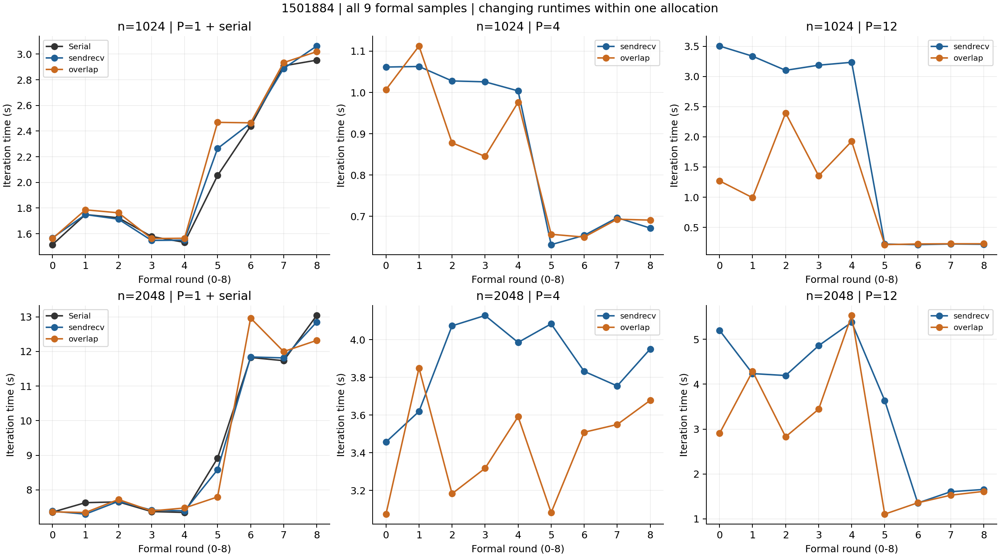
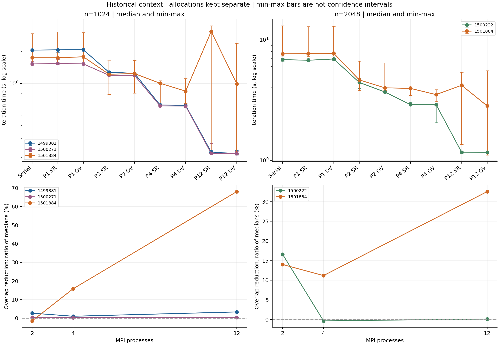

# 1501884：同分配双规模与非对称正确性复核

日期：2026-10-28。用户本人提交并下载；Codex审计原始目录、重算统计及逐点参考，未新增集群执行。

本轮实验1、实验3完整通过验收，未发现实质数值错误。非对称案例加强了正确性证据；双规模实验则暴露了同一次分配内的大幅时间变化，不能将它当作更稳定的规模规律或更漂亮的通信收益。实验2与内部插桩暂缓，先完成阶段报告。

## 原件与执行验收

- 作业1501884.stdct-mgmt-02，IN-005 / Xeon Gold 6438N；单节点12 CPU/4GB，最终PBS状态F、退出0，resources_used.walltime为00:24:34。
- GCC12.2.0、OpenMPI4.1.5、Python3.10.8；纯MPI，不启用OpenMP。构建日志核对四个程序各编译一次，性能使用原按行串行和原MPI程序；后两个是独立非对称正确性副本。
- 17份运行源码快照与上传包逐文件一致。与历史三轮逐一比较：每轮10份公共源码及两个性能可执行文件SHA-256完全一致，共36项一致性核验；性能差异不能归因为这些文件版本不同。
- 一次原结构化验证套件：92次，含88次数值执行、4次预期拒绝；其中43次完整小网格参考、27次正容差收敛。重新核对案例矩阵、工作量、原始stdout/stderr及数值验收。
- 新非对称验证31次，全部完整逐点及独立指标/停止轮数重核通过。
- 两规模各90次性能执行：每配置1预热+9正式，合计180次（18预热、162正式），未重复运行整套验证或重复预热。
- 780条exec前rank绑定与原始stderr一致，CPU列表为[1,3,5,7,41,43,45,47,49,51,53,55]，符合继承mask，全部属于记录的NUMA node1。串行/rank0均固定CPU1；这是执行前快照，不是连续采样。
- 180条计划、汇总及run.log中的实际sequence/配置/舍入计时逐条一致，命令和启动/结束时间顺序核对通过。每规模每配置覆盖内部九个位置；规模先后5/4分布，九轮没有覆盖全部十八个跨规模位置。

计数补充：沿用的verify_small.py在结构化套件前另做6次串行前检，日志保留3次收敛JSON及整体成功标记，另3次没有独立stdout文件。上述“92次”专指validation目录，不将这6次冒充另6份逐次原始JSON审计。本作业共303条结构化求解器记录（92+180+31），加此前检为309次求解器执行；前检不属于性能预热。

## 本作业内的正式统计

n=1024/2048均固定K=1000、tol=0；不是求解到收敛的耗时。时间包含迭代内必要通信/归约，MPI取最慢rank，不含初始化、最终误差/残差、输出和进程启动。

| n | 本次串行秒 | MPI P=1 sendrecv秒 | MPI P=1 overlap秒 |
|---:|---:|---:|---:|
| 1024 | 1.749200 | 1.749099 | 1.786112 |
| 2048 | 7.650589 | 7.667517 | 7.721334 |

各格顺序为sendrecv / overlap；加速比使用本规模在本作业内的串行中位数，未混用历史基准。

| n | P | 中位秒数 SR / OV | 相对串行加速比 SR / OV | 相对串行效率 SR / OV |
|---:|---:|---:|---:|---:|
| 1024 | 1 | 1.749099 / 1.786112 | 1.000 / 0.979 | 100.01% / 97.93% |
| 1024 | 2 | 1.221238 / 1.238940 | 1.432 / 1.412 | 71.62% / 70.59% |
| 1024 | 4 | 1.003814 / 0.845220 | 1.743 / 2.070 | 43.56% / 51.74% |
| 1024 | 12 | 3.101710 / 0.991551 | 0.564 / 1.764 | 4.70% / 14.70% |
| 2048 | 1 | 7.667517 / 7.721334 | 0.998 / 0.991 | 99.78% / 99.08% |
| 2048 | 2 | 4.643876 / 3.993469 | 1.647 / 1.916 | 82.37% / 95.79% |
| 2048 | 4 | 3.951408 / 3.509409 | 1.936 / 2.180 | 48.40% / 54.50% |
| 2048 | 12 | 4.192806 / 2.828012 | 1.825 / 2.705 | 15.21% / 22.54% |

全部18配置的min/max、样本CV、双基准加速比/效率见[performance_audited.csv](performance_audited.csv)。中位数照常报告，但不掩盖逐轮变化，也不把min/max当作置信区间。

本轮1024的sendrecv从P=4到P=12变慢，P=12相对串行仅0.564倍；overlap也从P=4的2.070倍降到P=12的1.764倍。2048的sendrecv由P=4的1.936倍降至P=12的1.825倍。因而“进程增加时耗时在所有已测作业中持续下降”已不成立。历史三轮的原统计仍有效，只能限定到那些分配。

## 逐轮数据为什么必须一起报告

1024/P12/sendrecv的正式r0–r4约3.102–3.504秒，r5–r8约0.213–0.224秒；overlap同样从较高耗时转入约0.214–0.228秒区间。与此同时，1024串行前五轮约1.514–1.749秒，后四轮增至2.054–2.953秒，MPI P=1也有类似上升。2048的串行/P1后期变慢，而P12后期总体更快。1024/P12两策略样本CV均约84%，2048/P12分别约45%/55%。

这些是全样本按轮次排列后的观测，不是据此切割数据、删除前半段、只报告后半段或另算更好加速比。不同配置变化方向也不同，不能未经测量就归因为单一全局CPU频率变化。源码/程序一致、数值匹配和执行前绑定均通过，但未采集连续运行期调度、共享负载、频率、硬件计数器或通信进度。

因此可以加强的判断是：固定同一次PBS分配、CPU列表和rank映射仍不足以保证本次计时平稳。共享节点干扰、频率/调度、内存/缓存/NUMA、通信进度等具体机制仍是假设，本次未确定根因。

## 通信比较：保留差异，也限制解释

| n | P | 中位数之比降低 | 同轮降低的中位数 | overlap同轮更快 |
|---:|---:|---:|---:|---:|
| 1024 | 2 | -1.45% | -1.40% | 2/9 |
| 1024 | 4 | 15.80% | 0.63% | 6/9 |
| 1024 | 12 | 68.03% | 22.79% | 6/9 |
| 2048 | 2 | 14.01% | 4.23% | 7/9 |
| 2048 | 4 | 11.19% | 9.88% | 8/9 |
| 2048 | 12 | 32.55% | 4.85% | 6/9 |

“中位数之比的耗时降低”定义为1−median(T_OV)/median(T_SR)；“同轮降低的中位数”定义为median(1−T_OV,r/T_SR,r)，二者不同。同轮仍是先后执行，不能自动消除时间变化或作为独立同步配对实验。

2048/P2本次中位数降低14.01%、7/9轮更快；历史1500222为16.61%、9/9轮更快，方向再次出现，幅度与逐轮一致性不等同于稳定复现。1024/P2本次overlap反而中位耗时高1.45%，仅2/9轮更快，继续不支持普遍优势。

1024/P12的68.03%及2048/P12的32.55%中位数之比差异，伴随明显时间变化；对应同轮降低的中位数分别只有22.79%和4.85%。不能把较大的数字写成底层有效通信重叠比例，也不把这些指标混称为同一种收益。立即等待对照和内部插桩均未实施，不能区分接口、计算顺序及调度的贡献。

## 规模对照得到什么、仍缺什么

本次在同一次分配、同一对性能程序和固定rank映射下交错1024/2048，减少了旧比较中的跨作业CPU分配差异。各规模有自己的串行和同策略MPI P=1基准，增强了比较设计的可解释性。

但运行期间存在时间变化，正式轮仅平衡规模内九个配置位置，不完全平衡十八个全局位置；不能说已隔离纯粹的规模效应。2048/1024的中位时间比，串行约4.374、P12/sendrecv约1.352、P12/overlap约2.852，只是本次全样本描述统计。不能由这些比值断言带宽、缓存或NUMA根因，也不能从本次或旧作业推出“规模越大效率必然越好/越差”。

## 非对称正确性：证据实质加强

u(x,y)=x+2y+xy满足Laplace方程，x=列/(n+1)，y=行/(n+1)。独立副本同步修改串行/MPI物理边界、解析误差、MPI收集后的上下边界和Python参考；性能版本未改。

31次执行由7次串行和24次MPI组成，覆盖n=1、2、7、8、12、24；包括非整除分区、每rank一行/两行、具有内部行、奇偶swap、两种通信方案及正容差停止。全部输出完整网格；最大逐点差异为8.881784197001252e-16。n=7/tol=1e-12的7个实现配置均在330轮停止，max_error=1.2454925979454856e-11、residual_inf=2.519300323911011e-10。

这加强了对坐标交换、非对称物理边界、halo、行分区和全局停止路径的辨别力。案例、进程和误差见[asymmetric_validation.csv](../ab_summary_2026-10-28/asymmetric_validation.csv)。这些阈值仅适用于小规模验收；不声称1024/2048已逐点验证或固定1000轮已收敛。两规模的四项全局指标与各自历史作业完全一致。

## 历史比较与本轮停止点

[四作业五数据集汇总](../ab_summary_2026-10-28/summary.json)保留45组配置、450次含预热性能执行和405次正式样本；各作业/规模独立统计，不合并基准。原1024两轮P12约7–9.5倍和原2048约5.86倍保留；本轮较差扩展同样报告，不以“环境不理想”为由删除整次作业。

本轮实验1与3已完成，无实质正确性问题，先进入阶段报告整理。实验2暂缓，内部阶段计时未做；不为解释每个变化继续追加大量实验。C、混合、多节点、弱扩展、二维分区仍未开展。libpbs.so.0警告保留，单节点成功不代表多节点PBS集成通过。旧1498804完整原件仍未取得。

完整下载目录：results/Vanda_ab_dual_1501884.stdct-mgmt-02。
完整归档：results/raw_archives/Vanda_ab_dual_1501884.stdct-mgmt-02.tar.gz。
SHA-256：ddda26f6f5822c5b29d7143549935a0544fc9dc3ac257bbb704d109f03f5f78b。
646个文件逐成员核验通过。精选目录不能代替完整包。

基础审计：[audit.json](audit.json)；追加核验：[supplemental_review.json](supplemental_review.json)；统计重建脚本：仓库根目录summarize_ab_supplement.py。重建需指定新的输出目录，既有原件/精选证据只读核对。

AI使用：Codex协助编写源码/验证/计时/审计工具，读取下载原件并生成分析与图表；用户完成Vanda认证、上传、qsub、状态保存及下载。未提交/推送Git、未发送邮件；实际成员贡献、个人理解及最终报告需人工确认。
