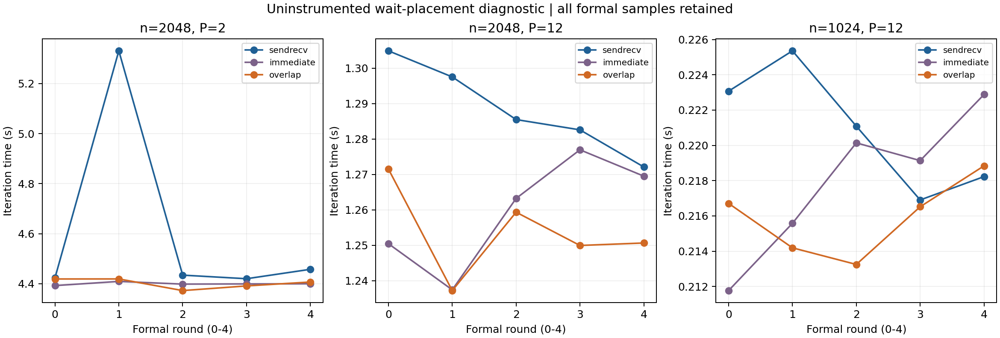

# 等待位置诊断：1502229.stdct-mgmt-02

仅诊断总迭代时间；固定K=1000/tol=0，不宣称收敛，不计算相对历史串行的加速比。
45次正确性与673条验证/性能执行前绑定、54次性能（9预热+45正式）、工作量、数值、哈希、实际顺序和统计通过重核。
源码/程序以本作业快照为准，与历史正式矩阵分开。五轮三方案位置计数1或2次，非完全平衡。

| n | P | 方案 | 中位秒 | min–max秒 | 样本CV |
|---:|---:|---|---:|---|---:|
| 2048 | 2 | sendrecv | 4.434342 | 4.420006–5.331092 | 8.70% |
| 2048 | 2 | immediate | 4.399289 | 4.392556–4.409246 | 0.14% |
| 2048 | 2 | overlap | 4.406850 | 4.372580–4.419169 | 0.45% |
| 2048 | 12 | sendrecv | 1.285498 | 1.272107–1.304917 | 1.00% |
| 2048 | 12 | immediate | 1.263220 | 1.237398–1.276956 | 1.25% |
| 2048 | 12 | overlap | 1.250628 | 1.237182–1.271535 | 1.01% |
| 1024 | 12 | sendrecv | 0.221087 | 0.216904–0.225360 | 1.56% |
| 1024 | 12 | immediate | 0.219135 | 0.211764–0.222883 | 1.98% |
| 1024 | 12 | overlap | 0.216518 | 0.213247–0.218837 | 1.03% |

| n | P | 对照 | 中位数之比降低 | 同轮降低的中位数 | 候选更快 |
|---:|---:|---|---:|---:|---:|
| 2048 | 2 | sendrecv→immediate | 0.79% | 0.81% | 5/5 |
| 2048 | 2 | immediate→overlap | -0.17% | -0.16% | 2/5 |
| 2048 | 2 | sendrecv→overlap | 0.62% | 1.14% | 5/5 |
| 2048 | 12 | sendrecv→immediate | 1.73% | 1.73% | 5/5 |
| 2048 | 12 | immediate→overlap | 1.00% | 0.31% | 4/5 |
| 2048 | 12 | sendrecv→overlap | 2.71% | 2.55% | 5/5 |
| 1024 | 12 | sendrecv→immediate | 0.88% | 0.43% | 3/5 |
| 1024 | 12 | immediate→overlap | 1.19% | 1.19% | 4/5 |
| 1024 | 12 | sendrecv→overlap | 2.07% | 2.85% | 4/5 |

三方案在每个组合内紧邻执行，仍是先后运行而非同时运行。检查完整逐轮图，不删除慢样本或自动追加重复。
SR与立即等待的差异同时包含接口、更新划分/顺序及可能代码生成差异，不能称为纯API成本。
立即等待与overlap共享数值计算及内部/边界顺序，仅等待位置改变；差异先描述为等待/计算调度收益。
总耗时及MPI非阻塞API不足以证明底层有效通信重叠；没有内部阶段插桩。
如果再次发生明显时间变化，结论降为不确定，保留结果结束本轮，不不断重提交直到变好。

原始包：D:\桌面文件\NUS_sem1\DSA5208\Project3\github_ready\DSA5208_Project3\results\raw_archives\Vanda_mpi_wait_1502229.stdct-mgmt-02.tar.gz；SHA-256：dfa84e17e040c138a21493aa24d45d8e097f8bba3ead62bf3025aed866ac687a；222文件逐成员核对。
环境警告：libpbs.so.0 warning retained。单节点不证明多节点PBS集成。
AI协助工具和分析；用户完成Vanda操作与最终报告人工确认。未提交Git或发送邮件。

