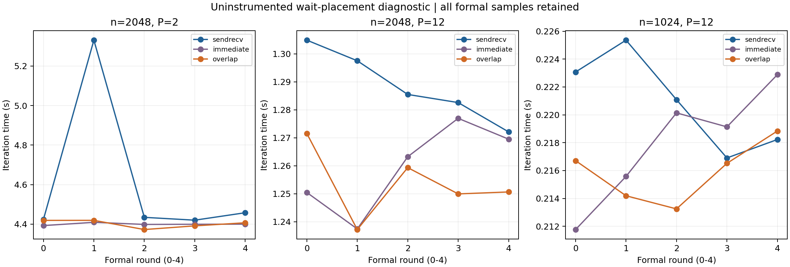

# 1502229：非阻塞立即等待与overlap诊断复核

日期：2026-10-28。用户本人完成Vanda提交、最终状态保存及完整下载；Codex核验原件并整理本分析，未再执行集群求解器。

实验2完整验收通过，未发现所测案例的数值错误。最重要的结果是：2048/P2中，overlap相对立即等待没有观察到清楚的收益；两个P12组合只有约1%的中位耗时降低。因而旧作业14–17%或更大的sendrecv/overlap差异，仍不能直接解释成“提前计算内部行带来的有效底层通信重叠”。

## 原件、运行与审计

- 作业1502229.stdct-mgmt-02，IN-006 / Xeon Gold 6438N；单节点12 CPU/4GB；PBS最终F、Exit_status=0，resources_used.walltime为00:04:45，run_count=1。日志RUN_STATUS=PASSED、JOB_EXIT_STATUS=0。
- GCC12.2.0、OpenMPI4.1.5、Python3.10.8；纯MPI，-std=c++17 -O2 -Wall -Wextra -Wpedantic。原MPI程序与独立诊断程序各构建一次；没有阶段插桩、额外迭代barrier或逐轮Jacobi打印。
- 8份运行源码/配置与上传包逐文件一致。原jacobi_mpi.cpp和原MPI ELF与1499881、1500222、1500271、1501884逐一一致；诊断程序是独立程序，54次性能执行都使用该诊断程序，未计时原生产程序的三个大网格配置。
- 45次正确性执行（18原生产、27诊断）全部先于性能执行完成。35次输出小网格并逐点比较独立Python参考，最大差异2.220446049250313e-16。n12/P12与n24/P12的10次执行只比较独立参考推导的全局指标，未输出全网格，不冒充逐点验证。
- n7/tol=1e-12的5种生产/诊断配置均324轮停止，max_error=1.1444623027045964e-11、residual_inf=2.3145219074649503e-10。这里是原x+y问题，不能混用非对称案例的330轮。
- 性能3组合×3方案×(1预热+5正式)=54次，含9预热、45正式；全部K=1000/tol=0，不宣称收敛。没有额外verify_small、串行计时或隐藏预热。
- CPU列表[25,27,29,31,33,41,43,47,51,57,59,61]与继承mask一致，均位于记录的NUMA node1。673条执行前绑定全部重核，其中验证205、性能468；不是全运行期连续采样。
- 完整99次命令/工作量/数值与先后时间、54条性能sequence及日志舍入耗时、三方案紧邻执行和五轮顺序均核对。各方案占每个位置1或2次，非完全平衡；同轮仍是先后执行。

## 三方案的全样本正式结果

| n / P | SR中位秒 | IM中位秒 | OV中位秒 | OV相对IM耗时降低 | OV同轮更快 |
|---|---:|---:|---:|---:|---:|
| 2048 / 2 | 4.434342 | 4.399289 | 4.406850 | -0.17% | 2/5 |
| 2048 / 12 | 1.285498 | 1.263220 | 1.250628 | +1.00% | 4/5 |
| 1024 / 12 | 0.221087 | 0.219135 | 0.216518 | +1.19% | 4/5 |

SR=sendrecv，IM=立即等待，OV=overlap。降低比例定义为1−median(T_OV)/median(T_IM)，正数表示OV更快。表内使用本次诊断程序五次正式样本；不是相对旧串行加速比，也不混入正式强扩展矩阵。

完整min/max、样本CV及全部方案比较分别见[performance.csv](performance.csv)、[comparisons.csv](comparisons.csv)。数据均保留，min/max不是置信区间。

### 2048/P2：没有观察到明确的等待位置收益

IM=4.399289秒，OV=4.406850秒；OV中位耗时高0.17%，仅2/5轮更快。其样本CV分别约0.14%与0.45%，在这一配置中没有观察到预期的提前内部行计算收益。

相对诊断SR，OV中位耗时低0.62%、5/5轮更快，而不是历史生产作业中的14–17%。SR的r1为5.331091754秒，其余四次约4.420–4.458秒，CV约8.70%。该较慢记录通过工作量、数值及绑定检查，未删除；不能把该轮约17%的成对差异当作全部五轮的典型收益。

这不是原生产ELF的严格大规模重复实验：性能三方案全部来自增加模式分支的诊断程序，且节点分配/时间不同。因此不能用当前结果否定旧原始数值，也不能确定旧现象的根因；能说的是，这次同程序的等待位置对照没有提供将旧大差异归因为提前计算的证据。

### P12：约1%的小幅观测，不作显著性或机制证明

2048/P12中OV比IM中位耗时低1.00%，4/5轮更快；同轮降低比例的中位数为0.31%。
1024/P12中OV比IM中位耗时低1.19%，4/5轮更快；同轮降低比例的中位数为1.19%。

这些差异先描述为本次配置中观察到的小幅等待/计算调度收益。只测一个PBS分配和五轮，差异与约1–2%的组内变动处在相近尺度，未建立统计显著性，也没有通信进度或硬件数据证明底层重叠。

相对SR的OV中位耗时降低分别为2.71%（2048/P12）和2.07%（1024/P12）。SR与IM不仅通信接口不同，还改变内部/边界行划分和更新顺序，可能影响代码生成，不能将其差异称为纯API成本。

## 与上一轮结果的关系

本次大部分配置的变动小于1501884，但2048/P2/SR仍有一条明显较慢记录。不能把本次较小波动因果归于“三方案紧邻执行”：代码、分配、节点及运行时间一起变化，仍缺少运行期系统测量。

本次没有给出可泛化的“大规模越大越容易重叠”规律；P2与P12的对照反而要求按配置限定结论。1501884的时间变化与较差扩展完整保留，不能用这次更接近旧耗时的数据替代它。

## 审计工具的跨Python舍入修复

最初本地审计停在统计完全相等检查。定位后仅三项CV在Python3.10/3.11间存在2.78e-17、5.55e-17和2.22e-16的末位差异；所有逐次耗时、中位数、min/max和方案比较完全一致。

仅CV比较新增rtol=1e-12、atol=1e-14；样本、其他统计、原始JSON和比较仍精确核对。修改中位数、CV、样本或方案计数的负向检查均被拒绝。未改原始结果、上传包或集群脚本，未重新提交作业。原本地工具与修复记录见[审计工具修复记录](../mpi_wait_audit_tool_fix_2026-10-28/analysis.md)。

## 归档与停止点

完整目录：results/Vanda_mpi_wait_1502229.stdct-mgmt-02。
完整包：results/raw_archives/Vanda_mpi_wait_1502229.stdct-mgmt-02.tar.gz。
SHA-256：dfa84e17e040c138a21493aa24d45d8e097f8bba3ead62bf3025aed866ac687a。
222个文件逐成员核验通过，包含运行期生成的Python字节码；没有删除或清理原件。

审计：[audit.json](audit.json)；追加复核：[supplemental_review.json](supplemental_review.json)。
本轮实验1、3、2均已完成，内部阶段计时未做；没有实质正确性问题，停止追加实验，进入报告人工审阅。libpbs.so.0警告保留；单节点成功仍不证明多节点PBS集成。C、多节点、弱扩展与二维分区未开展，旧1498804完整包仍未取得。

[最终汇总](../ab_final_2026-10-28/README.md)明确区分45个正式扩展配置与9个独立诊断配置；不合并不同程序、作业、规模的样本或基准。
用户完成学校登录、提交、下载；Codex协助工具、审计、分析和图表。未提交/推送Git，未发送邮件，成员贡献与代码理解仍需人工核对。
